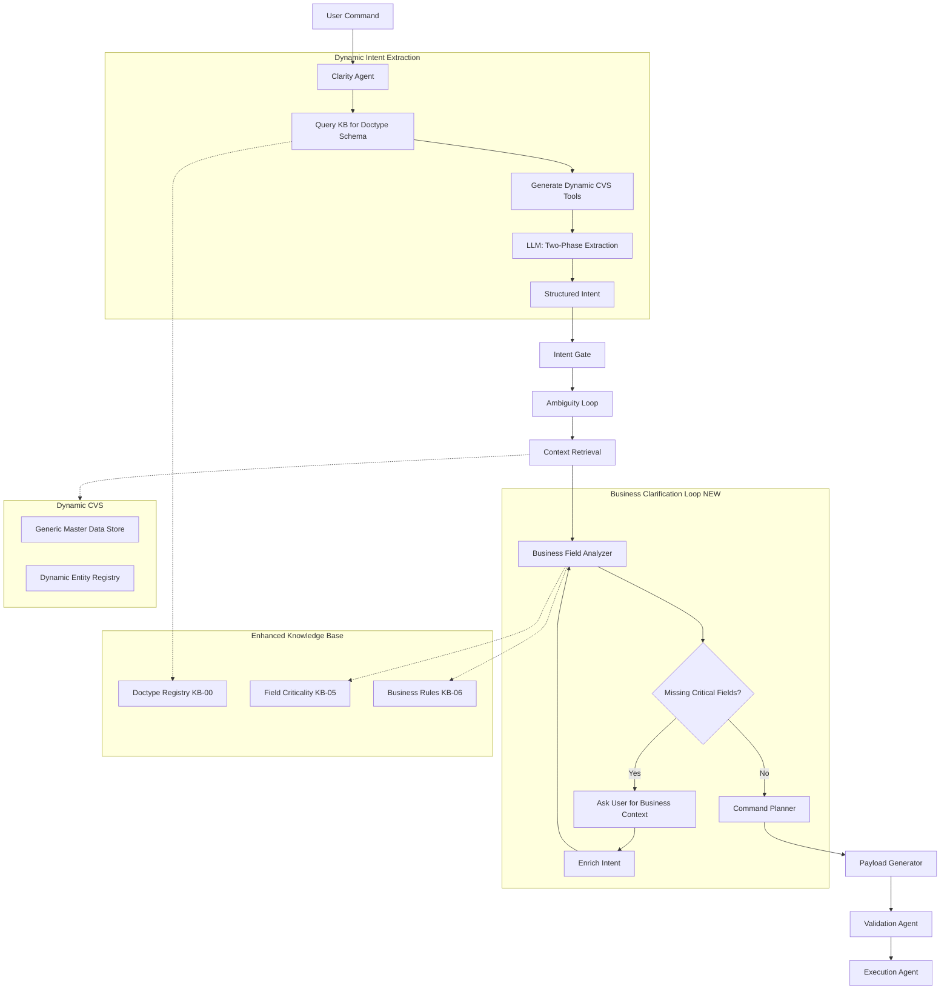

# Dynamic Business-Aware ERP OS Architecture

## Executive Summary

The current system is tightly coupled to three entity types (Customer, Supplier, Item) with hardcoded schemas, prompts, and validation logic. This plan evolves F3Next into a **fully dynamic, business-aware architecture** where:

- Intent extraction adapts to **any doctype** by querying enhanced KB structures
- The system distinguishes **critical business fields** (pricing, taxes, delivery) from optional schema fields
- A new **Business Clarification Loop** proactively asks users for missing critical context
- CVS and entity registry become **doctype-agnostic**

---

## Architecture Overview




---

## Phase 1: Knowledge Base Enhancements

### 1.1 KB-00: Doctype Registry (`doctype_registry.json`)

**Purpose:** Canonical metadata for every supported doctype, replacing hardcoded assumptions.

**Location:** `containers/knowledge_base/common/doctype_registry.json`

**Schema:**

```json
{
  "Sales Order": {
    "module": "Selling",
    "category": "transaction",
    "entity_type": "Document",
    "master_dependencies": {
      "customer": {
        "doctype": "Customer",
        "field": "customer",
        "mandatory": true,
        "cvs_registry_key": "customers"
      },
      "items": {
        "doctype": "Item",
        "field": "items.item_code",
        "mandatory": true,
        "cvs_registry_key": "items",
        "is_child_table": true
      }
    },
    "search_fields": ["name", "customer_name", "status"],
    "display_template": "{customer} - {transaction_date}"
  },
  "Lead": {
    "module": "CRM",
    "category": "master",
    "entity_type": "Document",
    "master_dependencies": {},
    "search_fields": ["lead_name", "email_id", "phone"],
    "display_template": "{lead_name} ({company_name})"
  }
}
```

**Integration Points:**

-  `containers/os/clarity_agent/kb_loader.py](containers/os/clarity_agent/kb_loader.py)`: Load during initialization
- `[containers/os/context_retrieval/company_profile.py](containers/os/context_retrieval/company_profile.py)`: Drive CVS master data queries

---

### 1.2 KB-05: Field Criticality Matrix (`field_criticality.json`)

**Purpose:** Defines which fields are **business-critical** (require user clarification) vs **optional** (can be defaulted/skipped).

**Location:** `containers/knowledge_base/common/field_criticality.json`

**Schema:**

```json
{
  "Sales Order": {
    "critical_fields": [
      {
        "field": "items",
        "reason": "Cannot create order without products",
        "clarification_prompt": "Which items should be included in this sales order?",
        "resolution_strategy": "ask_user"
      },
      {
        "field": "items.rate",
        "reason": "Pricing impacts revenue and customer trust",
        "clarification_prompt": "Should I use the standard selling price list, or do you want to specify custom rates?",
        "resolution_strategy": "suggest_default",
        "default_source": "price_list:Standard Selling"
      },
      {
        "field": "taxes_and_charges",
        "reason": "Tax compliance requirement",
        "clarification_prompt": "Which tax template should apply? (e.g., In-State GST, Out-of-State GST)",
        "resolution_strategy": "suggest_default",
        "default_source": "company_default:taxes_and_charges"
      }
    ],
    "optional_fields": [
      {
        "field": "po_no",
        "default_behavior": "leave_blank"
      },
      {
        "field": "delivery_date",
        "default_behavior": "calculate",
        "calculation": "transaction_date + company.default_lead_time_days"
      }
    ]
  },
  "Work Order": {
    "critical_fields": [
      {
        "field": "production_item",
        "reason": "Defines what to manufacture",
        "resolution_strategy": "ask_user"
      },
      {
        "field": "bom_no",
        "reason": "BOM defines materials and operations",
        "clarification_prompt": "I found {count} BOMs for {item}. Which one should I use?",
        "resolution_strategy": "ask_if_multiple"
      }
    ]
  }
}
```

**Criticality Tiers:**

- **Tier 1 (Must Ask):** Cannot proceed without user input (e.g., items, customer)
- **Tier 2 (Suggest Default):** Business-critical but has intelligent default (e.g., pricing, taxes)
- **Tier 3 (Optional):** Can safely default or skip (e.g., PO number, notes)

---

### 1.3 KB-06: Business Rules Engine (`business_rules.json`)

**Purpose:** Context-aware decision logic for defaults and validation.

**Location:** `containers/knowledge_base/common/business_rules.json`

**Schema:**

```json
{
  "rules": [
    {
      "rule_id": "pricing_strategy",
      "applies_to": ["Sales Order", "Sales Invoice", "Quotation"],
      "condition": {
        "field_missing": "items.rate"
      },
      "action": {
        "type": "suggest_default",
        "default_source": "price_list",
        "fallback": "last_sold_rate",
        "prompt_template": "Should I use {price_list_name} rates? Last sold at {last_rate}/unit."
      }
    },
    {
      "rule_id": "tax_jurisdiction",
      "applies_to": ["Sales Order", "Sales Invoice"],
      "condition": {
        "field_missing": "taxes_and_charges"
      },
      "action": {
        "type": "intelligent_default",
        "logic": "If customer.state == company.state then 'In-State GST' else 'Out-of-State GST'",
        "prompt_template": "Applying {tax_template} based on customer location."
      }
    }
  ]
}
```

---

## Phase 2: Dynamic Intent Extraction (Clarity Agent Refactor)

### 2.1 Current Issues (from research)

**File:** `[containers/os/clarity_agent/activities.py](containers/os/clarity_agent/activities.py)`

**Problems:**

1. **Hardcoded schemas** (`_IntentSchema`, `_Entities`, `_Item`) only support Customer/Supplier/Item
2. **Tool enum locked** to `["Item", "Customer", "Supplier"]` (lines 189-210)
3. **CVS search** hardcoded `type_map` (lines 837-843)
4. **Prompt drift**: `_build_extract_prompt` has inline rules; `prompts.py` KB-driven prompts are unused
5. **Schema mismatch**: Pydantic says `ambiguities: List[str]`, but code produces `List[dict]`

### 2.2 Solution: Schema-Driven Extraction

#### Step 2.2.1: Replace Hardcoded Schemas with Dynamic Generation

**New Module:** `containers/os/clarity_agent/schema_builder.py`

```python
def build_intent_schema(doctype: str, kb: KnowledgeBase) -> dict:
    """Generate Gemini response_schema for any doctype using KB-00 + KB-01."""
    registry = kb.doctype_registry[doctype]
    
    # Build entity slots dynamically
    entity_properties = {}
    for dep_name, dep_spec in registry["master_dependencies"].items():
        if dep_spec["is_child_table"]:
            entity_properties[dep_name] = {
                "type": "array",
                "items": build_child_table_schema(dep_spec, kb)
            }
        else:
            entity_properties[dep_name] = {"type": "string"}
    
    # Add standard fields
    entity_properties.update({
        "transaction_date": {"type": "string"},
        "company": {"type": "string"},
        # ... other common fields
    })
    
    return {
        "type": "object",
        "properties": {
            "intent_id": {"type": "string"},
            "target_doctype": {"type": "string"},
            "confidence": {"type": "number"},
            "ambiguities": {
                "type": "array",
                "items": {
                    "type": "object",
                    "properties": {
                        "field": {"type": "string"},
                        "question": {"type": "string"},
                        "required": {"type": "boolean"}
                    }
                }
            },
            "entities": {
                "type": "object",
                "properties": entity_properties
            }
        }
    }
```

**Changes to `[activities.py](containers/os/clarity_agent/activities.py)`:**

- Remove `_IntentSchema`, `_Entities`, `_Item` (lines 41-76)
- In `_call_agentic_llm`, replace `response_schema=_IntentSchema` with dynamic schema from `schema_builder`
- Fix ambiguities to always be `List[dict]`

---

#### Step 2.2.2: Dynamic CVS Tool Generation

**Update `_call_agentic_llm` tool definition** (lines 189-210):

```python
def build_cvs_search_tools(doctype: str, kb: KnowledgeBase) -> list[gt.Tool]:
    """Generate search tools for all master dependencies of a doctype."""
    registry = kb.doctype_registry[doctype]
    function_declarations = []
    
    for dep_name, dep_spec in registry["master_dependencies"].items():
        if dep_spec.get("cvs_registry_key"):  # Only for masters stored in CVS
            function_declarations.append(
                gt.FunctionDeclaration(
                    name=f"search_{dep_spec['cvs_registry_key']}",
                    description=f"Search {dep_spec['doctype']} master data",
                    parameters={
                        "type": "object",
                        "properties": {
                            "query": {"type": "string", "description": "Search query"},
                        },
                        "required": ["query"]
                    }
                )
            )
    
    return [gt.Tool(function_declarations=function_declarations)] if function_declarations else None
```

**Update `_search_cvs_master_data`** (lines 792-883):

- Remove hardcoded `type_map`
- Accept `entity_type` as any CVS registry key
- Use KB-00 `search_fields` and `display_template` for scoring and formatting

---

#### Step 2.2.3: Unified Prompt Builder

**Move to KB-driven prompts:**

- Delete inline `_build_extract_prompt` logic (lines 518-585)
- Use `[prompts.py](containers/os/clarity_agent/prompts.py)` `build_user_prompt()` which already loads from KB
- Ensure `prompts.py` uses KB-00 doctype registry instead of hardcoded lists

---

### 2.3 Intent Detection Flow

**New Logic in `extract_intent`:**

1. **Detect target doctype** from user prompt (use LLM or keyword match against KB-01)
2. **Load doctype schema** from KB-00
3. **Generate dynamic response schema** and tools
4. **Phase 1: Tool loop** with dynamic master data searches
5. **Phase 2: Structured extraction** with doctype-specific schema
6. **Post-processing:** Merge with KB-05 critical fields to inject initial ambiguities

---

## Phase 3: Business-Aware Clarification Loop

### 3.1 Architecture Decision: Where Does Business Logic Live?

**Answer:** A **new activity between Context Retrieval and Command Planner**

**Rationale:**

- **After Context Retrieval:** Need ERP master data, company settings, and CVS for intelligent defaults
- **Before Planner:** Planner should receive complete, business-validated intent
- **Separate from Clarity:** Clarity handles NL parsing; business logic needs structured data + ERP context

**New Activity:** `analyze_business_requirements`

---

### 3.2 Business Field Analyzer

**File:** `containers/os/command_planner/business_analyzer.py` (new)

```python
@activity.defn(name="analyze_business_requirements")
async def analyze_business_requirements(
    intent: dict,
    context: dict
) -> dict:
    """
    Analyze intent against KB-05 criticality matrix and KB-06 business rules.
    
    Returns:
        {
            "missing_critical_fields": [
                {
                    "field": "items.rate",
                    "tier": 2,
                    "question": "Should I use Standard Selling rates?",
                    "suggested_default": {"source": "price_list", "value": "Standard Selling"},
                    "resolution_strategy": "suggest_default"
                }
            ],
            "applied_defaults": [
                {"field": "taxes_and_charges", "value": "In-State GST", "reason": "Customer in same state"}
            ],
            "ready_for_planning": false
        }
    """
    kb = load_kb()
    doctype = intent["target_doctype"]
    
    criticality = kb.field_criticality.get(doctype, {})
    missing = []
    
    for crit_field in criticality.get("critical_fields", []):
        field_path = crit_field["field"]
        if not _field_present_in_intent(intent["entities"], field_path):
            # Check if KB-06 rules can auto-resolve
            default_value = await _apply_business_rules(crit_field, context, kb)
            
            if default_value and crit_field["resolution_strategy"] == "intelligent_default":
                # Apply silently, inform user
                applied_defaults.append({
                    "field": field_path,
                    "value": default_value,
                    "reason": crit_field["reason"]
                })
            elif crit_field["resolution_strategy"] in ["ask_user", "suggest_default"]:
                # Need user clarification
                missing.append({
                    "field": field_path,
                    "tier": crit_field.get("tier", 1),
                    "question": crit_field["clarification_prompt"].format(**context_vars),
                    "suggested_default": default_value,
                    "resolution_strategy": crit_field["resolution_strategy"]
                })
    
    return {
        "missing_critical_fields": missing,
        "applied_defaults": applied_defaults,
        "ready_for_planning": len(missing) == 0
    }
```

---

### 3.3 Workflow Integration

**File:** `[containers/os/os_workflow/workflow.py](containers/os/os_workflow/workflow.py)`

**Insert after line ~492 (after Context Retrieval, before Planner):**

```python
# Step 3.5: Business Requirements Analysis (NEW)
self._status = "analyzing_business_requirements"
business_analysis: dict = await workflow.execute_activity(
    "analyze_business_requirements",
    args=[intent_dict, context],
    start_to_close_timeout=timedelta(seconds=30),
)

# Business Clarification Loop
if not business_analysis["ready_for_planning"]:
    for biz_round in range(2):  # Max 2 rounds for business clarifications
        missing = business_analysis["missing_critical_fields"]
        
        # Build structured question
        business_question = _build_business_clarification_prompt(missing)
        
        # Reuse ambiguity loop infrastructure with new type
        self._status = "awaiting_business_clarification"
        self._confirmation_request = {
            "type": "business_clarification",  # NEW type
            "question": business_question,
            "fields": missing,  # Structured field list for richer UI
            "round": biz_round,
        }
        
        # Wait for user answer (same signal pattern as ambiguity loop)
        await workflow.wait_condition(
            lambda: self._user_answer is not None,
            timeout=timedelta(minutes=5)
        )
        
        # Merge user answers into intent
        intent_dict = _merge_business_clarifications(
            intent_dict,
            self._user_answer,
            missing
        )
        
        # Re-analyze
        business_analysis = await workflow.execute_activity(
            "analyze_business_requirements",
            args=[intent_dict, context],
            start_to_close_timeout=timedelta(seconds=30),
        )
        
        if business_analysis["ready_for_planning"]:
            break
```

**Helper functions:**

- `_build_business_clarification_prompt`: Format missing critical fields as user-friendly question
- `_merge_business_clarifications`: Parse user answer and update `intent_dict["entities"]`

---

### 3.4 UI Contract Extension

**Frontend needs to handle new `confirmation_request.type`:**

```typescript
// New type for business clarifications
type BusinessClarificationRequest = {
  type: "business_clarification";
  question: string;
  fields: Array<{
    field: string;
    tier: number;
    question: string;
    suggested_default?: { source: string; value: any };
    resolution_strategy: "ask_user" | "suggest_default";
  }>;
  round: number;
};
```

**UX Flow:**

1. Show grouped questions by tier
2. For `suggest_default` strategy, show default with "Use this" / "Specify custom" buttons
3. Allow batch answers (all fields in one form)
4. Progressive disclosure: Tier 1 first, then Tier 2 if needed

---

## Phase 4: Dynamic CVS & Entity Registry

### 4.1 Current Limitations

**Files:**

- `[containers/context_versioning/snapshot_builder/erp_fetcher.py](containers/context_versioning/snapshot_builder/erp_fetcher.py)`: Hardcoded `asyncio.gather` for Customer/Supplier/Item/Warehouse (lines 186-244)
- `[containers/os/context_retrieval/company_profile.py](containers/os/context_retrieval/company_profile.py)`: `entity_registry` only has `known_customers/suppliers/items/warehouses` (lines 320-328)

### 4.2 Solution: Generic Master Data Fetcher

**Update `fetch_master_data()` in `erp_fetcher.py`:**

```python
async def fetch_master_data(adapter: ERPAdapter, project_id: str) -> dict:
    """Fetch master data for all doctypes configured in KB-00."""
    kb = load_kb()
    master_doctypes = kb.get_master_doctypes()  # From KB-00 where category="master"
    
    tasks = {}
    for doctype_name, doctype_spec in master_doctypes.items():
        if doctype_spec.get("include_in_cvs", True):
            fields = doctype_spec.get("cvs_fields", ["name"])
            tasks[doctype_name] = adapter.list_records(
                doctype=doctype_name,
                fields=fields,
                filters=doctype_spec.get("cvs_filters", {}),
                limit=doctype_spec.get("cvs_limit", 1000)
            )
    
    results = await asyncio.gather(*tasks.values(), return_exceptions=True)
    
    master_data = {
        "entities_by_doctype": {},
        "known_names": {},
        "counts": {}
    }
    
    for doctype_name, result in zip(tasks.keys(), results):
        if isinstance(result, Exception):
            continue
        
        registry_key = kb.doctype_registry[doctype_name]["cvs_registry_key"]
        master_data["entities_by_doctype"][registry_key] = result
        master_data["known_names"][registry_key] = [r["name"] for r in result]
        master_data["counts"][registry_key] = len(result)
    
    # Backward compatibility: keep old keys
    master_data["customers"] = master_data["entities_by_doctype"].get("customers", [])
    master_data["known_customers"] = master_data["known_names"].get("customers", [])
    # ... repeat for suppliers, items, warehouses
    
    return master_data
```

---

### 4.3 Dynamic Entity Registry

**Update `fetch_cvs_enrichment()` in `[company_profile.py](containers/os/context_retrieval/company_profile.py)`:**

```python
if layer == "master_data":
    data = row.data
    
    # NEW: Generic entity registry
    entity_registry = {
        "known_names": data.get("known_names", {}),
        "counts": data.get("counts", {}),
    }
    
    # Backward compat
    entity_registry.update({
        "known_customers": data.get("known_customers", []),
        "known_suppliers": data.get("known_suppliers", []),
        "known_items": data.get("known_items", []),
        "known_warehouses": data.get("known_warehouses", []),
    })
    
    result_dict["entity_registry"] = entity_registry
```

---

### 4.4 Validation Updates

**File:** `[containers/os/validation_agent/validator.py](containers/os/validation_agent/validator.py)`

**Replace hardcoded checks** (lines 430-436) with dynamic lookup:

```python
def _validate_runtime_links(payload: dict, context: dict, doctype: str) -> list[dict]:
    """Validate link fields against CVS entity registry (dynamic)."""
    kb = load_kb()
    registry = context.get("company_profile", {}).get("entity_registry", {})
    known_names = registry.get("known_names", {})
    
    errors = []
    doctype_spec = kb.doctype_registry[doctype]
    
    for dep_name, dep_spec in doctype_spec["master_dependencies"].items():
        registry_key = dep_spec.get("cvs_registry_key")
        if not registry_key:
            continue
        
        known_list = known_names.get(registry_key, [])
        if not known_list:
            continue  # No data, skip validation
        
        field_value = payload.get(dep_name)
        if field_value and field_value not in known_list:
            errors.append({
                "rule_id": f"unknown_{registry_key}",
                "field": dep_name,
                "message": f"{dep_spec['doctype']} '{field_value}' not found in ERP",
                "severity": "error"
            })
    
    return errors
```

---

## Phase 5: Observability & Metrics

### 5.1 New Metrics

**File:** `[shared/os_metrics.py](shared/os_metrics.py)`

```python
# Business clarification tracking
OS_BUSINESS_CLARIFICATION_TRIGGERED = Counter(
    "os_business_clarification_triggered_total",
    "Business clarification loop invoked",
    ["doctype", "field", "tier"]
)

OS_BUSINESS_DEFAULT_APPLIED = Counter(
    "os_business_default_applied_total",
    "Intelligent defaults applied via KB-06",
    ["doctype", "field", "rule_id"]
)

# Dynamic extraction
OS_DYNAMIC_DOCTYPE_EXTRACTED = Counter(
    "os_dynamic_doctype_extracted_total",
    "Intent extracted for non-hardcoded doctype",
    ["doctype"]
)

OS_CVS_TOOL_INVOKED = Counter(
    "os_cvs_tool_invoked_total",
    "CVS search tool called during extraction",
    ["entity_type"]
)
```

---

### 5.2 Structured Logging

**In `business_analyzer.py`:**

```python
logger.info(
    "Business requirements analysis",
    extra={
        "doctype": doctype,
        "missing_critical_count": len(missing),
        "applied_defaults_count": len(applied_defaults),
        "ready_for_planning": ready,
    }
)
```

---

## Phase 6: Migration & Backward Compatibility

### 6.1 Rollout Strategy

**Stage 1: KB Foundation (No Breaking Changes)**

1. Add KB-00, KB-05, KB-06 JSON files
2. Populate with existing Customer/Supplier/Item definitions
3. Deploy—no agent changes yet

**Stage 2: Clarity Agent Refactor (Transparent)**

1. Implement dynamic schema generation
2. Keep backward compat by defaulting to "Sales Order" if doctype unclear
3. Deploy—functionally equivalent for existing commands

**Stage 3: Business Clarification Loop (New Feature)**

1. Add `analyze_business_requirements` activity
2. Wire into workflow after context retrieval
3. Deploy—users now see business questions for critical fields

**Stage 4: Extend Doctypes (Incremental)**

1. Add Lead, Work Order, BOM to KB-00/KB-05
2. Test with "Create a lead" commands
3. Gradually expand doctype coverage

---

### 6.2 Backward Compatibility Checklist

- `entity_registry` keeps old `known_customers/suppliers/items/warehouses` keys
- CVS `master_data` JSON has both old flat keys and new `entities_by_doctype`
- Intent schema includes `customer`, `supplier`, `items` top-level for existing validators
- Validation `unknown_customer/supplier/item` rule IDs unchanged
- Metrics dashboards query both old and new counter names during transition

---

## Implementation Checklist

### Phase 1: Knowledge Base

- Create KB-00 `doctype_registry.json` with Sales Order, Lead, Work Order, Customer, Supplier, Item
- Create KB-05 `field_criticality.json` for Sales Order (items.rate, taxes_and_charges)
- Create KB-06 `business_rules.json` for pricing and tax jurisdiction
- Update `kb_loader.py` to load new KB files
- Add KB accessor methods: `kb.doctype_registry`, `kb.field_criticality`, `kb.business_rules`

### Phase 2: Clarity Agent

- Create `schema_builder.py` with `build_intent_schema()` and `build_cvs_search_tools()`
- Refactor `_call_agentic_llm` to use dynamic schemas and tools
- Update `_search_cvs_master_data` to use KB-00 metadata
- Fix ambiguities type to always be `List[dict]`
- Remove hardcoded `_IntentSchema`, `_Entities`, `_Item`
- Move prompt logic to use `prompts.py` KB-driven builder

### Phase 3: Business Clarification

- Create `business_analyzer.py` with `analyze_business_requirements` activity
- Implement KB-05 criticality evaluation logic
- Implement KB-06 business rules engine
- Add business clarification loop to `os_workflow.py`
- Create `_build_business_clarification_prompt()` helper
- Create `_merge_business_clarifications()` helper
- Update frontend to handle `business_clarification` confirmation type

### Phase 4: Dynamic CVS

- Refactor `fetch_master_data()` to load doctypes from KB-00
- Update CVS snapshot schema to include `entities_by_doctype` and `known_names`
- Update `fetch_cvs_enrichment()` for generic entity registry
- Refactor validation `_validate_runtime_links()` to be doctype-agnostic
- Add backward compatibility mappings for old entity keys

### Phase 5: Observability

- Add new Prometheus counters to `os_metrics.py`
- Integrate metrics in `business_analyzer.py`
- Integrate metrics in dynamic `extract_intent`
- Add structured logging for business clarifications
- Create Grafana dashboard for business clarification rates

### Phase 6: Testing & Rollout

- Unit tests for `schema_builder.py`
- Integration test: "Create SO for Reliance, 40kg mangoes" triggers rate clarification
- Test Lead creation (new doctype path)
- Load test dynamic CVS with 10 master doctypes
- Backward compat test: verify old API contracts still work
- Deploy Stage 1 (KB only)
- Deploy Stage 2 (Clarity refactor)
- Deploy Stage 3 (Business loop)
- Expand to 5+ new doctypes

---

## Success Metrics

**Dynamic Extraction:**

- 0 hardcoded doctypes in `activities.py` (down from 3)
- Support for 10+ doctypes (Sales Order, Lead, Work Order, BOM, Customer, Supplier, Item, Warehouse, Employee, Project)
- 95%+ intent extraction accuracy maintained

**Business Awareness:**

- 80%+ of Sales Orders trigger rate clarification when missing
- 90%+ tax templates auto-applied via KB-06 rules
- User satisfaction with "feels like talking to an ERP consultant"

**System Health:**

- No increase in validation failures (business loop catches issues earlier)
- 30% reduction in "silent bad defaults" incidents
- Zero breaking changes for existing commands during rollout

---

## Open Questions for User

Before finalizing implementation, please clarify:

1. **F3iche Integration:** Should KB-05 criticality definitions be mergeable from F3iche overrides (like Tier1 extensions)? Or keep them pure KB?
2. **LLM Cost:** Dynamic tool generation increases token count. Acceptable tradeoff vs flexibility?
3. **Default Aggressiveness:** For Tier 2 "suggest_default" fields, should we auto-apply and notify, or always wait for user confirmation?
4. **Doctype Priority:** Which 5 doctypes should we support first after Sales Order? (Suggested: Lead, Work Order, Purchase Order, Stock Entry, BOM)
5. **Transaction Intel:** Should business analyzer use CVS `transaction_intel` (recent orders, overdue invoices) for smarter defaults? E.g., "Last time you sold mangoes to Reliance at ₹50/kg"?

