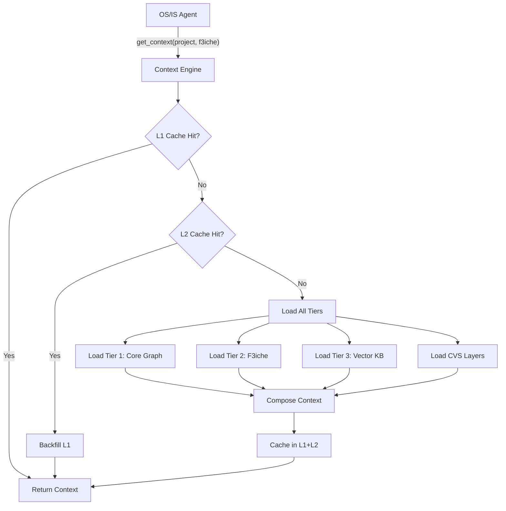
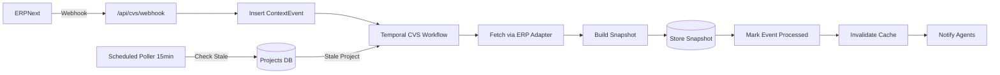
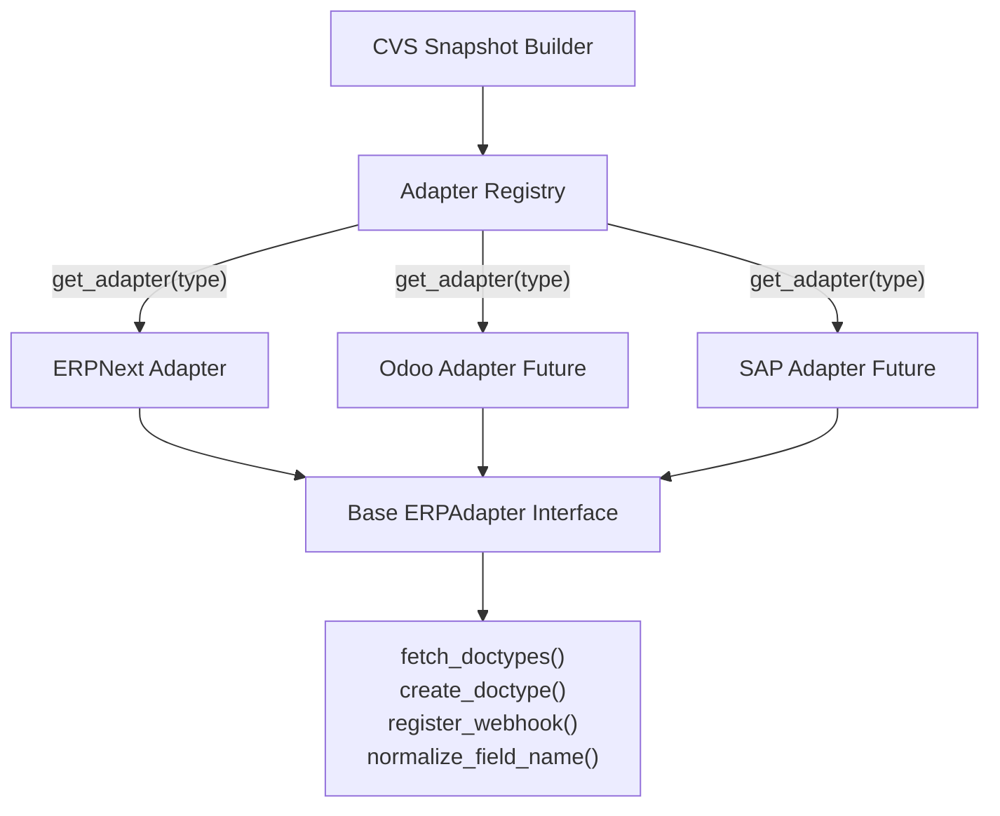

# F3Next Context Engine & CVS Implementation Plan

## Executive Summary

This plan addresses three critical architectural pillars:

1. **Context Engine Infrastructure**: Unified loader, tiered caching (L1/L2), and deterministic versioning for the 3-Tier Context Architecture
2. **CVS Production Readiness**: Complete operational gaps, hybrid sync model (webhooks + polling safety net), and multi-ERP abstraction
3. **Scale & Resilience**: Hot-reloadable F3iches, observability, circuit breakers, and zero-downtime context updates

## Current State Assessment

### What Exists

- **Tier 1 (Core Graph)**: `erpnext_doctype_graph.json`, `field_mappings.json`, validation rules
- **Tier 2 (F3iche)**: 3 manufacturing JSON files, `signals_registry.json`, but **no unified loader**
- **Tier 3 (Knowledge Base)**: pgvector `kb_embeddings`, seed script, RAG in profile agent
- **CVS**: Temporal workflows, ERPNext HTTP fetcher, webhook ingestion, layered snapshots
- **LLM Agents**: Gemini router, OS/IS/Discovery workers with Temporal orchestration

### Critical Gaps

1. **No unified Context Engine** - context loading scattered across agents
2. **CVS operational incompleteness** - `processed_at` not updated, webhook secrets not wired, duplicate event inserts
3. **Hard-coded ERP assumptions** - ERPNext-specific code throughout, not multi-ERP ready
4. **Limited F3iche scale** - only 3 templates, no hot-reload mechanism
5. **No caching layer** - every agent loads context from DB/files

---

## Architecture Design

### 1. Context Engine Core

Create a new module at `[shared/context_engine/](shared/context_engine/)` that serves as the **single source of truth** for all context operations.

#### 1.1 Directory Structure

```
shared/
└── context_engine/
    ├── __init__.py
    ├── engine.py              # Main ContextEngine class
    ├── loader.py              # Tier 1/2/3 loaders
    ├── cache.py               # L1 (memory) + L2 (Redis) cache
    ├── versioning.py          # Context version resolution
    ├── models.py              # Context domain objects
    └── config.py              # Engine configuration
```

#### 1.2 Core Interface

```python
class ContextEngine:
    """Unified context engine for 3-tier architecture"""
    
    async def get_context(
        self,
        project_id: str,
        f3iche_id: str,
        layers: list[str] = ["identity", "master_data"],
        version: Optional[int] = None
    ) -> ProjectContext:
        """
        Get composed context with all 3 tiers + CVS layers.
        
        Resolution order:
        1. Check L1 cache (in-memory LRU, TTL 5min)
        2. Check L2 cache (Redis, TTL 30min)
        3. Load Tier 1 (core graph) - cached indefinitely
        4. Load Tier 2 (F3iche addendum) - hot-reloadable
        5. Load Tier 3 (vector KB results) - on-demand
        6. Load CVS layers from latest snapshot
        7. Compose & cache result
        """
```

**Key Features:**

- **Tiered caching**: L1 (in-process LRU, 5min TTL) → L2 (Redis, 30min TTL) → DB/storage
- **Lazy loading**: Tier 3 embeddings only retrieved when explicitly requested
- **Version pinning**: Agents can pin to specific context versions for deterministic execution
- **Composition**: Tier 2 F3iche JSON overrides/extends Tier 1 base graph using JSON Merge Patch (RFC 7396)

#### 1.3 Tier L oading Strategy

**Tier 1 (Core Graph)**

- **Location**: `[containers/knowledge_base/erpnext/](containers/knowledge_base/erpnext/)`
- **Loading**: Singleton loader, cached on first access, reloaded on SIGHUP
- **Versioning**: Git commit hash + file checksums, tracked in `context_metadata` table
- **Files**:
  - `erpnext_doctype_graph.json` → core schema
  - `field_mappings.json` → field-level semantics
  - `validation_rules.json` → constraints

**Tier 2 (F3iche Addendums)**

- **Storage**: Hybrid approach
  - **Core F3iches** (bundled): `containers/knowledge_base/common/f3iches/*.json`
  - **Custom F3iches** (hot-reloadable): New `f3iche_definitions` table + S3/R2
- **Schema**:

```sql
  CREATE TABLE f3iche_definitions (
    f3iche_id TEXT PRIMARY KEY,
    version INTEGER NOT NULL,
    source TEXT NOT NULL, -- 'bundled' | 'custom'
    definition JSONB NOT NULL,
    created_at TIMESTAMPTZ DEFAULT NOW(),
    updated_at TIMESTAMPTZ DEFAULT NOW()
  );
  

```

- **Loading**: Check DB first (custom), fallback to bundled files, merge both if present
- **Hot-reload API**: `POST /api/admin/f3iches` to upload custom F3iche JSON

**Tier 3 (Knowledge Base)**

- **Storage**: `kb_embeddings` table (pgvector)
- **Loading**: On-demand RAG queries, cached per (query_embedding, top_k) tuple
- **Enrichment**: Expand to include F3iche-specific chunks (currently only manufacturing/trading globals)

#### 1.4 Cache Implementation

```python
# shared/context_engine/cache.py

class ContextCache:
    def __init__(self):
        self.l1 = LRUCache(maxsize=500, ttl=300)  # 5min
        self.l2 = RedisCache(ttl=1800)             # 30min
        
    async def get(self, key: str) -> Optional[ProjectContext]:
        # Try L1
        if val := self.l1.get(key):
            return val
        # Try L2
        if val := await self.l2.get(key):
            self.l1.set(key, val)  # Backfill L1
            return val
        return None
        
    async def invalidate(self, pattern: str):
        """Invalidate by pattern, e.g. 'project:123:*'"""
        self.l1.delete_pattern(pattern)
        await self.l2.delete_pattern(pattern)
```

**Cache Keys**:

- `ctx:v1:{project_id}:{f3iche_id}:{layers_hash}:{version}` for full context
- `tier1:v1:{file_hash}` for core graph (long-lived)
- `tier2:v1:{f3iche_id}:{version}` for F3iche JSON
- `tier3:v1:{query_hash}:{top_k}` for vector results

**Invalidation Triggers**:

- CVS snapshot write → invalidate `ctx:v1:{project_id}:`*
- F3iche update → invalidate `tier2:v1:{f3iche_id}:*` + all dependent project contexts
- Core graph deployment → invalidate `tier1:*` (rare)

---

### 2. CVS Production Readiness

#### 2.1 Fix Operational Gaps

**Gap 1: `processed_at` / `version_produced` never updated**

In `[containers/context_versioning/cvs_workflow/workflow.py](containers/context_versioning/cvs_workflow/workflow.py)`:

```python
@workflow.defn
class CVSUpdateWorkflow:
    @workflow.run
    async def run(self, input: CVSInput) -> CVSResult:
        event_id = input.event_id
        
        # 1. Log event (already exists)
        await workflow.execute_activity(...)
        
        # 2. Build snapshot (already exists)
        snapshot_id = await workflow.execute_activity(
            build_and_store_snapshot, ...
        )
        
        # 3. NEW: Mark event as processed
        await workflow.execute_activity(
            mark_event_processed,
            args=[event_id, snapshot_id],
            ...
        )
        
        # 4. Invalidate cache (already exists)
        await workflow.execute_activity(invalidate_session_cache, ...)
```

New activity in `[containers/context_versioning/context_store/activities.py](containers/context_versioning/context_store/activities.py)`:

```python
@activity.defn
async def mark_event_processed(event_id: str, snapshot_id: Optional[str]):
    async with get_db() as db:
        stmt = (
            update(ContextEvent)
            .where(ContextEvent.id == event_id)
            .values(
                processed_at=func.now(),
                version_produced=snapshot_id
            )
        )
        await db.execute(stmt)
        await db.commit()
```

**Gap 2: Webhook secret not wired**

In `[backend/app/api/cvs.py](backend/app/api/cvs.py)`, fix `_load_profile_for_project`:

```python
async def _load_profile_for_project(project_id: str, db: AsyncSession):
    project = await db.get(Project, project_id)
    if not project:
        raise HTTPException(404, "Project not found")
    
    profile = {
        "erp_url": project.implementation_profile["deployment_details"]["site_url"],
        "api_key": project.implementation_profile["deployment_details"]["api_key"],
        "api_secret": project.implementation_profile["deployment_details"]["api_secret"],
        "webhook_secret": project.implementation_profile["deployment_details"].get("webhook_secret"),  # NEW
    }
    return profile
```

**Gap 3: Duplicate `ContextEvent` inserts**

In `[backend/app/api/cvs.py](backend/app/api/cvs.py)`, remove the INSERT before Temporal:

```python
@router.post("/webhook/{project_id}")
async def webhook_handler(...):
    # REMOVE THIS:
    # event = ContextEvent(...)
    # db.add(event)
    
    # Let the workflow log the event instead:
    await trigger_webhook_sync(project_id, payload, source_doc, source_name)
```

The workflow's `log_context_event` will be the single source of truth.

**Gap 4: `cvs_force_sync_for_project` sends wrong body**

In `[containers/context_versioning/context_store/activities.py](containers/context_versioning/context_store/activities.py)`:

```python
@activity.defn
async def cvs_force_sync_for_project(project_id: str):
    async with get_db() as db:
        project = await db.get(Project, project_id)
        profile = project.implementation_profile
        
        # Send the full company_profile, not just slug:
        payload = {
            "company_profile": {
                "deployment_details": profile["deployment_details"],
                "company_slug": profile.get("company_slug"),
            }
        }
        
        async with httpx.AsyncClient() as client:
            resp = await client.post(
                f"{BACKEND_URL}/api/cvs/force-sync/{project_id}",
                json=payload
            )
            resp.raise_for_status()
```

#### 2.2 Hybrid Sync Architecture

Implement **webhooks for real-time + scheduled polling as safety net**.

**New Scheduled Polling Worker**

Create `[containers/context_versioning/poller_worker.py](containers/context_versioning/poller_worker.py)`:

```python
"""
Scheduled CVS polling worker (safety net for missed webhooks).
Runs every 15 minutes, checks each project's last snapshot age.
"""

async def poll_projects():
    async with get_db() as db:
        # Find projects with stale snapshots (>20min since last update)
        stmt = text("""
            SELECT p.id, MAX(cs.created_at) as last_snapshot
            FROM projects p
            LEFT JOIN context_snapshots cs ON cs.project_id = p.id
            WHERE p.implementation_profile->>'deployment_details' IS NOT NULL
            GROUP BY p.id
            HAVING MAX(cs.created_at) < NOW() - INTERVAL '20 minutes'
               OR MAX(cs.created_at) IS NULL
        """)
        results = await db.execute(stmt)
        
        for row in results:
            project_id = row.id
            # Trigger force sync via Temporal
            await temporal_client.start_workflow(
                CVSUpdateWorkflow.run,
                args=[CVSInput(
                    project_id=project_id,
                    trigger_source="scheduled_poll",
                    ...
                )],
                id=f"cvs-poll-{project_id}-{int(time.time())}",
                task_queue="cvs-main-queue",
            )

if __name__ == "__main__":
    schedule.every(15).minutes.do(poll_projects)
    while True:
        schedule.run_pending()
        time.sleep(60)
```

Deploy as separate service in `[docker-compose.yml](docker-compose.yml)`:

```yaml
cvs_poller:
  build: ./containers/context_versioning
  command: python poller_worker.py
  environment:
    - DATABASE_URL
    - TEMPORAL_HOST
  depends_on:
    - temporal
    - db
```

**Recovery Job for Stuck Events**

Wire up the existing `recover_stuck_events` activity with a cron:

```python
# containers/context_versioning/recovery_worker.py
"""Recovers stuck CVS events every 5 minutes"""

async def run_recovery():
    await recover_stuck_events()

if __name__ == "__main__":
    schedule.every(5).minutes.do(run_recovery)
    ...
```

#### 2.3 Multi-ERP Abstraction Layer

Create ERP adapters to isolate ERPNext-specific logic.

**New Directory**: `[shared/erp_adapters/](shared/erp_adapters/)`

```
shared/erp_adapters/
├── __init__.py
├── base.py           # Abstract ERPAdapter class
├── erpnext.py        # ERPNextAdapter
├── odoo.py           # (future) OdooAdapter
└── registry.py       # Adapter factory
```

**Base Adapter**:

```python
# shared/erp_adapters/base.py

class ERPAdapter(ABC):
    @abstractmethod
    async def fetch_doctypes(self, doctype: str, filters: dict) -> list[dict]:
        """Fetch records from ERP"""
        
    @abstractmethod
    async def create_doctype(self, doctype: str, data: dict) -> str:
        """Create record in ERP, return ID"""
        
    @abstractmethod
    async def register_webhook(self, doctype: str, callback_url: str, fields: list[str]):
        """Register webhook for doctype changes"""
        
    @abstractmethod
    def normalize_field_name(self, doctype: str, field: str) -> str:
        """Normalize ERP-specific field names to F3Next schema"""
```

**ERPNext Implementation**:

```python
# shared/erp_adapters/erpnext.py

class ERPNextAdapter(ERPAdapter):
    def __init__(self, url: str, api_key: str, api_secret: str):
        self.client = httpx.AsyncClient(...)
        
    async def fetch_doctypes(self, doctype: str, filters: dict):
        # Existing erp_fetcher.py logic moves here
        resp = await self.client.get(
            f"{self.url}/api/resource/{doctype}",
            params={"filters": json.dumps(filters), "limit_page_length": 500}
        )
        ...
```

**Refactor CVS to use adapters**:

In `[containers/context_versioning/snapshot_builder/activities.py](containers/context_versioning/snapshot_builder/activities.py)`:

```python
from shared.erp_adapters import get_adapter

@activity.defn
async def build_and_store_snapshot(...):
    # OLD: from .erp_fetcher import fetch_master_data
    # NEW:
    adapter = get_adapter(
        erp_type=profile.get("erp_type", "erpnext"),  # default erpnext
        url=profile["erp_url"],
        credentials=...
    )
    
    master_data = await adapter.fetch_doctypes("Company", {})
    ...
```

This allows adding Odoo/SAP adapters in the future without touching CVS core logic.

---

### 3. Agent Integration

Refactor all agents to use the Context Engine instead of scattered context loading.

#### 3.1 OS Agent Integration

**Before** (in `[containers/os/context_retrieval/activities.py](containers/os/context_retrieval/activities.py)`):

```python
@activity.defn
async def retrieve_context(...):
    # Loads company_profile, kb files, doctype graph separately
    company_ctx = await fetch_company_context(...)
    kb_ctx = context_kb()  # File-based singleton
    ...
```

**After**:

```python
from shared.context_engine import get_context_engine

@activity.defn
async def retrieve_context(project_id: str, f3iche_id: str):
    engine = get_context_engine()
    
    # Single call gets all 3 tiers + CVS layers
    ctx = await engine.get_context(
        project_id=project_id,
        f3iche_id=f3iche_id,
        layers=["identity", "master_data"],
        include_tier3=False  # OS doesn't need vector KB
    )
    
    # ctx.tier1 = core graph
    # ctx.tier2 = F3iche addendum (merged)
    # ctx.cvs = {"identity": {...}, "master_data": {...}}
    
    return ctx
```

#### 3.2 IS Agent Integration

**Profile Agent** (in `[containers/implementation/profile_agent/activities.py](containers/implementation/profile_agent/activities.py)`):

```python
@activity.defn
async def retrieve_industry_knowledge(state: dict):
    engine = get_context_engine()
    
    # Tier 3 RAG with F3iche-specific chunks
    kb_results = await engine.get_tier3_knowledge(
        f3iche_id=state["f3iche_id"],
        query=f"Best practices for {state['industry']} ...",
        top_k=5
    )
    
    # LLM synthesis (existing logic)
    ...
```

**Import Agent** (in `[containers/implementation/import_agent/activities.py](containers/implementation/import_agent/activities.py)`):

```python
@activity.defn
async def execute_import_plan(...):
    engine = get_context_engine()
    
    ctx = await engine.get_context(
        project_id=state["project_id"],
        f3iche_id=state["f3iche_id"],
        layers=["identity"],  # Only need company basics
        version=state.get("context_version")  # Pin to workflow start version
    )
    
    # Use ctx.tier1.doctype_graph for seeding order
    # Use ctx.tier2.overrides for F3iche-specific seed rules
    ...
```

#### 3.3 Clarity Agent Integration

**Intent Extraction** (in `[containers/os/clarity_agent/activities.py](containers/os/clarity_agent/activities.py)`):

```python
async def _build_extract_prompt(session_context, project_id, f3iche_id):
    engine = get_context_engine()
    
    ctx = await engine.get_context(
        project_id=project_id,
        f3iche_id=f3iche_id,
        layers=["master_data"]  # Need recent transactions for context
    )
    
    # Use ctx.cvs.master_data for entity hints
    # Use ctx.tier2.intent_patterns for F3iche-specific commands
    prompt = f"""
    Company: {ctx.cvs.identity.company_name}
    Recent items: {ctx.cvs.master_data.get("Item", [])[:10]}
    ...
    """
    return prompt
```

---

### 4. F3iche Scale Strategy

#### 4.1 Hot-Reload API

Create admin endpoints for managing custom F3iches at `[backend/app/api/admin_f3iches.py](backend/app/api/admin_f3iches.py)`:

```python
@router.post("/admin/f3iches")
async def upload_f3iche(
    f3iche_id: str,
    definition: dict,
    db: AsyncSession = Depends(get_db)
):
    """Upload or update a custom F3iche definition"""
    
    # Validate JSON schema
    validate_f3iche_schema(definition)
    
    # Upsert to DB
    existing = await db.get(F3icheDefinition, f3iche_id)
    if existing:
        existing.version += 1
        existing.definition = definition
        existing.updated_at = func.now()
    else:
        f3iche = F3icheDefinition(
            f3iche_id=f3iche_id,
            version=1,
            source="custom",
            definition=definition
        )
        db.add(f3iche)
    
    await db.commit()
    
    # Invalidate caches
    engine = get_context_engine()
    await engine.cache.invalidate(f"tier2:v1:{f3iche_id}:*")
    
    # Notify all workers via Redis pub/sub
    await redis.publish("f3iche_updates", f3iche_id)
    
    return {"status": "ok", "version": existing.version if existing else 1}

@router.get("/admin/f3iches/{f3iche_id}")
async def get_f3iche(f3iche_id: str, db: AsyncSession = Depends(get_db)):
    """Retrieve F3iche definition"""
    ...
```

#### 4.2 F3iche Schema Expansion

Extend F3iche JSON schema to support more overrides:

```json
{
  "f3iche_id": "manufacturing_pcb_assembly",
  "version": 1,
  "base_f3iche": "manufacturing_fabrication_jobshop",  // Inheritance
  "overrides": {
    "tier1_extensions": {
      "BOM": {
        "required_fields": ["pcb_layers", "solder_type"],  // Add fields
        "unlocks": ["Quality Inspection"]  // Extend graph
      }
    },
    "import_phases": {
      "phase_2_manufacturing": {
        "steps": [
          {"doctype": "Work Order", "seed_priority": 1},
          {"doctype": "PCB Specs", "seed_priority": 2}  // Custom doctype
        ]
      }
    },
    "signals_registry": {
      "keywords": ["pcb", "circuit board", "smt"],
      "files": ["gerber", "pcb", "bom.xlsx"]
    },
    "intent_patterns": {
      "create_pcb_order": {
        "triggers": ["new pcb order", "pcb quote"],
        "required_fields": ["pcb_layers", "quantity", "board_size"]
      }
    }
  },
  "kb_chunks": [  // F3iche-specific knowledge
    {
      "content": "PCB assembly requires...",
      "metadata": {"kb_type": "best_practices"}
    }
  ]
}
```

When the Context Engine loads Tier 2, it:

1. Loads base F3iche (if specified)
2. Applies JSON Merge Patch from `overrides`
3. Appends `kb_chunks` to Tier 3 retrieval pool

#### 4.3 Migration Path

**Phase 1**: Move existing 3 F3iches to DB

```bash
python scripts/migrate_f3iches_to_db.py
# Reads containers/knowledge_base/common/f3iches/*.json
# Inserts into f3iche_definitions with source='bundled'
```

**Phase 2**: Create 20+ F3iches from `signals_registry.json`

- For each niche in signals_registry without a JSON file, generate a base F3iche template using LLM + domain expert review
- Upload via `POST /admin/f3iches`

**Phase 3**: External F3iche marketplace

- Partners/consultants can create & upload F3iches via UI
- Versioning + approval workflow before production use

---

### 5. Observability & Resilience

#### 5.1 Metrics & Monitoring

**Key Metrics to Track**:

- Context Engine:
  - `context_engine.cache.hit_rate` (L1/L2 separately)
  - `context_engine.load_duration_ms` (p50/p95/p99)
  - `context_engine.errors_total` (by tier)
- CVS:
  - `cvs.webhook.received_total` (by project, doctype)
  - `cvs.snapshot.build_duration_ms`
  - `cvs.sync_lag_seconds` (time between ERP change and snapshot)
  - `cvs.stuck_events_total`
- F3iche:
  - `f3iche.load_source` (bundled vs custom vs fallback)
  - `f3iche.hot_reload_total`

**Implementation**: Use Prometheus + Grafana

- Add `prometheus-client` to requirements.txt
- Instrument Context Engine and CVS activities
- Create Grafana dashboard with SLO alerts (e.g. sync_lag > 5min)

#### 5.2 Circuit Breakers

Add circuit breakers for ERP calls to prevent cascading failures:

```python
# shared/erp_adapters/base.py

from circuitbreaker import circuit

class ERPAdapter:
    @circuit(failure_threshold=5, recovery_timeout=60, expected_exception=httpx.HTTPError)
    async def fetch_doctypes(self, doctype: str, filters: dict):
        ...
```

When circuit opens (5 consecutive ERP failures):

1. Return cached CVS data (stale but available)
2. Log alert: "ERP circuit open for project {project_id}"
3. Retry with exponential backoff

#### 5.3 Graceful Degradation

If Tier 2 F3iche fails to load:

1. Fallback to base Tier 1 (core graph only)
2. Log warning: "F3iche {f3iche_id} unavailable, using core graph"
3. Continue execution with reduced context

If CVS snapshot is stale (>1 hour):

1. Serve stale data with header `X-CVS-Staleness: 3600`
2. Trigger background force-sync
3. Log alert for investigation

---

## Implementation Phasing

### Phase 1: Context Engine Foundation (Priority: P0)

1. Create `shared/context_engine/` module structure
2. Implement `ContextEngine` class with tier loaders
3. Add tiered cache (L1 memory + L2 Redis)
4. Create `context_metadata` table for versioning
5. Wire into OS agent's `retrieve_context` as proof of concept

### Phase 2: CVS Operational Completeness (Priority: P0)

1. Fix `processed_at` / `version_produced` updates
2. Wire webhook secret validation
3. Remove duplicate event inserts
4. Create scheduled poller worker
5. Deploy recovery worker as cron
6. Add monitoring dashboards

### Phase 3: Multi-ERP Abstraction (Priority: P1)

1. Create `shared/erp_adapters/` with base + ERPNext adapter
2. Refactor CVS snapshot builder to use adapters
3. Add circuit breakers and retry logic
4. Document adapter interface for Odoo/SAP contributors

### Phase 4: F3iche Scale (Priority: P1)

1. Create `f3iche_definitions` table and model
2. Build admin API (`POST /admin/f3iches`)
3. Implement hot-reload with Redis pub/sub
4. Migrate existing 3 F3iches to DB
5. Generate 20+ F3iche templates from signals_registry

### Phase 5: Agent Refactoring (Priority: P1)

1. Refactor OS agents (retrieve_context, clarity)
2. Refactor IS agents (profile, target, import)
3. Remove legacy kb_loader.py and context_kb() singletons
4. Add context version pinning for deterministic execution

### Phase 6: Advanced Features (Priority: P2)

1. F3iche inheritance (base_f3iche support)
2. Tier 3 F3iche-specific KB chunks
3. External F3iche marketplace APIs
4. GraphQL API for context exploration

---

## Success Criteria

1. **Unified Context Access**: All agents use `ContextEngine.get_context()` - zero direct file/DB access
2. **Cache Hit Rate**: >80% L1+L2 combined hit rate in production
3. **CVS Reliability**: <1% stuck events, <5min p99 sync lag
4. **F3iche Scale**: 50+ F3iches deployed, hot-reload <10s propagation
5. **Multi-ERP Ready**: ERPNext logic isolated in adapter, Odoo adapter interface documented
6. **Zero Downtime**: F3iche updates and CVS syncs do not interrupt agent workflows

---

## Data Flow Diagrams

### Context Engine Flow




### CVS Hybrid Sync Flow




### Multi-ERP Adapter Pattern




---

## Key Files to Create/Modify

### New Files

- `[shared/context_engine/engine.py](shared/context_engine/engine.py)` - Core Context Engine
- `[shared/context_engine/cache.py](shared/context_engine/cache.py)` - L1/L2 cache implementation
- `[shared/context_engine/loader.py](shared/context_engine/loader.py)` - Tier 1/2/3 loaders
- `[shared/erp_adapters/base.py](shared/erp_adapters/base.py)` - ERP adapter interface
- `[shared/erp_adapters/erpnext.py](shared/erp_adapters/erpnext.py)` - ERPNext adapter
- `[containers/context_versioning/poller_worker.py](containers/context_versioning/poller_worker.py)` - Scheduled CVS poller
- `[containers/context_versioning/recovery_worker.py](containers/context_versioning/recovery_worker.py)` - Stuck event recovery
- `[backend/app/api/admin_f3iches.py](backend/app/api/admin_f3iches.py)` - F3iche management API
- `[shared/models/f3iche_models.py](shared/models/f3iche_models.py)` - F3iche DB models

### Modified Files

- `[containers/context_versioning/cvs_workflow/workflow.py](containers/context_versioning/cvs_workflow/workflow.py)` - Add `mark_event_processed` step
- `[containers/context_versioning/context_store/activities.py](containers/context_versioning/context_store/activities.py)` - Fix force-sync, add mark activity
- `[backend/app/api/cvs.py](backend/app/api/cvs.py)` - Wire webhook secret, remove duplicate insert
- `[containers/context_versioning/snapshot_builder/activities.py](containers/context_versioning/snapshot_builder/activities.py)` - Use ERP adapters
- `[containers/os/context_retrieval/activities.py](containers/os/context_retrieval/activities.py)` - Use Context Engine
- `[containers/implementation/profile_agent/activities.py](containers/implementation/profile_agent/activities.py)` - Use Context Engine
- `[docker-compose.yml](docker-compose.yml)` - Add Redis, cvs_poller, cvs_recovery services

---

## Risk Mitigation

1. **Cache Inconsistency**: Implement versioned cache keys + aggressive invalidation on writes
2. **ERP Downtime**: Circuit breakers + serve stale data with alerts
3. **F3iche Schema Evolution**: Validate all F3iche JSON against JSON Schema before storage
4. **Backward Compatibility**: Keep legacy context loading for 1 release cycle, add deprecation warnings
5. **Performance Regression**: Load test Context Engine with 100 concurrent requests, target p95 <100ms

---

## Next Steps

1. Review and approve this plan
2. Create Jira/Linear epics for each phase
3. Set up monitoring infrastructure (Prometheus, Grafana)
4. Phase 1 implementation sprint (2 weeks)
5. Incremental rollout with feature flags

