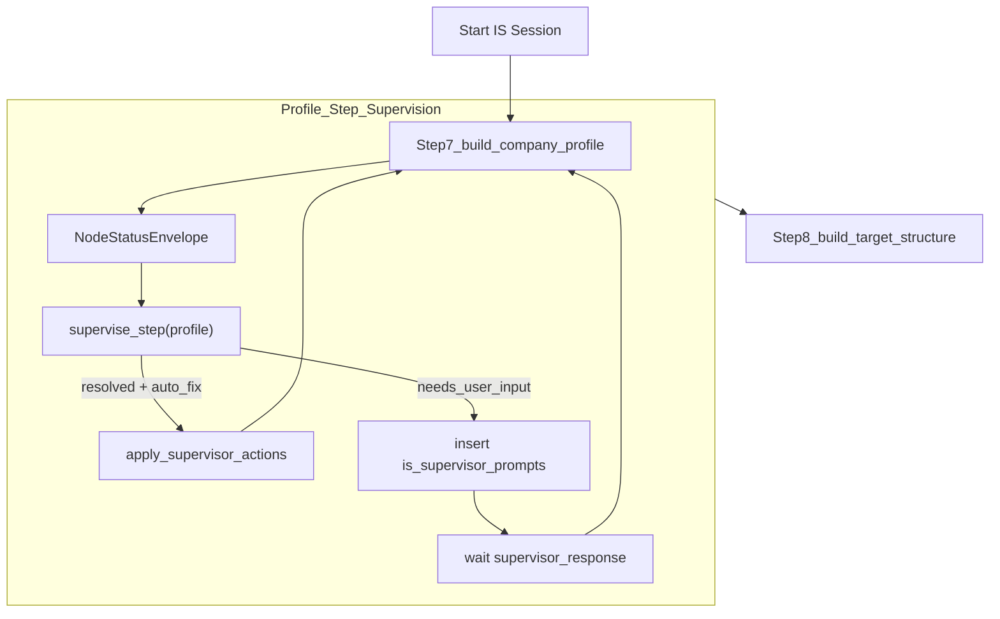

# Supervisor Agent & Implementation System Hardening Plan

## High-level goals

- **Add a Supervisor Agent** around the Implementation System (IS) pipeline so that KB-touching steps never fail silently: they either auto-fix issues safely or pause for a natural-language conversation with the user.
- **Align all IS nodes with the new KB design** from `[.cursor/plans/pgvector_kb_design.md](.cursor/plans/pgvector_kb_design.md)` and the 14-step workflow in `[docs/ARCH_IMPLEMENTATION.md](docs/ARCH_IMPLEMENTATION.md)`.
- **Keep strict JSON KB as the source of truth**, using pgvector only for explanation and option phrasing.

## Current architecture snapshot (relevant pieces)

- **Workflow & worker**: `ImplementationWorkflow` in `[containers/implementation/is_workflow/workflow.py](containers/implementation/is_workflow/workflow.py)` orchestrates 14 steps, run by `[containers/implementation/is_worker.py](containers/implementation/is_worker.py)`.
- **Key agents**:
  - `signals_agent` → f3iche detection & verification (`infer_f3iche`, `verify_f3iche`).
  - `profile_agent` → `build_company_profile`, `retrieve_industry_knowledge`, `enrich_company_profile`, `merge_company_profile`.
  - `target_agent` → `build_target_structure` (writes `_target/target_structure.json`).
  - `mapping_agent` → `map_file_to_erpnext` and helpers in `[containers/implementation/mapping_agent/*.py](containers/implementation/mapping_agent/)`.
  - `validation_agent` → `validate_mapped_data`.
  - `import_agent` → `build_import_plan`, `execute_import_phase`.
- **Strict KB files** (already mapped in `ARCH_IMPLEMENTATION`):
  - `[containers/knowledge_base/erpnext/erpnext_doctype_graph.json](containers/knowledge_base/erpnext/erpnext_doctype_graph.json)`.
  - `[containers/knowledge_base/erpnext/schema/validation_rules.json](containers/knowledge_base/erpnext/schema/validation_rules.json)`.
  - `[containers/knowledge_base/erpnext/schema/field_mappings.json](containers/knowledge_base/erpnext/schema/field_mappings.json)`.
  - `[containers/knowledge_base/erpnext/erpnext_deafaults_baseline.json](containers/knowledge_base/erpnext/erpnext_deafaults_baseline.json)`.
  - `[containers/knowledge_base/common/f3iches/*.json](containers/knowledge_base/common/f3iches/)`.
- **Semantic KB (pgvector)** will be reorganized per `[.cursor/plans/pgvector_kb_design.md](.cursor/plans/pgvector_kb_design.md)` into collections:
  - `f3iche_<id>`, `erpnext_module_docs`, `apqc_pcf`, `company_<project_id>`, `industry_reality_<id>`.

## Design principles & authority hierarchy

- **Authority order (hard rule)** for structural decisions:
  1. `erpnext_doctype_graph.json` — what doctypes/fields exist and base `required_fields`.
  2. `validation_rules.json` — type, enum, and business-rule validations.
  3. `f3iches/<id>.json` — niche-specific requiredness & overlays.
  4. `company_context_vN.json` — this company’s profile and constraints (from R2 `_profile/company_context_vN.json`).
  5. pgvector CE chunks — `company_<project_id>`, `erpnext_module_docs`, `f3iche_<id>`, `apqc_pcf`, `industry_reality_<id>` — **explanations and option phrasing only**.
- **Never override higher-ordered sources with lower ones for structure.** If company note or industry stories disagree with schema/f3iche, the Supervisor surfaces a `conflict` and asks the user; it does not silently accept the lower-ranked claim.
- **Deterministic vs LLM responsibilities**:
  - Deterministic code computes: target doctypes tree, validation results, mapping schemas, and derived prerequisite records.
  - LLM (via Supervisor) computes: explanations, suggested auto-fixes (expressed as patches), and natural-language questions/options.

## Shared models & contracts

We introduce shared models under a new module, e.g. `[shared/models/is_status.py](shared/models/is_status.py)` (names illustrative).

### `NodeStatusEnvelope`

- Returned by all KB-touching IS activities.
- Fields (conceptual; implementation later):
  - `status`: `"success" | "partial" | "failed"`.
  - `primary_result`: node-specific payload (e.g. profile version, target_structure snapshot, summary of mapped doctypes, validation summary).
  - `errors: List[Dict]`: machine-readable hard failures (`code`, `message`, `doctype`, `field`, `row`, `details`).
  - `warnings: List[Dict]`: soft issues (low coverage, heuristic guesses, sparse data).
  - `missing_information: List[str]`: what the node could not resolve without external input.
  - `conflicts: List[Dict]`: contradictions between sources with fields like `scope`, `field`, `erp_schema`, `f3iche`, `company`, `action`.

### `SupervisorAction` & `SupervisorPrompt`

- `SupervisorAction` (per-issue unit produced by Supervisor):
  - `id: str` — stable identifier.
  - `type: "auto_fix" | "ask_user" | "hard_block"`.
  - `scope: str` — e.g. `"Work Order"`, `"BOM"`, `"Batch"`.
  - `changes: List[Dict]` — only for `auto_fix`, patch specs like `{ "target": "r2|db", "doctype": "Work Order", "path": "records[*].status", "from": "PASS", "to": "Completed", "row_selector": {...} }`.
  - `question: Optional[str]` — user-facing question for `ask_user`.
  - `options: Optional[List[str]]` — discrete choices.
  - `metadata: Dict` — reasons, authority sources, confidence, etc.

- `SupervisorPrompt` (stored in DB table `is_supervisor_prompts`):
  - `id: UUID`.
  - `project_id: str`.
  - `step: str` — e.g. `"mapping"`, `"validation"`, `"target_structure"`.
  - `status: "open" | "answered" | "obsolete"`.
  - `node_status: NodeStatusEnvelope` — snapshot for traceability.
  - `actions: List[SupervisorAction]`.
  - `summary_for_ui: str` — short explanation.
  - Timestamps and `answer_payload` for audit.

These models are imported by relevant activities and used consistently.

## Supervisor Agent components

Create a new package `[containers/implementation/supervisor_agent/](containers/implementation/supervisor_agent/)` with:

- `activities.py` — Temporal activities.
- (Optionally) `prompts.py` — LLM prompt templates for Supervisor.
- (Optionally) `models.py` — thin wrappers around shared models if needed.

### Activities

1. **`supervise_step`**
   - Inputs:
     - `node_name: str` (e.g. `"validate_mapped_data"`).
     - `status: NodeStatusEnvelope`.
     - `context: SupervisorContext` (project_id, f3iche_id, current step & phase, doctypes_in_focus, strict KB slices, company profile JSON).
   - Behaviour:
     - Classify each error/warning into `auto_fixable`, `needs_user_choice`, or `hard_block` using authority order and rule heuristics.
     - Optionally query CE with:
       - `company_<project_id>`, `erpnext_module_docs`, `f3iche_<id>`, `apqc_pcf`, `industry_reality_<id>` as per `[.cursor/plans/pgvector_kb_design.md](.cursor/plans/pgvector_kb_design.md)`.
     - Generate a list of `SupervisorAction`s and `summary_for_ui` via LLM.
   - Output: `SupervisorResult` with:
     - `actions: List[SupervisorAction]`.
     - `summary_for_ui: str`.
     - `final_status: "resolved" | "needs_user_input" | "hard_block"`.

2. **`apply_supervisor_actions`**
   - New Temporal activity (NOT workflow code) because it performs I/O (R2 + Supabase).
   - Inputs: `ApplySupervisorActionsInput` referencing a `SupervisorPrompt` row or inlined actions.
     - Contains project_id, step, and `actions[]` filtered to `type == "auto_fix"`.
   - Behaviour:
     - For each `auto_fix` action, patch the relevant R2 JSON payloads (e.g. `_validation/report.json`, `mappings/mapped_payloads/*.json`) or Supabase tables (`is_mapped_data`, `is_field_mappings`).
     - Record successes and failures.
   - Output: `ApplyActionsResult` with `applied`, `skipped`, `errors` arrays for audit and logs.

### Temporal signal: `supervisor_response`

- Add a distinct signal type to `ImplementationWorkflow` in `[containers/implementation/is_workflow/workflow.py](containers/implementation/is_workflow/workflow.py)`:
  - Payload: `{ project_id, prompt_id, chosen_action_id, extra_data }`.
- This is separate from existing gates: `files_uploaded`, `f3iche_confirmed`, `mapping_confirmed`, `validation_submitted`, `sandbox_approved`.

## Correction loops per step

Wrap key nodes in a bounded, Supervisor-backed loop inside the workflow.

- **Supervised steps** (initial set):
  - Step 7: `build_company_profile`.
  - Step 8: `build_target_structure`.
  - Step 8b: new `derive_required_records` (see below).
  - Step 9: `map_file_to_erpnext`.
  - Step 11: `validate_mapped_data`.
  - Optionally Step 12: `build_import_plan`.

- **Loop semantics (per step)**:
  1. Call node activity → `NodeStatusEnvelope`.
  2. If `status == "success"` and `errors` is empty → proceed.
  3. Else call `supervise_step`.
  4. If `final_status == "resolved"` with only `auto_fix` actions:
     - Call `apply_supervisor_actions` once.
     - Re-run node.
  5. If `final_status == "needs_user_input"`:
     - Persist a `SupervisorPrompt` row in `is_supervisor_prompts` (Supabase) with `actions`, `summary_for_ui`, and `node_status`.
     - Transition to a local wait on `supervisor_response` signal.
  6. If `final_status == "hard_block"`:
     - Persist a `hard_block` prompt.
     - Wait for `supervisor_response` that either requests cancel or explicitly chooses “proceed with known risks”.

- **Loop bounds**:
  - `auto_fix`: max 1 attempt per failing step; if node is still not clean, Supervisor must escalate to `ask_user`.
  - `ask_user`: max 2 cycles (e.g. user can adjust their answer once); if after 2 responses node remains in error, Supervisor returns `hard_block`.
  - `hard_block`: no automatic retries; only explicit user override may proceed.
- All loop iterations and decisions are logged in `is_audit_trail` for traceability.

## New node: `derive_required_records` (Step 8b)

**Motivation:** Close the gap between a complete target structure and actual data — e.g. BOMs required for Work Orders, Quality Inspection Templates for operations — by having a dedicated node that can derive prerequisite records or ask the user for missing information.

- **Location:** new activity in `target_agent` or a dedicated `derive_agent`:
  - e.g. `[containers/implementation/target_agent/activities.py](containers/implementation/target_agent/activities.py)` or `containers/implementation/derive_agent/activities.py`.

- **Inputs:**
  - `ISTargetStructure.setup_steps` from Step 8.
  - Company profile JSON from R2 (`_profile/company_context_vN.json`).
  - Manifest / mapped data for already-processed doctypes in this phase, e.g. Items, Work Orders (from `mappings/mapped_payloads/*.json`).
  - Strict KB additions like `seeding_strategies` in `f3iches/<id>.json` (you will own writing these).

- **Core logic:**
  - For each doctype where:
    - `action == "MUST_CREATE"`, and
    - `created_by == "derived"` in f3iche seeding strategies,
  - Check whether there is a direct mapped file (`mappings/mapped_payloads/{doctype}.json`).
  - If not, attempt deterministic derivation using KB hints and existing mapped data (e.g. derive BOMs from Items + Work Orders).
  - Write derived records to R2 as `derived_payloads/{doctype}.json` with a `draft` flag.

- **Outputs:**
  - `NodeStatusEnvelope` where:
    - `primary_result` summarises derived doctypes and counts.
    - `errors` record failures to derive where seeding is required.
    - `missing_information` lists what data is needed to derive safely.
    - `conflicts` capture discrepancies between seeding strategies vs company profile.

- This node is supervised like others: Supervisor might ask the user if they want to auto-create placeholder BOMs or upload a BOM CSV, etc.

## Per-node changes (concrete to this repo)

### `build_company_profile` (Step 7)

File: `[containers/implementation/profile_agent/activities.py](containers/implementation/profile_agent/activities.py)`.

- **Today:** Builds v1 profile, writes to `is_company_profiles` and R2 `_profile/company_context_v1.json`. Calls subsequent enrichment steps; does not return a structured status.
- **Plan:**
  - Refactor to construct and return a `NodeStatusEnvelope`:
    - `primary_result` includes `profile_version`, `required_modules`, draft `required_doctypes`.
    - `errors` when core identity (f3iche, industry, company name) is missing or inconsistent.
    - `warnings` when coverage is low or inferred modules have weak support in signals/files.
    - `missing_information` when it cannot decide which modules/doctypes to enable.
    - `conflicts` when company note contradicts f3iche on structural aspects.
  - After writing v1 profile and R2 JSON, call the new `seed_company_context()` utility (you already planned in `pgvector_kb_design.md`) to maintain `company_<project_id>` chunks.
  - Wire in Supervisor loop so that ambiguous or conflicting profiles trigger Supervisor prompts rather than silently pushing forward.

### `retrieve_industry_knowledge` & `enrich_company_profile` (Steps 7a, 7b)

File: same `profile_agent/activities.py`.

- **Today:** Call RAG against generic `apqc_pcf` and `erpnext_docs` & `f3iche_*`. Enrich profile and write back.
- **Plan:**
  - Update CE calls to use the new collections and `top_k` from `[.cursor/plans/pgvector_kb_design.md](.cursor/plans/pgvector_kb_design.md)`:
    - `apqc_pcf`, `erpnext_module_docs`, `f3iche_<id>`, `industry_reality_<id>`, and `company_<project_id>`.
  - (Optional initially) Return `NodeStatusEnvelope` to let Supervisor comment on extreme inconsistencies between enrichment and base profile.
  - Trigger `seed_company_context()` after enrichment and profile merges (Step 7b & Step 11a) to keep `company_<project_id>` up to date.

### `build_target_structure` (Step 8)

File: `[containers/implementation/target_agent/activities.py](containers/implementation/target_agent/activities.py)`.

- **Today:** Uses `erpnext_doctype_graph.json` + `erpnext_deafaults_baseline.json` + f3iche to compute required doctypes, setup steps, and import phases. CE (`erpnext_docs` + `apqc_pcf`) only annotates reasoning.
- **Plan:**
  - Return `NodeStatusEnvelope` with:
    - `primary_result` = complete target_structure (required_doctypes, setup_steps, import_phases, and any seeding classifications you add).
    - `errors` if graph traversal fails or doctypes cannot be classified.
    - `missing_information` if f3iche/graph/KB cannot tell how to seed certain doctypes.
    - `conflicts` where company profile disables or demands doctypes that contradict f3iche/graph.
  - Extend target_structure JSON so each doctype entry also includes fields like `action`, `created_by`, `min_records`, `seeding_strategy` populated from new f3iche KB fields (you will own KB authoring).
  - Maintain CE usage exactly as in `ARCH_IMPLEMENTATION`: RAG only for `llm_reasoning` annotation; never reorder or drop doctypes based on embeddings.

### `map_file_to_erpnext` (Step 9)

File: `[containers/implementation/mapping_agent/activities.py](containers/implementation/mapping_agent/activities.py)`.

- **Today:** Deterministic two-stage mapping pipeline, writes:
  - `is_field_mappings`, `is_mapped_data`.
  - R2 `mappings/extracted_rows/` and `mappings/mapped_payloads/`.
  - Returns a simple result (e.g. doctype name); does not expose structured errors.
- **Plan:**
  - Wrap existing logic in a `NodeStatusEnvelope`:
    - `primary_result` summarises which doctypes this file mapped to and how many records.
    - `errors` for:
      - Failure to classify doctype when target_structure expects one.
      - Zero records extracted where a file clearly contains data.
    - `warnings` for low coverage, fallback mappings, or when it maps to a doctype not present in target_structure.
    - `missing_information` for ambiguous multi-entity files with no clear resolution.
    - `conflicts` where mapping violates schema (e.g. mapping unknown columns to nonexistent fields).
  - Keep mapping deterministic and LLM-free as per `ARCH_IMPLEMENTATION`; let Supervisor provide UX feedback and questions when mapping is incomplete or ambiguous.

### `validate_mapped_data` (Step 11)

File: `[containers/implementation/validation_agent/activities.py](containers/implementation/validation_agent/activities.py)`.

- **Today:** Uses target_structure and mapped data plus some hardcoded required/enums; writes `is_validation_results`, `is_validation_errors`, and R2 `_validation/report.json`. Returns a basic success/fail string.
- **Plan:**
  - Wire it to consume `[containers/knowledge_base/erpnext/schema/validation_rules.json](containers/knowledge_base/erpnext/schema/validation_rules.json)` as primary rules, replacing hardcoded `_REQUIRED_FIELDS_FALLBACK` and `_ENUM_FIELDS_FALLBACK` (as noted in `ARCH_IMPLEMENTATION` KB gap section).
  - Return `NodeStatusEnvelope`:
    - `primary_result` = high-level validation summary per doctype.
    - `errors` = structured, per-field, per-row; incorporate messages from `_validation/report.json`.
    - `warnings` = data quality issues (e.g. sparse batches, non-numeric but coercible values).
    - `missing_information` = structural gaps like “BOM is required but neither mapped nor derived BOM data exists”.
    - `conflicts` = contradictions between company profile, f3iche overlays, and actual data (e.g. company claims no batch tracking, but data shows batch columns).
  - Integrate Supervisor loop so validation errors become actionable:
    - Auto-fix numeric coercions and simple enum mappings.
    - Ask user about serious structural issues (missing BOMs, batches, etc.).

### Optional: `build_import_plan` (Step 12)

File: `[containers/implementation/import_agent/activities.py](containers/implementation/import_agent/activities.py)`.

- **Plan:**
  - Optionally refactor to return a `NodeStatusEnvelope` focusing on:
    - `errors` where import plan refers to doctypes without data.
    - `missing_information` around ordering or cross-phase dependencies.
  - Supervisor could then surface "this phase includes a doctype with 0 records" warnings before user approves sandbox imports.

## Context Engine usage aligned with `pgvector_kb_design.md`

- All Supervisor and profile/target nodes must query CE with **explicit collection prefixes** and `top_k` per the table at the bottom of `[.cursor/plans/pgvector_kb_design.md](.cursor/plans/pgvector_kb_design.md)`.
- Example CE calls:
  - `build_company_profile` / `enrich_company_profile`:
    - `collections`: `apqc_pcf`, `erpnext_module_docs`, `f3iche_<id>`, `industry_reality_<id>`, `company_<project_id>`; `top_k` per collection.
  - `build_target_structure`:
    - `collections`: `erpnext_module_docs` (4), `apqc_pcf` (3), `company_<project_id>` (3).
  - Supervisor explanation calls:
    - `collections`: `company_<project_id>`, `erpnext_module_docs`, `f3iche_<id>`, `industry_reality_<id>`.
- `industry_reality` must be namespaced by f3iche at both seed and query time: `kb_source = f"industry_reality_{f3iche_id}"`, `rag_retrieve(..., f"industry_reality_{f3iche_id}", ...)`.
- CE results are injected **after** strict JSON is loaded and only used for natural-language context.

## Frontend & API integration (one-page IS with Supervisor panel)

Backend changes (API + DB) should support a single-page IS UI with a right-side Supervisor conversation.

- **New table**: `is_supervisor_prompts` in Supabase, schema matching `SupervisorPrompt`.
- **API endpoints** (likely FastAPI under existing implementation backend):
  - `GET /api/implementation/{project_id}/supervisor-prompts`
    - Returns open + recent prompts for that project.
  - `POST /api/implementation/{project_id}/supervisor-prompts/{prompt_id}/respond`
    - Body: `{ "chosen_action_id": "...", "extra_data": {...} }`.
    - Backend:
      - Persists `answer_payload` and marks prompt `answered`.
      - Emits `supervisor_response` signal to Temporal with normalized payload.
- **UI responsibilities** (not implemented here, but contract-driven):
  - Left rail: existing stepper based on `is_sessions.stage` and signal gates.
  - Center panel: step-specific views (mapping tables, validation reports, target_structure view) using existing R2 + DB endpoints.
  - Right panel: Supervisor chat-like panel based on `is_supervisor_prompts`:
    - Shows `summary_for_ui`, actions/questions, and history of responses.
    - Distinguishes normal gates (large stepper transitions) from Supervisor prompts (inline conversational cards).

## Mermaid overview of new control flow

## Phased implementation steps

1. **Shared models & authority utilities**
   - Add `NodeStatusEnvelope`, `SupervisorAction`, `SupervisorPrompt`, `SupervisorResult`, and `ApplySupervisorActionsInput/Result` models in a shared module.
   - Add a helper in `shared/structured_llm.py` (or a new helper module) that returns the authority-order prompt fragment used by Supervisor and any LLM-based IS nodes.

2. **Wire status envelopes into nodes (no Supervisor yet)**
   - Refactor `build_company_profile`, `build_target_structure`, `map_file_to_erpnext`, and `validate_mapped_data` (and optionally `build_import_plan`) to:
     - Construct and return `NodeStatusEnvelope`.
     - Still perform all their existing side-effects (DB + R2 writes).
   - Update `ARCH_IMPLEMENTATION.md` to reflect the new contracts once stable.

3. **Supervisor Agent skeleton**
   - Create `[containers/implementation/supervisor_agent/activities.py](containers/implementation/supervisor_agent/activities.py)` with stubs for `supervise_step` and `apply_supervisor_actions` that simply log input and return no-op actions.
   - Wire CE calls inside `supervise_step` to use the new pgvector collections, but keep decisions trivial until later phases.

4. **Temporal integration & new signal**
   - Add `supervisor_response` signal to `ImplementationWorkflow` in `[containers/implementation/is_workflow/workflow.py](containers/implementation/is_workflow/workflow.py)`.
   - Around **one node only** (start with `validate_mapped_data`), implement:
     - Single call → status envelope → `supervise_step` stub → just log and proceed.
   - Ensure this doesn’t change behaviour yet, only instrumentation.

5. **Full correction loop for `validate_mapped_data`**
   - Implement real `supervise_step` logic for validation errors (missing required fields, type mismatches, invalid enums, missing BOM/Batch coverage) using strict KB.
   - Create `is_supervisor_prompts` table and minimal API endpoints.
   - Implement bounded while-loop around `validate_mapped_data` following the correction rules (1 auto-fix attempt, up to 2 user responses, then hard-block).
   - Implement `apply_supervisor_actions` for simple auto-fixes: numeric coercion, enum mapping, minor default injection (never altering structure).

6. **Introduce and supervise `derive_required_records`**
   - Add the `derive_required_records` node between Steps 8 and 9, reading target_structure and using new f3iche seeding strategies.
   - Make it return a `NodeStatusEnvelope` and plug it into the Supervisor loop.
   - Handle common manufacturing prerequisites like BOMs, Quality Inspection Templates, Workstations, etc.

7. **Extend Supervisor loops to mapping and target structure**
   - Apply the same pattern (status → supervise → optional auto-fix → re-run / ask user) to `build_target_structure` and `map_file_to_erpnext`.
   - Implement appropriate `apply_supervisor_actions` patches for mapping (e.g. fix enum values, strip units, correct obvious mis-mappings).

8. **Refine profile & enrichment supervision (optional)**
   - If needed, add true supervision for `build_company_profile` and `enrich_company_profile`, especially for conflicts between company note and f3iche or for module enable/disable decisions.

9. **UI integration & polish**
   - Implement the API endpoints and right-panel Supervisor UI using the `is_supervisor_prompts` contract.
   - Ensure clear UX distinction between:
     - Normal signal gates in the main stepper.
     - Exception-driven Supervisor prompts in the conversation panel.
   - Add observability: basic metrics on how many prompts are auto-resolved vs require user answers vs reach hard-block.

This plan keeps KB authoring and pgvector seeding under your control, while making the Implementation System codebase Supervisor-compatible, correction-loop aware, and robust enough for production onboarding flows.