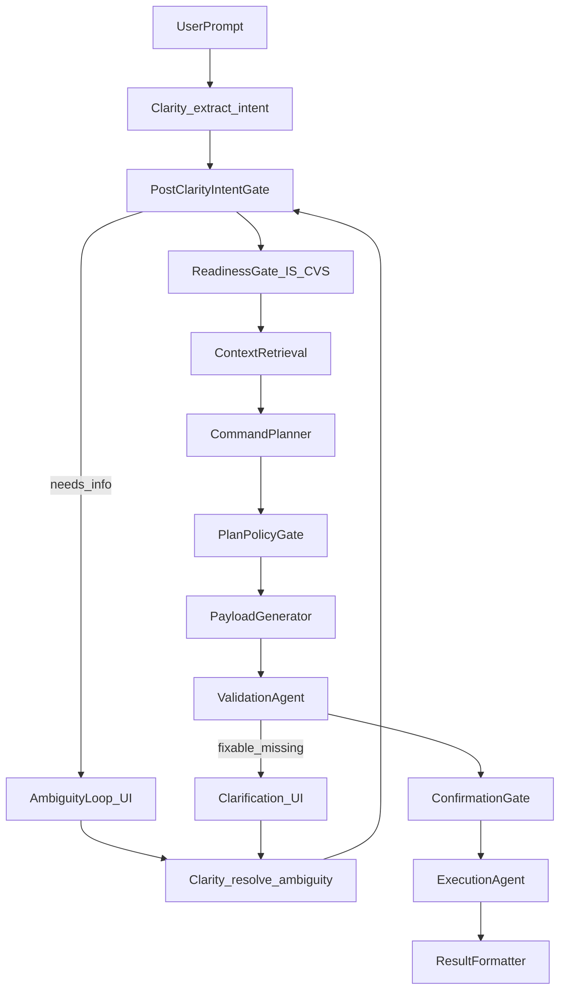

## Goals
- Prevent “garbage intent → silent substitutions → invalid payload” cascades.
- Make identifiers consistent (UUID vs slug) so CVS/context reads never fail with invalid UUID.
- Replace silent best-effort behavior with **policy-driven** best-effort: only when confidence is high and always visible to the user.
- Ensure OS only runs against a “ready” Implementation/CVS state (or clearly communicates why it can’t).

## Non-goals
- Building a new unified portal for OS+Implementation now (covered as an optional later step).
- Re-architecting every agent; this is targeted hardening at the boundaries where failures cascade.

## Current failure modes (from code)
- **Clarity fallback disables the ambiguity loop**: `_fallback_intent` returns `ambiguities=[]` + `has_ambiguities=False` even when required entities are missing and confidence is low. See [`containers/os/clarity_agent/activities.py`](containers/os/clarity_agent/activities.py) (fallback block around `confidence=0.60`).
- **Fallback misclassifies natural language**: regex “for X” extracts `customer=X` and item extraction only catches code-like tokens, so “raw mango” becomes customer and `items=[]`.
- **Planner silently substitutes link fields**: `_resolve_link_field` chooses `options[0]` when desired value not found (“not found, using existing ...”). See [`containers/os/command_planner/prereq_resolver.py`](containers/os/command_planner/prereq_resolver.py).
- **ContextEngine accepts non-UUID and then fails at DB**: `uuid.UUID()` failure falls back to using the raw string in the DB filter, causing invalid UUID errors for slugs like `f3`. See [`shared/context_engine/engine.py`](shared/context_engine/engine.py).
- **OS workflow passes inconsistent IDs**: Step 1 passes `project_id` to Clarity, but Step 3 passes `company_id` into context retrieval and then into ContextEngine. See [`containers/os/os_workflow/workflow.py`](containers/os/os_workflow/workflow.py).
- **OS can run with dummy profile (IS not ready)**, which is useful for dev but unsafe in prod if not gated. See [`containers/os/context_retrieval/company_profile.py`](containers/os/context_retrieval/company_profile.py).

## Target architecture (high level)

## Implementation plan (phased)

### Phase 1 — Canonical identifiers + CVS read reliability (P0)
**Outcome**: all internal CVS/context lookups use UUID; slugs are allowed at the boundary but normalized immediately.

- Update OS orchestration to use UUID consistently.
  - **Files**:
    - [`containers/os/os_workflow/workflow.py`](containers/os/os_workflow/workflow.py)
    - [`shared/models/command.py`](shared/models/command.py)
    - [`backend/app/services/os_launcher.py`](backend/app/services/os_launcher.py)
  - **Actions**:
    - Treat `CommandRequest.project_id` as canonical UUID for internal calls.
    - Treat `CommandRequest.company_id` as “company_slug” for display/legacy; keep it optional/backward compatible.
    - In the workflow, pass UUID into context retrieval and ContextEngine reads.

- Make profile lookup accept UUID or slug.
  - **Files**: [`containers/os/context_retrieval/company_profile.py`](containers/os/context_retrieval/company_profile.py)
  - **Actions**:
    - Change `fetch_profile_from_db()` query from `WHERE p.company_slug = :project_id` to a dual lookup: by `p.id` when `project_id` parses as UUID, else by `p.company_slug`.
    - Ensure the returned profile includes both `company_id` (UUID) and `company_slug`.

- Fix ContextEngine’s CVS loader to never attempt DB filtering with non-UUID.
  - **Files**: [`shared/context_engine/engine.py`](shared/context_engine/engine.py)
  - **Actions**:
    - On UUID parse failure, do **slug→UUID resolution** (single DB query on `projects.company_slug`) and use that UUID for `ContextSnapshot.project_id` filters.
    - If resolution fails, return `cvs={}` and emit a structured warning (not a stack trace).

- Align CVS snapshot queries to use UUID types.
  - **Files**:
    - [`containers/context_versioning/snapshot_builder/activities.py`](containers/context_versioning/snapshot_builder/activities.py)
    - [`backend/app/services/cvs_launcher.py`](backend/app/services/cvs_launcher.py)
  - **Actions**:
    - Ensure `ContextSnapshot.project_id` comparisons use UUID objects (or consistently typed strings that SQLAlchemy/asyncpg accept), and add a tiny helper `parse_uuid_or_raise()` used in all CVS-read paths.

**Acceptance criteria**
- “invalid UUID 'f3'” never appears in ContextEngine logs.
- A request with `{project_id: <uuid>, company_id: 'f3'}` still works (slug kept for compatibility) but internal CVS reads use UUID.

### Phase 2 — Post-Clarity intent gate (P0)
**Outcome**: Clarity output cannot bypass missing required entities; low-confidence/fallback output triggers clarification.

- Add an explicit **Post-Clarity Intent Gate** right after `extract_intent` in the OS workflow.
  - **Files**: [`containers/os/os_workflow/workflow.py`](containers/os/os_workflow/workflow.py)
  - **Gate rules (deterministic)**:
    - If `intent_dict._fallback == True` and the doctype requires items/party → force `ambiguities` with a question.
    - If `confidence < MIN_CONF` (configurable) → force clarification unless entities are fully validated.
    - If required entities are missing (e.g., Sales Order has empty `items`) → force clarification.

- Make the fallback “safe” instead of “wrong.”
  - **Files**: [`containers/os/clarity_agent/activities.py`](containers/os/clarity_agent/activities.py)
  - **Actions**:
    - In `_fallback_intent`, stop extracting `customer` from “for X” unless X matches a known customer at high confidence.
    - Attempt CVS-based classification (Item vs Customer vs Supplier) using the existing `_search_cvs_master_data` tool.
    - When uncertain, return `has_ambiguities=True` + a single high-signal question (“Which customer? Which item(s) + qty?”).

**Acceptance criteria**
- When LLM is unavailable (503) and user says “create sales order for raw mango”, OS pauses in the ambiguity loop instead of proceeding with `items=[]`.

### Phase 3 — Entity resolution + “best-effort only when confident” (P0/P1)
**Outcome**: When the system auto-fills or maps names, it does so only with measurable confidence and always tells the user.

- Implement a reusable **EntityResolver** utility.
  - **Files** (new): `shared/entity_resolution/` (module)
  - **Inputs**: raw string, entity type (Item/Customer/Supplier/Warehouse), project UUID.
  - **Data sources**:
    - Prefer `company_profile.entity_registry` (from [`containers/os/context_retrieval/company_profile.py`](containers/os/context_retrieval/company_profile.py)) when present.
    - Fallback to ContextEngine CVS layer (`pc.cvs['master_data']`) when needed.
  - **Outputs**: `{chosen, confidence, alternatives, evidence}`.

- Apply resolver in two places:
  - **Clarity**: validate/normalize LLM output and fallback output.
  - **Planner**: resolve link fields; if confidence is high, auto-select and attach a warning note; if not, convert into an ambiguity question.

- Surface best-effort actions to the user.
  - **Files**:
    - [`containers/os/os_workflow/workflow.py`](containers/os/os_workflow/workflow.py) (confirmation preview building)
    - Planner/payload metadata (`plan.steps[].resolution_source`, etc.)
  - **UI behavior** (existing confirmation block): include a “We assumed:” section listing substitutions.

**Acceptance criteria**
- No more silent substitution logs without a corresponding user-visible warning in confirmation preview.

### Phase 4 — Planner prerequisite policy (P0)
**Outcome**: required link fields never fall back to `options[0]` silently.

- Replace `_resolve_link_field` fallback behavior with a policy matrix.
  - **Files**: [`containers/os/command_planner/prereq_resolver.py`](containers/os/command_planner/prereq_resolver.py)
  - **Policy examples**:
    - `Sales Order.customer`: must resolve to an existing customer with high confidence; else block for clarification.
    - `company`: may default from profile if it exists in ERP; else block.
    - Optional link fields: may choose a default/first option **only** when confidence is high and emit a warning.

- Risk escalation when inserting bootstrap prerequisite steps.
  - If a missing master record triggers a “bootstrap create” prereq step, force confirmation and mark risk at least “medium”.

**Acceptance criteria**
- Planner can no longer turn “raw mango” into a random existing customer without explicit user approval.

### Phase 5 — Validation recovery loop (P1)
**Outcome**: if payload validation fails for fixable missing info, the workflow asks the user and retries instead of ending.

- Classify validation errors into: fixable-via-clarification vs non-fixable.
  - **Files**:
    - [`containers/os/validation_agent/validator.py`](containers/os/validation_agent/validator.py)
    - [`containers/os/os_workflow/workflow.py`](containers/os/os_workflow/workflow.py)
  - **Actions**:
    - On fixable errors (missing items/customer/date), pause and ask targeted questions, then re-run from `resolve_ambiguity` → planner → payload → validate.
    - Keep a max retry count (e.g., 2 rounds) to avoid loops.

**Acceptance criteria**
- “items mandatory” becomes a clarification prompt rather than a terminal error for normal user mistakes.

### Phase 6 — Readiness gate across Implementation/CVS/OS (P0/P1)
**Outcome**: OS doesn’t run “half-configured” unless explicitly allowed for development.

- Add a ReadinessGate activity (or inline gate) before Context Retrieval.
  - **Checks**:
    - Project has ERP credentials (and not dummy profile) unless `ALLOW_DUMMY_PROFILE=1`.
    - CVS has a recent `master_data` snapshot (or at least non-empty known_items/customers).
    - Optional: minimum viable master data exists (>=1 Customer, >=1 Item).

- Ensure IS reliably triggers CVS `force-sync` after deployment/import.
  - **Files**:
    - [`containers/implementation/is_workflow/workflow.py`](containers/implementation/is_workflow/workflow.py)
    - [`backend/app/api/cvs.py`](backend/app/api/cvs.py)
    - [`backend/app/services/cvs_launcher.py`](backend/app/services/cvs_launcher.py)
  - **Actions**:
    - Confirm the IS pipeline calls `/api/cvs/force-sync/{project_id}` once credentials exist and again after import phases that materially change master data.

**Acceptance criteria**
- If CVS has no snapshot, OS returns a clear “Setup not complete; run force-sync” message instead of proceeding with weak context.

### Phase 7 — Observability & guardrails (P1)
**Outcome**: you can see where failures happen and why.

- Add counters:
  - Clarity fallback rate
  - Clarification-loop entry rate and reason
  - Entity-resolution substitutions count
  - Readiness gate failures
- Add structured logs containing `project_id`, `company_slug`, `intent_id`, `workflow_id`, `_fallback`, `confidence`, and `resolution_confidence`.

## Portal question (OS+IS single portal)
- Treat as a **separate, later UX project**: unify the UI shell/navigation, not the runtime systems.
- The reliability issues here are primarily **contracts + ID normalization + policy gates**; a single portal won’t remove those failure modes.

## Rollout strategy
- Introduce gates in “warn-only” mode first (log + show in confirmation preview), then flip to “block” once metrics show low false positives.
- Keep backward compatibility at API boundary: accept slug in `company_id` but normalize to UUID.

## Test plan (minimal but sufficient)
- Unit tests:
  - ContextEngine slug→UUID resolution
  - Fallback intent classification for ambiguous phrases
  - Planner policy matrix (required field cannot silently fall back)
- Integration tests (mock ERPAdapter + seeded ContextSnapshot rows):
  - LLM 503 → ambiguity prompt triggered
  - Missing CVS snapshot → readiness gate blocks
  - Known item name mistakenly placed in customer → resolver reclassifies or asks user
