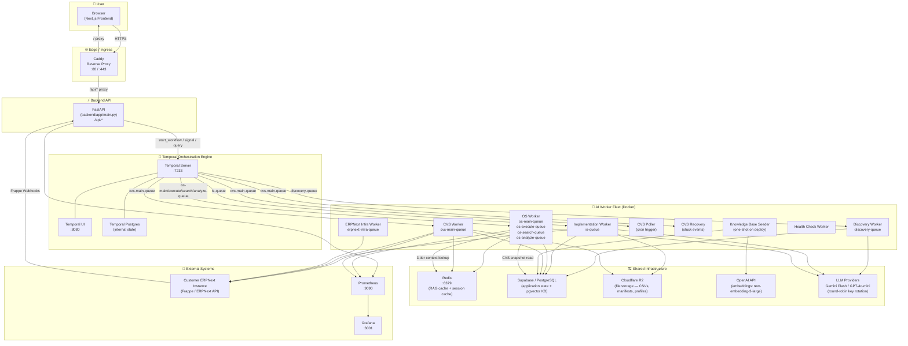
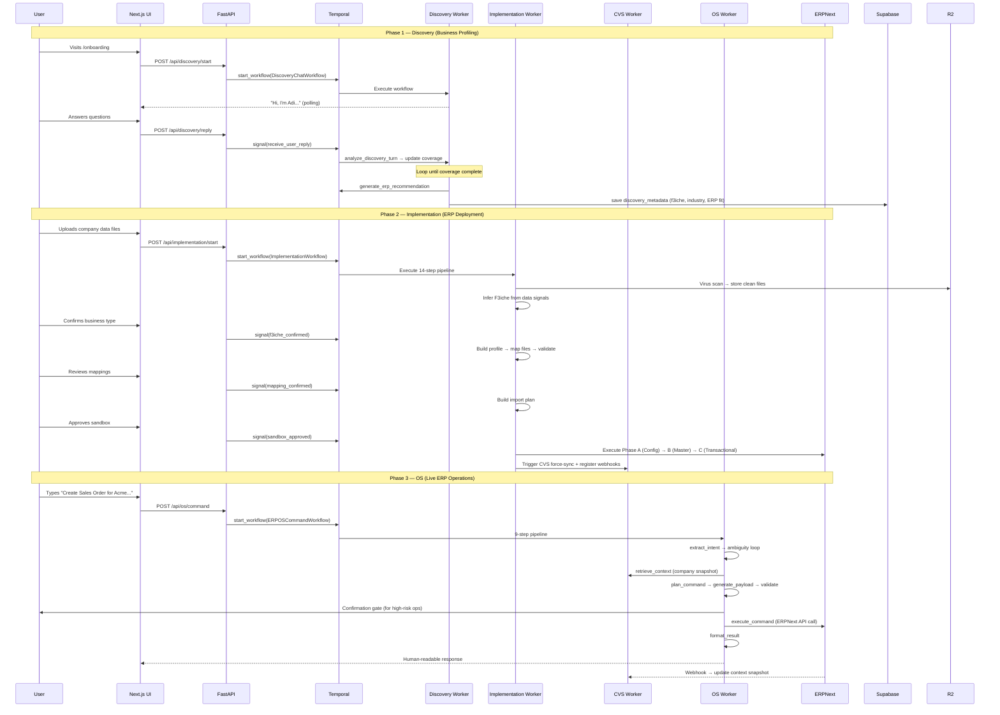

# F3Next — Complete System Architecture

> F3Next is an **autonomous ERP deployment and operations platform**. It ingests a company's raw data, intelligently maps it to ERPNext, deploys the ERP system, and then lets users control it via natural language commands — all orchestrated by Temporal workflows.

---

## 🗺️ System Overview — How Every Service Connects



---

## 🧱 Layer Architecture

| Layer | Service | Technology | Role |
|-------|---------|-----------|------|
| **Frontend** | `frontend_web` | Next.js 15, React, TailwindCSS | Mission Control UI, Discovery Chat, OS Terminal |
| **Reverse Proxy** | `caddy` | Caddy v2 | SSL termination, routes `/api/*` → FastAPI, `/` → Next.js |
| **API Gateway** | `backend_api` | FastAPI (Python) | Synchronous bridge: auth, workflow launch, signal relay |
| **Orchestrator** | `temporal` | Temporal.io | Durable workflow execution, retry, state management |
| **Discovery Agent** | `discovery_worker` | Python + Temporal | AI consultant "Adi" — business profiling chat |
| **Implementation System** | `implementation_worker` | Python + Temporal | 14-step ERP onboarding pipeline |
| **OS Agent** | `os_worker` | Python + Temporal | Natural language → ERP command execution |
| **Context Versioning** | `cvs_worker` + `cvs_poller` | Python + Temporal | Keeps company context snapshots fresh from ERPNext |
| **Context Engine** | `shared/context_engine/` | Python | 3-tier context loader (static + f3iche + CVS live data) |
| **LLM Router** | `llm_router.py` | LangChain + OpenAI/Gemini | Provider-agnostic LLM with key rotation & fallback |
| **Knowledge Base** | `containers/knowledge_base/` | pgvector (PostgreSQL) | APQC + ERPNext docs + F3iche domain knowledge |
| **Cache** | `redis` | Redis 7 | RAG query cache, OS session context cache |
| **Database** | Supabase | PostgreSQL 15 | All application state (projects, sessions, CVS snapshots) |
| **File Storage** | Cloudflare R2 | S3-compatible | Raw uploads, parsed manifests, mapped data, import plans |
| **Observability** | `prometheus` + `grafana` | Prometheus + Grafana | LLM health, latency, pipeline metrics |

---

## 🔄 End-to-End User Journey



---

## 📁 Repository Structure

```
F3Next/
├── ARCHITECTURE.md                  ← This file
├── docs/
│   ├── ARCH_OS.md                   ← OS Agent deep-dive
│   ├── ARCH_DISCOVERY.md            ← Discovery Agent deep-dive
│   ├── ARCH_IMPLEMENTATION.md       ← Implementation System deep-dive
│   ├── ARCH_CVS.md                  ← Context Versioning Service deep-dive
│   └── ARCH_CONTEXT_ENGINE.md       ← Shared Context Engine deep-dive
│
├── frontend/                        ← Next.js 15 UI
├── backend/                         ← FastAPI gateway
├── containers/
│   ├── os/                          ← OS Agent Worker
│   ├── discovery/                   ← Discovery Agent Worker
│   ├── implementation/              ← Implementation System Worker
│   ├── context_versioning/          ← CVS Worker + Poller + Recovery
│   ├── knowledge_base/              ← KB seeding scripts
│   ├── erpnext/                     ← ERPNext infra worker
│   └── health_check/                ← Health diagnostics worker
├── shared/
│   ├── context_engine/              ← 3-tier context loading
│   ├── llm_providers/               ← OpenAI + Gemini provider abstraction
│   ├── erp_adapters/                ← ERP-specific API adapters
│   ├── models/                      ← SQLAlchemy ORM models
│   ├── database/                    ← DB connection (async + sync)
│   ├── embedding_generator.py       ← OpenAI embedding w/ key rotation
│   ├── rag_cache.py                 ← Redis-backed RAG cache
│   └── r2_client.py                 ← Cloudflare R2 file operations
├── llm_router.py                    ← Universal LLM router (root-level)
├── docker-compose.yml               ← Full stack definition
├── Caddyfile                        ← Reverse proxy config
└── monitoring/                      ← Prometheus + Grafana configs
```

---

## 🔑 Key Design Principles

1. **Temporal-First Orchestration** — All multi-step business logic runs inside Temporal workflows. Activities are retried automatically; workflows survive crashes.

2. **Human-in-the-Loop Signals** — Temporal `signal` primitives allow the UI to inject user decisions (confirmations, clarifications) into running workflows mid-execution.

3. **3-Tier Context Architecture** — The Context Engine assembles company context from three layers: static ERP schema (Tier 1), industry/f3iche templates (Tier 2), and live CVS snapshots from ERPNext (Tier 3).

4. **Event-Driven Context Freshness** — CVS worker listens to Frappe webhooks from customer ERPNext instances and triggers snapshot rebuilds automatically whenever data changes.

5. **Provider-Agnostic LLM** — `llm_router.py` provides a single interface backed by Gemini Flash and GPT-4o-mini with automatic key rotation, quota sidetracking, and cross-provider fallback.

6. **Zero-Hardcode Policy** — Frontend uses only relative `/api/*` paths; all ERP URLs and credentials are resolved from the database at runtime.

---

*For detailed flowcharts of each subsystem, see the `docs/` directory.*
