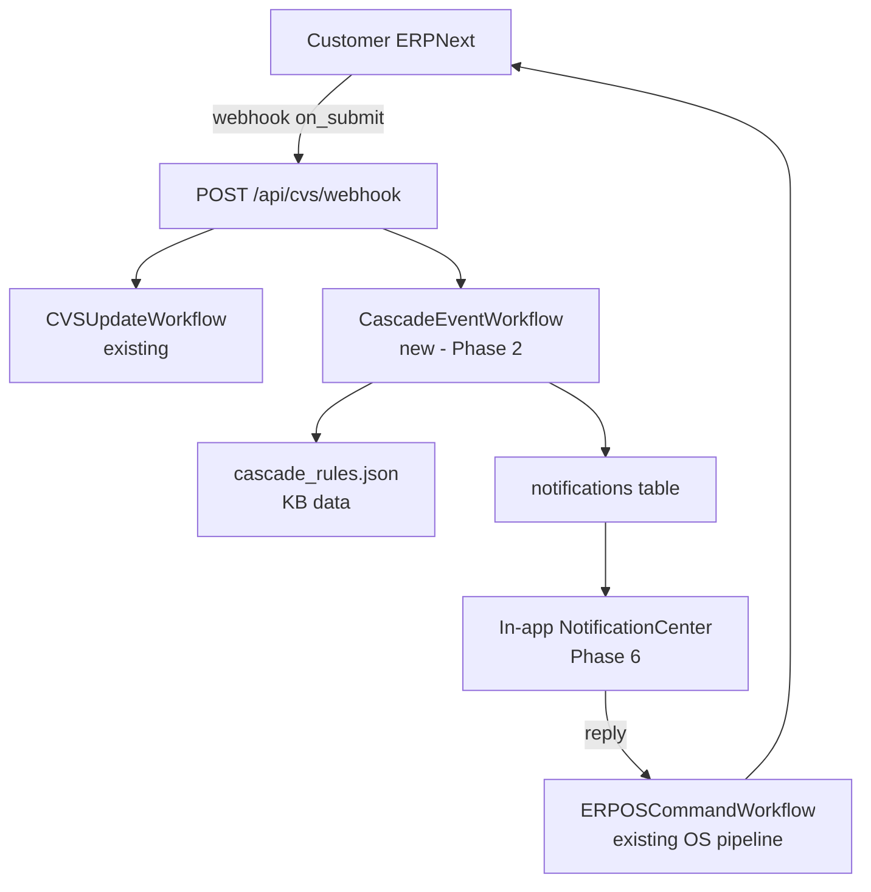

# Cascade / Operations Control Plane — Architecture

> Reactive operations layer: ERPNext events fan out to department-scoped notifications; user replies route back through the existing OS command pipeline.

**Status:** Phase 0–1 in progress on branch `control-plane`  
**Related:** [ARCH_CVS.md](./ARCH_CVS.md) · [ARCH_OS.md](./ARCH_OS.md) · [PRIORITIES.md](./PRIORITIES.md)

---

## Problem

F3Next today is **inbound-only** after go-live:

- **IS** writes data into ERPNext once at onboarding.
- **OS** writes data when a user types a natural-language command.

Neither reacts to what ERPNext does *after* a write. CVS already receives Frappe webhooks (`POST /api/cvs/webhook/{project_id}`) but only rebuilds context snapshots — it does not notify anyone.

---

## Solution: two new layers on existing plumbing

### Layer L6 — Reactive / Notification (new foundation layer)

| Component | Location | Role |
|-----------|----------|------|
| Department taxonomy | `shared/erp_policies/departments.py` | Route events to Sales/Purchase/Production/etc. |
| Team membership | `project_members.department`, `team_invites.department` | Who receives what |
| Cascade event log | `cascade_events` table | Audit trail per ERPNext webhook |
| Notification outbox | `notifications` table | Per-recipient delivery records |
| Cascade worker | `containers/cascade/` (Phase 2) | Temporal workflow: rules → translate → dispatch |
| Cascade rules KB | `containers/knowledge_base/common/cascade_rules.json` (Phase 3) | Doctype + event → departments + template |
| Channel adapters | `shared/notification_channels/` (Phase 5) | In-app v1; WhatsApp stub |
| Notification UI | `NotificationCenter.tsx` in `UniversalHeader` (Phase 6) | Bell + reply box |

### Design rules

1. **Do not duplicate the OS NL pipeline.** Replies from notifications enter `ERPOSCommandWorkflow` with `seed_context` (Phase 7).
2. **Do not duplicate risk scoring.** Extend `shared/erp_policies/action_risk.py` with `context="cascade"`.
3. **Do not register a second webhook on ERPNext.** Fan out from the existing CVS webhook receiver in `backend/app/api/cvs.py`.
4. **Rules are KB data**, not Python branches — same policy as command patterns.

---

## Phase rollout

| Phase | Deliverable | Status |
|-------|-------------|--------|
| 0 | Department enum, schema, invite flow, backlog docs | In progress |
| 1 | `cascade_events` + `notifications` models + SQL | In progress |
| 2 | `containers/cascade/` worker + webhook fan-out | Pending |
| 3 | `cascade_rules.json` seeded for 6 webhook doctypes | Pending |
| 4 | Risk extension for cascade context | Pending |
| 5 | `shared/notification_channels/` | Pending |
| 6 | Notification API + UI bell | Pending |
| 7 | Reply → OS pipeline with `seed_context` | Pending |
| 8 | Widen webhook doctypes (MR, WO, Job Card) | Pending |

---

## Recipient resolution (Phase 0 contract)

When a cascade rule targets `purchase`:

1. Query `project_members` where `department = 'purchase'`.
2. If none found, fall back to workspace owner (`projects.client_id`).
3. Write one `notifications` row per recipient.

WhatsApp delivery is deferred; `channel` defaults to `in_app`.

---

*For system overview, see [ARCHITECTURE.md](../ARCHITECTURE.md)*
