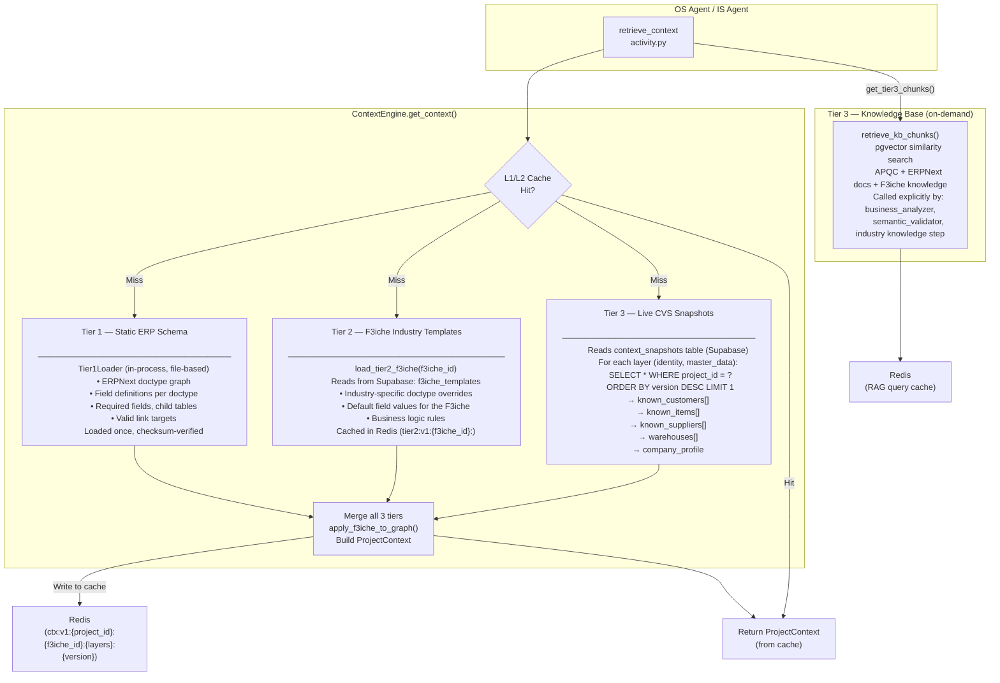
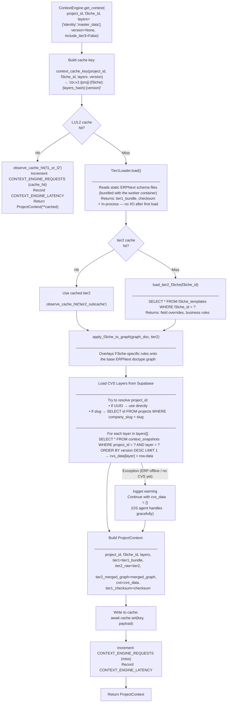
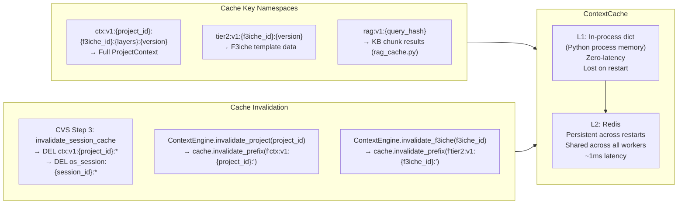
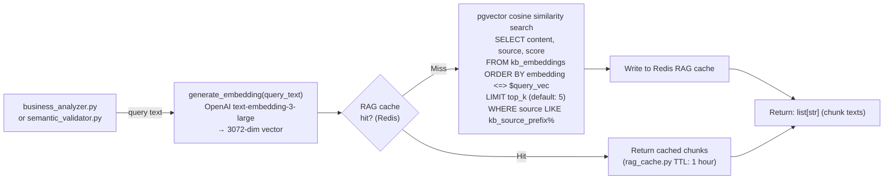
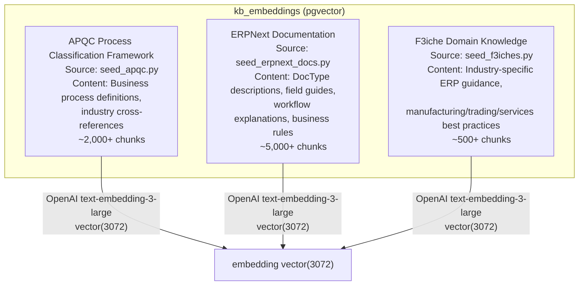

# Context Engine — Architecture & Flow

> The Context Engine is the **shared intelligence layer** that assembles complete company context for every OS command. It merges static ERP schema knowledge, industry-specific templates, and live CVS snapshots into a single `ProjectContext` object — with a tiered Redis + in-process cache to keep latency sub-50ms.

### Live Entity Registry (LER) overlay — v1.0.0 foundation

**CVS may suggest; LER decides.** Context snapshots and OS commands also carry a **live ERP overlay** built by `shared/entity_resolution/` (`build_link_cache`, `resolve_entities_batch`). This wraps `BulkLinkResolver` — the same path IS import preflight uses — so validators and planners check **live Frappe link names**, not stale CVS alone. Keys: `link_cache`, `resolved_entities`, `resolution_gaps`, `live_fetched_at`, `brain_version`. Wired into workflows on `foundation/os-brain`; see [`docs/v1.0.0/branch-02-foundation-os-brain.md`](v1.0.0/branch-02-foundation-os-brain.md).

---

## 🏗️ Component Map

```
shared/context_engine/
├── __init__.py         ← Exports ContextEngine, get_context_engine()
├── engine.py           ← ContextEngine class — main orchestrator
├── loader.py           ← Tier1Loader, load_tier2_f3iche, retrieve_kb_chunks
├── cache.py            ← ContextCache (Redis-backed, in-process L1)
├── versioning.py       ← Cache key generation (context_cache_key, tier2_cache_key)
├── models.py           ← ProjectContext dataclass
├── config.py           ← Config (TTLs, Redis URL)
└── metrics.py          ← Prometheus: CONTEXT_ENGINE_LATENCY, CONTEXT_ENGINE_REQUESTS
```

---

## 🏛️ 3-Tier Architecture



---

## 🔁 get_context() Execution Flow



---

## 🗃️ Cache Architecture



---

## 📐 ProjectContext Model

```python
@dataclass
class ProjectContext:
    project_id: str
    f3iche_id: str
    layers: list[str]

    # Tier 1 — Static ERP schema
    tier1: dict              # {doctype_graph: {...}, field_defs: {...}}
    tier1_checksum: str      # SHA256 of tier1 bundle (for cache invalidation)

    # Tier 2 — Industry template
    tier2_raw: dict          # Raw F3iche template from Supabase
    tier2_merged_graph: dict # tier1 graph + tier2 overlays merged

    # Tier 3 — Live company data (from CVS)
    cvs: dict[str, Any]      # {identity: {...}, master_data: {...}}
    # cvs['master_data'] contains:
    #   known_customers: [{name, customer_name, customer_group}, ...]
    #   known_items: [{item_code, item_name, stock_uom, item_group}, ...]
    #   known_suppliers: [{name, supplier_name, supplier_group}, ...]
    #   warehouses: [{name, is_group}, ...]

    context_version: Optional[int]  # Pinned version (for audit replay)
```

---

## 🔍 Tier 3 On-Demand: Knowledge Base Chunks

The `get_tier3_chunks()` method performs **semantic search** over the knowledge base — used by the Business Analyzer and Semantic Validator:



---

## 📊 Knowledge Base Contents



---

## 🔑 Key Design Decisions

1. **Tiered cache = speed** — L1 (in-process dict) catches repeated requests within the same worker process. L2 (Redis) catches requests across workers and restarts. Cache miss only hits Supabase.

2. **CVS failure is non-fatal** — If Supabase is unreachable or there's no CVS snapshot yet, `get_context()` logs a warning and continues with `cvs = {}`. The OS agent's readiness blocker will catch the missing data case.

3. **Checksum-based Tier 1 invalidation** — The static ERP schema (Tier 1) is bundled with the worker container and loaded once. If the schema file changes, the checksum changes, and all cached context entries become invalid.

4. **Slug → UUID resolution** — Context can be requested by either the project UUID or the human-readable `company_slug`. The engine resolves slugs to UUIDs transparently via a single DB lookup.
