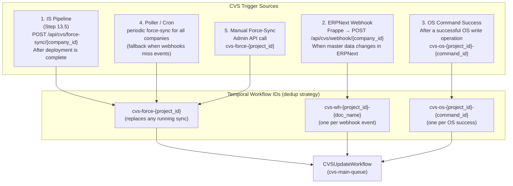
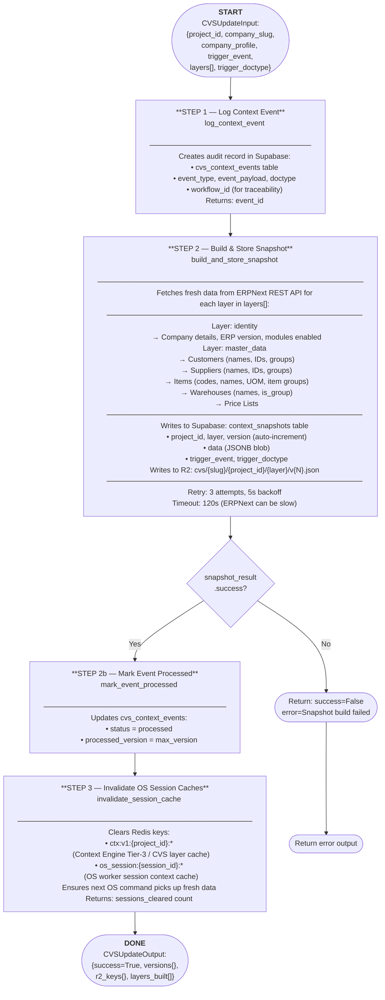
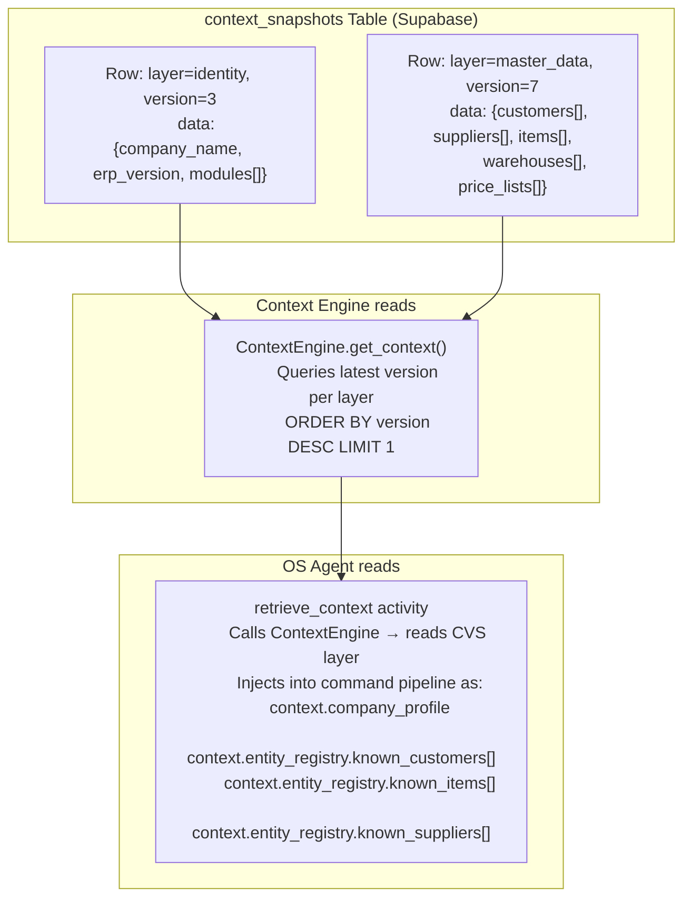
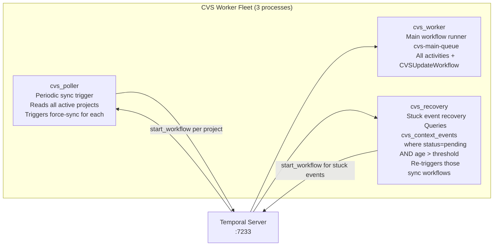

# Context Versioning Service (CVS) — Architecture & Flow

> The CVS is F3Next's **event-driven context synchronization layer**. It continuously keeps a structured snapshot of each company's live ERPNext data (customers, suppliers, items, warehouses) in Supabase, so the OS Agent always has fresh, accurate context without making expensive real-time API calls during command execution.

---

## 🏗️ Component Map

```
containers/context_versioning/
├── cvs_worker.py                  ← Main worker — cvs-main-queue
├── poller_worker.py               ← Cron poller — periodic sync trigger
├── recovery_worker.py             ← Stuck event recovery
├── cvs_workflow/
│   └── workflow.py                ← CVSUpdateWorkflow (4-step, ~7KB)
├── snapshot_builder/
│   └── activities.py              ← build_and_store_snapshot (ERPNext → Supabase + R2)
└── context_store/
    └── activities.py              ← read_latest_snapshot, invalidate_session_cache,
                                     log_context_event, mark_event_processed,
                                     register_frappe_webhooks, recover_stuck_events,
                                     cvs_force_sync_for_project

shared/
├── cvs_profile.py                 ← CVS profile utilities
├── cvs_metrics.py                 ← Prometheus metrics for CVS
└── cvs_routing.py                 ← Routing helpers for CVS workflow IDs
```

---

## 🔄 Trigger Architecture (3 Entry Points)



---

## 🔁 CVSUpdateWorkflow — 4-Step Pipeline



---

## 🗃️ Snapshot Layer Architecture



---

## 🔁 Worker Fleet



---

## 📡 Frappe Webhook Integration

```mermaid
sequenceDiagram
    participant ERPNext as Customer ERPNext
    participant API as FastAPI
    participant T as Temporal
    participant CVS as CVS Worker

    Note over ERPNext: User creates/updates Customer in ERPNext

    ERPNext->>API: POST /api/cvs/webhook/{company_id}
    Note right of API: Frappe sends:
    note: {doctype, docname, event_type}

    API->>API: Validate webhook_secret header

    API->>T: start_workflow(CVSUpdateWorkflow,
    note: workflow_id="cvs-wh-{proj}-{docname}")

    T->>CVS: Execute pipeline
    CVS->>ERPNext: Fetch fresh master_data
    CVS->>Supabase: Write new context_snapshot v{N+1}
    CVS->>Redis: Invalidate OS session caches

    Note over CVS: Next OS command gets fresh context
```

---

## 📊 Prometheus Metrics

| Metric | Type | Description |
|--------|------|-------------|
| `cvs_snapshot_builds_total` | Counter | Total snapshot builds (success/failure) |
| `cvs_snapshot_build_duration_seconds` | Histogram | Time to build a snapshot |
| `cvs_webhooks_received_total` | Counter | Webhook events received |
| `cvs_cache_invalidations_total` | Counter | Redis cache invalidations |
| `cvs_context_event_age_seconds` | Gauge | Age of pending unprocessed events |

---

## 🗄️ Database Tables

| Table | Owner | Contents |
|-------|-------|---------|
| `context_snapshots` | CVS | Latest per-layer snapshots (versioned JSONB) |
| `cvs_context_events` | CVS | Audit log of every sync trigger event |

---

## ⚙️ Workflow ID Strategy (Deduplication)

The CVS uses Temporal's workflow ID uniqueness to prevent redundant syncs:

```
force_sync:  cvs-force-{project_id}
  → If a force-sync is already running, the new one terminates the old one
  → Ensures only ONE sync runs per company at a time

webhook:     cvs-wh-{project_id}-{doc_name}
  → One workflow per ERPNext document change event
  → Multiple events for different documents run in parallel

os_command:  cvs-os-{project_id}-{command_id}
  → One refresh per successful OS command
  → Lightweight: only refreshes affected layer
```
