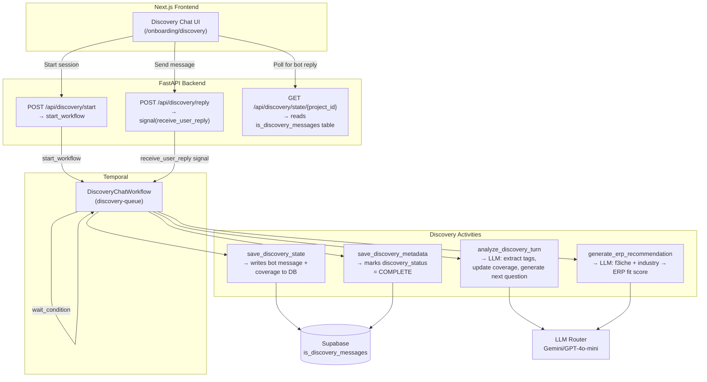
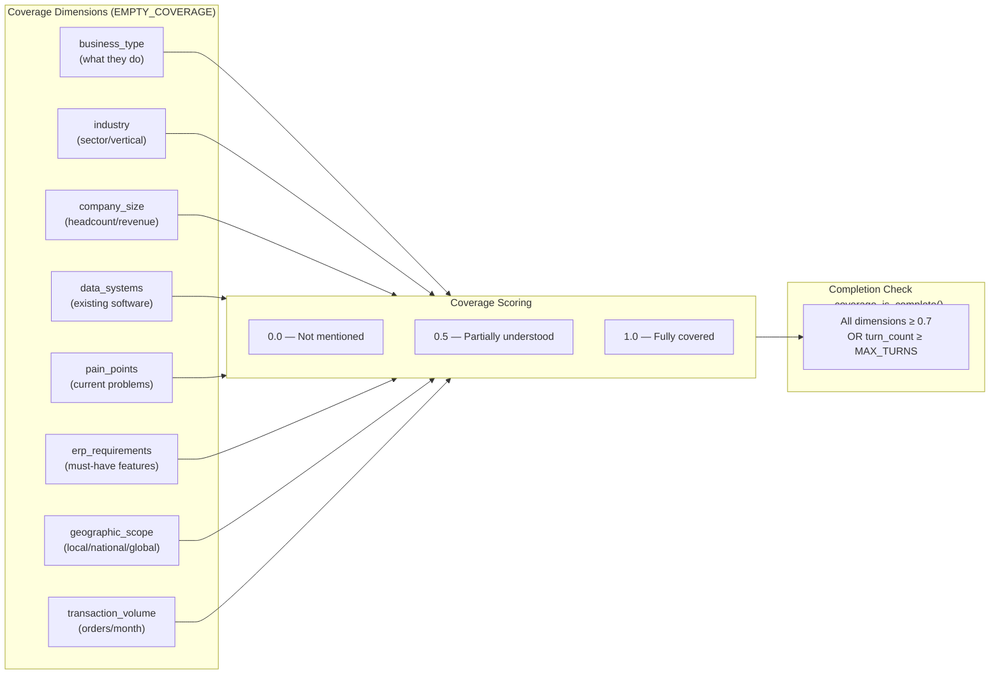

# Discovery Agent — Architecture & Flow

> The Discovery Agent is F3Next's AI business consultant ("Adi"). It conducts a natural, coverage-driven conversation to understand a company's operations, then generates an ERP fit recommendation. One discovery session = one `DiscoveryChatWorkflow` execution.

---

## 🏗️ Component Map

```
containers/discovery/
├── worker.py          ← Worker entrypoint — registers on discovery-queue
├── workflows.py       ← DiscoveryChatWorkflow (Temporal workflow)
├── activities.py      ← All discovery activities (LLM calls, DB writes)
└── prompts.py         ← Prompt templates for Adi's persona
```

---

## 🔄 Workflow Architecture



---

## 🔁 Conversation Loop (Step-by-Step)

```mermaid
flowchart TD
    START(["`**START**
    project_id received`"]) --> INIT

    INIT["Initialize workflow state:
    ─────────────────────────────
    • _coverage = EMPTY_COVERAGE
    • _extracted_tags = []
    • _conversation_history = []
    • _turn_count = 0
    • bot_message = Adi's opening greeting"]

    INIT --> LOOP_START

    subgraph CONVERSATION_LOOP["Conversation Loop (while not complete)"]
        LOOP_START["1. save_discovery_state
        ──────────────────────────────
        Writes to Supabase:
        • is_discovery_messages (bot message)
        • coverage snapshot
        • turn_count, is_complete=False"]

        WAIT["2. wait_condition
        ──────────────────────
        Workflow pauses here.
        Frontend polling sees the message.
        User types a reply.
        Signal: receive_user_reply(message)"]

        ANALYZE["3. analyze_discovery_turn
        ──────────────────────────────────
        LLM call with:
        • user_answer (just received)
        • current_coverage (all dimensions)
        • accumulated_tags
        • conversation_history (last 16 msgs)
        • turn_count
        ────────────────────────────────────
        LLM returns:
        • updated_coverage (per-dimension)
        • extracted_tags (e.g. 'manufacturing')
        • message (Adi's next question)
        • is_complete (bool)
        • status: SUCCESS / RETRY"]

        UPDATE["4. Update workflow state
        ──────────────────────────────
        • Merge coverage scores
        • Accumulate + deduplicate tags
        • Append to conversation history
        • Increment turn_count
        • Check: is_complete OR max_turns?"]

        CHECK{"`is_complete
        OR coverage
        complete?`"}

        LOOP_START --> WAIT
        WAIT --> ANALYZE
        ANALYZE --> UPDATE
        UPDATE --> CHECK
        CHECK -->|"No"| LOOP_START
        CHECK -->|"Yes"| EXIT_LOOP
    end

    EXIT_LOOP["Exit conversation loop"]

    RECOMMEND["generate_erp_recommendation
    ─────────────────────────────────
    LLM call with:
    • all extracted_tags
    • final coverage scores
    ─────────────────────────────────
    Returns:
    • f3iche: 'manufacturing' | 'trading' | 'services' | ...
    • industry: string
    • recommended_erp: 'ERPNext' | ...
    • fit_score: 0.0 - 1.0"]

    SAVE_FINAL["save_discovery_metadata
    ─────────────────────────────────
    Writes to Supabase:
    • discovery_status = COMPLETE
    • f3iche, industry, fit_score
    • recommendation JSON
    ─────────────────────────────────
    IS workflow can now read this
    and auto-start with discovery context"]

    EXIT_LOOP --> RECOMMEND --> SAVE_FINAL

    DONE(["`**DONE**
    {status, tags, coverage, f3iche,
    recommended_erp, fit_score}`"])
    SAVE_FINAL --> DONE
```



---

## 📊 Coverage System

The coverage system tracks how well Adi understands each dimension of the business. The conversation continues until coverage is sufficiently complete or `MAX_TURNS` is reached.



---

## 🏷️ F3iche Classification

After discovery, the system classifies the company into a **F3iche** (pronounced "F-3 niche") — a business archetype that drives all subsequent Implementation and OS behavior:

| F3iche | Description | Example |
|--------|-------------|---------|
| `trading` | Buy-sell distribution business | Wholesale distributor, retailer |
| `manufacturing` | Makes physical products | Factory, OEM, assembler |
| `services` | Delivers professional services | IT firm, consultancy, agency |
| `project` | Project-based work | Construction, EPC, events |
| `hybrid` | Combination of above | Manufacturer + distributor |

---

## 📡 Database Tables Written

| Table | Written By | Contents |
|-------|-----------|---------|
| `is_discovery_messages` | `save_discovery_state` | Chat turn history (bot + user msgs) |
| `is_discovery_coverage` | `save_discovery_state` | Coverage dimension scores per turn |
| `projects` | `save_discovery_metadata` | `discovery_status = COMPLETE` |
| `projects` | `save_discovery_metadata` | `f3iche`, `industry`, `recommended_erp`, `fit_score` |

---

## 🔑 Key Design Decisions

1. **Coverage-driven, not script-driven** — Adi asks follow-up questions based on what's *missing*, not a fixed script. The LLM decides what to ask next based on current coverage gaps.

2. **Signal-based HITL** — The workflow pauses indefinitely (no timeout) waiting for `receive_user_reply`. This means a user can take days to complete discovery; Temporal preserves state.

3. **Conversation history capped at 16 messages** — To prevent context window overflow while still giving the LLM enough conversational context.

4. **Graceful RETRY handling** — If `analyze_discovery_turn` returns `status = RETRY` (LLM parse error), the loop still updates `bot_message` and clears the reply slot without incrementing `turn_count`.
