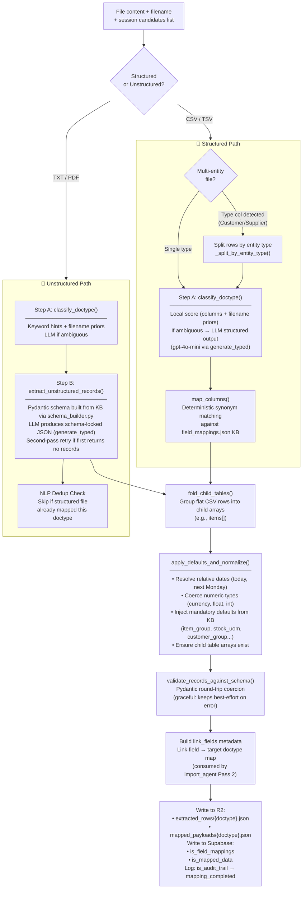
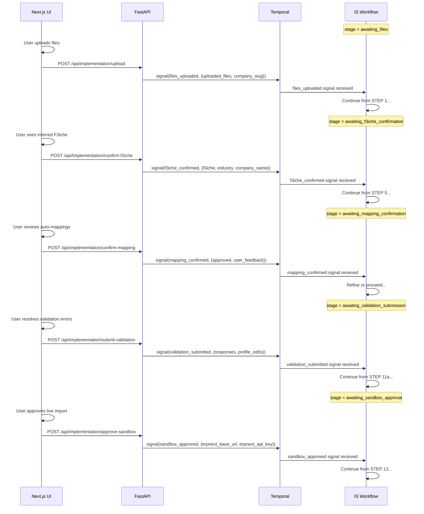
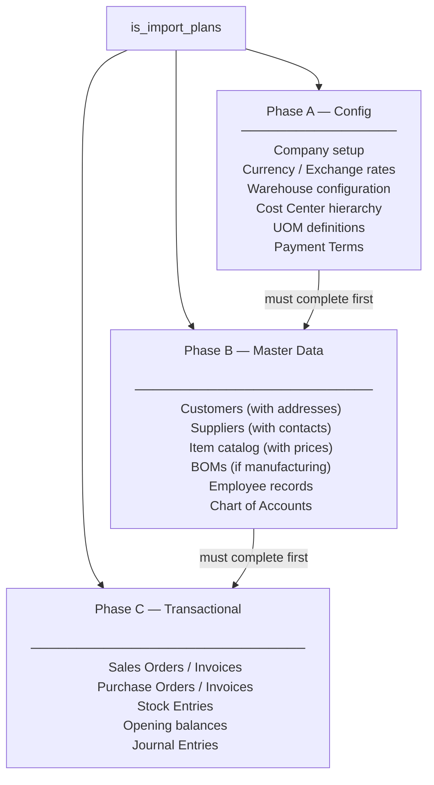

```mermaid
flowchart TD
    classDef direct fill:#1a3a2a,stroke:#2ecc71,color:#a8ffcb
    classDef rag fill:#1a2a3a,stroke:#3498db,color:#a8d8ff
    classDef gap fill:#3a2a1a,stroke:#e67e22,color:#ffd5a8
    classDef node fill:#1e1e2e,stroke:#7c7cff,color:#e0e0ff,rx:6

    subgraph KB["🗄️ Knowledge Base Files"]
        direction TB
        KF1["📄 signals_registry.json\n(common/)"]
        KF2["📄 f3iches/*.json\n(common/f3iches/)"]
        KF3["📄 erpnext_doctype_graph.json\n(erpnext/)"]
        KF4["📄 erpnext_deafaults_baseline.json\n(erpnext/)"]
        KF5["📄 field_mappings.json\n(erpnext/schema/)"]
        KF6["📄 module_docs.json\n(erpnext/docs/)"]
        KF7["🗃️ pgvector kb_embeddings\napqc_pcf | erpnext_docs | f3iche_*"]
    end

    subgraph PIPELINE["⚙️ IS Pipeline Nodes (KB-Touching Only)"]
        direction TB

        N1["Step 3 — Signals Inference\ninfer_f3iche"]
        N2["Step 5 — F3iche Verification\nverify_f3iche"]
        N3["Step 7 — Build Company Profile\nbuild_company_profile"]
        N4["Step 7a — Industry Knowledge Retrieval\nretrieve_industry_knowledge"]
        N5["Step 7b — Profile Enrichment\nenrich_company_profile"]
        N6["Step 8 — Target Structure Builder\nbuild_target_structure"]
        N7["Step 9 — File Mapping\nmap_file_to_erpnext\n(classify_doctype + extract + defaults)"]
        N8["Step 11 — Pre-Import Validation\nvalidate_mapped_data"]
    end

    %% Step 3 — Signals Inference
    KF1 -->|"📂 Direct JSON\nLoads niche_ids + niche_definitions\nto build LLM prompt choices"| N1
    KF7 -->|"🔍 pgvector RAG\nSemantic cross-check after LLM inference\nqueries f3iche_* collection\n(secondary candidate surfacing)"| N1

    %% Step 5 — Verify F3iche (no KB)
    N2 -.->|"No KB access\n(pure logic: broad-category prefix matching\non user vs signals f3iche IDs)"| N2

    %% Step 7 — Build Company Profile
    KF2 -->|"📂 Direct JSON\nLoads f3iche overlay for required_modules,\nrequired_doctypes, workflows, business_reality\n(fallback when RAG returns nothing)"| N3
    KF7 -->|"🔍 pgvector RAG\napqc_pcf (top 5) — process framework\nerpnext_docs (top 5) — ERP module docs\nf3iche_<id> (top 6) — niche narratives\nAll injected into profile-build LLM prompt"| N3

    %% Step 7a — Industry Knowledge Retrieval
    KF7 -->|"🔍 pgvector RAG\napqc_pcf (top 5) — compliance + workflows\nerpnext_docs (top 5) — system docs\nf3iche_<id> (top 6) — niche specifics\nSynthesized by LLM into industry insights"| N4

    %% Step 7b — Profile Enrichment
    KF2 -->|"📂 Direct JSON\nFallback only: if LLM enrichment fails,\nloads required_modules + required_doctypes\nfrom f3iche template"| N5
    KF7 -->|"🔍 pgvector RAG\nerpnext_docs (top 5)\nf3iche_<id> (top 5)\nInjected as rag_context into enrichment prompt"| N5

    %% Step 8 — Target Structure
    KF3 -->|"📂 Direct JSON\nCore usage: BFS graph traversal\nResolves ALL transitive doctype prerequisites\nOrders by dependency layer (0–8)"| N6
    KF4 -->|"📂 Direct JSON\nClassifies each doctype:\nMUST CREATE vs USE DEFAULT vs AUTO\nbased on whether baseline values exist"| N6
    KF2 -->|"📂 Direct JSON\nFallback: loads seed doctypes + modules\nif company profile has no required_doctypes"| N6
    KF7 -->|"🔍 pgvector RAG\nerpnext_docs (top 5) + apqc_pcf (top 4)\nUsed ONLY for LLM reasoning annotation\n(does NOT change setup_steps order)"| N6

    %% Step 9 — Mapping
    KF5 -->|"📂 Direct JSON (lru_cache)\nClassify: column scoring + synonym matching\nagainst doctypes[].field_mappings[].user_input_synonyms\nMap: source column → ERP fieldname\nDefaults: mandatory field injection\nLink fields: extract Link fieldtype + options\nKeyword hints: doctype_keyword_hints for NLP fallback"| N7
    KF3 -->|"📂 Direct JSON (lru_cache)\nUsed by schema_builder.py:\nBuilds Pydantic extraction schema\nfrom required_fields per doctype"| N7
    KF4 -->|"📂 Direct JSON (lru_cache)\napply_defaults_and_normalize():\nInjects item_group, stock_uom,\ncustomer_group, territory defaults"| N7
    KF6 -.->|"⚠️ Gap\nmodule_docs.json exists but is NOT\naccessed by mapping agent.\nPlanned: use for richer field context\nand doctype descriptions in LLM prompts"| N7

    %% Step 11 — Validation
    KF3 -->|"📂 Direct JSON\nRequired field rules per doctype\n(graph.doctypes.<dt>.required_fields)\nFallback: hardcoded _REQUIRED_FIELDS_FALLBACK"| N8
    KF5 -->|"📂 Direct JSON\nEnum rules: Select fieldtype + options\nper doctype field\nFallback: hardcoded _ENUM_FIELDS_FALLBACK"| N8

    %% Styling
    class N1,N2,N3,N4,N5,N6,N7,N8 node
    class KF1,KF2,KF3,KF4,KF5 direct
    class KF7 rag
    class KF6 gap
```

# Implementation System — Architecture & Flow

> The Implementation System (IS) is F3Next's automated ERP onboarding pipeline. It takes a company's raw data files (CSVs, XLSXs, TXTs, PDFs), intelligently maps them to ERPNext's data model via a **two-stage deterministic + LLM pipeline**, and executes a phased import. The full pipeline runs as a Temporal workflow with **6 human-in-the-loop signal gates** (including a Supervisor gate between Data Readiness and Validation).
>
> **Supervisor Agent** sits cross-cutting across the pipeline. After each major node (data readiness, validation), it evaluates the node output, classifies gaps as `critical / important / optional`, calls an LLM for rich natural-language messages, and emits `ask_user` or `auto_fix` actions that the UI renders as interactive prompts. The workflow waits on a `supervisor_response` signal before proceeding.
>
> The current implementation treats uploads as a **corpus**, not a one-file/one-doctype contract: all files in the active upload wave are parsed, upload notes are carried forward into profile/target/readiness prompts, and if the user re-uploads after a supervisor-critical gap the workflow re-runs on the **union of prior + new files**.

**Product backlog (master queue):** [`PRODUCT_BACKLOG.md`](./PRODUCT_BACKLOG.md)  
**Active sprint plan:** [`PRIORITIES.md`](./PRIORITIES.md) (tiers 0–7, pre-demo day plan)  
**IS detail appendix:** [`IS_V2_BACKLOG.md`](./IS_V2_BACKLOG.md) (10 pillars, universal IS bridge)  
**Long-term v2 vision:** [`ARCH_V2_VISION.md`](./ARCH_V2_VISION.md)

---

## 🏗️ Component Map

```
containers/implementation/
├── is_worker.py                   ← Worker entrypoint — is-queue
├── is_workflow/
│   └── workflow.py                ← ImplementationWorkflow (steps + signal gates)
├── virus_scan_agent/
│   └── activities.py              ← virus_scan_quarantine
├── file_io/
│   ├── fetch_clean_files.py       ← Download + parse files from R2
│   ├── persist_session.py         ← Create/update is_sessions row
│   └── persist_audit.py           ← Audit trail writer (log_audit)
├── signals_agent/
│   └── activities.py              ← infer_f3iche, verify_f3iche
├── profile_agent/
│   └── activities.py              ← align_discovery_and_signals,
│                                     retrieve_industry_knowledge,
│                                     build_company_profile,
│                                     enrich_company_profile,
│                                     merge_company_profile
├── target_agent/
│   └── activities.py              ← build_target_structure
│                                     ⚠️ reads mvp_focus from ISSession to bound
│                                        required_doctypes to MVP scope
├── mapping_agent/                 ← ⭐ Upgraded modular pipeline
│   ├── activities.py              ← map_file_to_erpnext, refine_mapping_with_llm,
│   │                                 infer_doctype_from_columns
│   ├── classifier.py              ← Step A: DocType classification
│   │                                 (local scoring → LLM fallback via structured output)
│   ├── extraction.py              ← Step B: Schema-locked unstructured extraction
│   │                                 (Pydantic-constrained generate_typed)
│   ├── defaults.py                ← Deterministic normalization + defaults injection
│   │                                 (fold_child_tables, apply_defaults_and_normalize)
│   ├── schema_builder.py          ← Builds doctype-specific Pydantic schemas from KB
│   ├── kb.py                      ← KB loaders (field_mappings, baseline_defaults)
│   └── prompts.py                 ← REFINE_MAPPING_PROMPT template
├── data_readiness_agent/          ← ⭐ Gap analysis before validation
│   ├── activities.py              ← assess_data_readiness
│   │                                 Deterministic scan → LLM enrichment → gap_report
│   │                                 Writes: is_data_readiness_assessments
│   ├── gap_analyzer.py            ← Pre-analysis: maps files to required doctypes
│   ├── models.py                  ← DataReadinessAssessment, DoctypeGap, DoctypeReady
│   └── prompts.py                 ← DATA_READINESS_PROMPT
├── supervisor_agent/              ← ⭐ Cross-cutting quality gate
│   ├── activities.py              ← supervise_step, apply_supervisor_actions
│   │                                 Evaluates node output → classifies gaps
│   │                                 → LLM generates messages → emits SupervisorActions
│   │                                 Writes: is_supervisor_prompts
│   └── prompts.py                 ← SUPERVISOR_PROMPT
├── validation_agent/
│   └── activities.py              ← validate_mapped_data
│                                     ⚠️ Multi-file payload merge (not overwrite)
│                                     ⚠️ Required-field check spans 10 rows (not 1)
├── import_agent/
│   └── activities.py              ← build_import_plan, execute_import_phase,
│                                     preflight_import (NEW: read-only dry-run report),
│                                     get_import_plan_phases
├── utils/
│   └── llm_helper.py              ← generate_json (LLM helper for IS agents)
├── dev_fixtures/                  ← JSON fixtures for is_harness testing
└── is_harness.py                  ← Dev tool: run any step without Temporal
                                      (Supports --confirm-execution and --step preflight_import)

shared/
├── erp_adapters/
│   ├── erpnext.py                 ← Upgraded with doc status submission, item+company unique constraints
│   └── link_resolver.py           ← NEW: BulkLinkResolver (batch fetching, suffix wildcarding, alias mappings)
└── erp_policies/                  ← NEW: Shared business safety and config policies
    ├── lifecycle.py               ← Auto-submit rule maps (BOM), risk tier filters, disabled-query rules
    └── action_risk.py             ← High-risk doctype classification & confirmation message templates


---

## 🔄 Full 14-Step Pipeline

```mermaid
flowchart TD
    START(["`**START**
    project_id + discovery_meta`"]) --> S0

    S0["**STEP 0 — Session Creation**
    persist_session
    ─────────────────────────────
    Creates is_sessions row in Supabase
    status = awaiting_files
    Returns: session_id (UUID)"]

    S0 --> SIG1{{"⏸️ SIGNAL GATE 1\nfiles_uploaded\n(user uploads CSV/XLSX/TXT/PDF files)"}}

    SIG1 --> S1

    S1["**STEP 1 — Virus Scan**
    virus_scan_quarantine
    ─────────────────────────────
    Scans all uploaded files
    Writes: is_files (virus_scan_status)
    Stores in R2: clean-data/ or quarantine/
    ⚠️ HALT on infected files"]

    S1 --> SCAN_OK{"`All files
    clean?`"}
    SCAN_OK -->|"No"| HALT(["HALT: infected_halt"])
    SCAN_OK -->|"Yes"| S2

    S2["**STEP 2 — Fetch & Parse Clean Files**
    fetch_clean_files
    ─────────────────────────────────────
    Downloads clean files from R2
    Parses: CSV, XLSX, XLS, TSV, PDF, TXT
    Builds file manifest (column names, row counts)
    Writes R2: clean-data/{slug}/{proj}/_manifest/"]

    S2 --> S3

    S3["**STEP 3 — Signals Inference (F3iche Detection)**
    infer_f3iche
    ─────────────────────────────────────
    LLM analyzes file manifest + row samples
    Detects business type signals:
    • Column names (Customer, Supplier, BOM...)
    • Data patterns (invoice numbers, SKUs...)
    Outputs: f3iche, confidence, collected_signals
    Writes: is_file_signals, is_f3iche_scores"]

    S3 --> S4

    S4["**STEP 4 — Update Session**
    persist_session: status = awaiting_f3iche_confirmation"]

    S4 --> SIG2{{"⏸️ SIGNAL GATE 2\nf3iche_confirmed\n(user confirms business type + industry)"}}

    SIG2 --> S5

    S5["**STEP 5 — Verify F3iche**
    verify_f3iche
    ─────────────────────────────────────
    Compares: user_f3iche vs inferred_f3iche
    Flags mismatches for audit trail
    (non-fatal — user's choice wins)"]

    S5 --> S6A

    S6A["**STEP 6a — Discovery-Signals Alignment**
    align_discovery_and_signals
    ─────────────────────────────────────────
    Cross-references Discovery chat intent
    vs. what the uploaded files actually show
    Produces: alignment_score, mismatches[]"]

    S6A --> S7

    S7["**STEP 7 — Build Company Profile**
    build_company_profile
    ─────────────────────────────────────
    Creates is_company_profiles v1 in Supabase
    Writes R2: _profile/company_context_v1.json
    Includes: f3iche, industry, company metadata,
    signal summary, alignment score, uploaded files"]

    S7 --> S7A

    S7A["**STEP 7a — Industry Knowledge Retrieval**
    retrieve_industry_knowledge (LLM Node 2)
    ─────────────────────────────────────────
    Queries pgvector KB for industry best practices
    Returns: industry_differentiators, best_practices"]

    S7A --> S7B

    S7B["**STEP 7b — LLM Profile Enrichment**
    enrich_company_profile (LLM Node 3)
    ──────────────────────────────────────
    LLM reads manifest + profile v1
    Generates: data_quality_score, observations,
    recommended_customizations
    Appends to company profile"]

    S7B --> S8

    S8["**STEP 8 — Build Target Structure**
    build_target_structure
    ─────────────────────────────────────
    LLM determines required ERPNext Doctypes
    and setup sequence based on f3iche + industry
    Outputs: required_doctypes[], setup_steps[]
    Writes: is_target_structures, R2: _target/"]

    S8 --> S9

    S9["**STEP 9 — Automated File Mapping**
    map_file_to_erpnext (per file, structured first)
    ──────────────────────────────────────────────────────
    Two-stage pipeline per file (see Mapping Agent below):
      Step A: classify_doctype (local scoring → LLM fallback)
      Step B: extract + fold + normalize + validate
    Writes: is_field_mappings, is_mapped_data
    Writes R2: mappings/extracted_rows/, mappings/mapped_payloads/
    Logs: is_audit_trail → mapping_completed"]

    S9 --> SIG3{{"⏸️ SIGNAL GATE 3\nmapping_confirmed\n(user reviews auto-mappings)"}}

    SIG3 -->|"approved=True, no feedback"| S11
    SIG3 -->|"user_feedback present"| S10

    S10["**STEP 10 — Conversational Mapping Refinement**
    refine_mapping_with_llm
    ──────────────────────────────────────────────────
    LLM reads user feedback
    Adjusts field mappings accordingly
    updated_mappings[] / removed_mappings[]
    Writes updated is_field_mappings + ISFieldMappingHistory
    Regenerates affected R2 mapped_payloads"]

    S10 --> SIG3

    S11["**STEP 11 — Pre-Import Validation**
    validate_mapped_data
    ─────────────────────────────────────────
    Checks mapped data vs target structure rules:
    • Required fields present?
    • Data types correct?
    • Foreign key references valid?
    Writes: is_validation_results, is_validation_errors
    Updates: is_mapped_data.validation_status
    Writes R2: _validation/report.json"]

    S11 --> SIG4{{"⏸️ SIGNAL GATE 4\nvalidation_submitted\n(user reviews validation, resolves issues)"}}

    SIG4 --> S11A

    S11A["**STEP 11a — Merge Profile Edits (conditional)**
    merge_company_profile
    ─────────────────────────────────────────────
    If user submitted profile_edits:
      Creates new is_company_profiles version
      Patches specified fields
    Writes is_audit_trail → profile_merged"]

    S11A --> S12

    S12["**STEP 12 — Build Import Plan**
    build_import_plan
    ─────────────────────────────────────
    Reads: is_target_structures + is_mapped_data
    Creates 3-phase sequential plan:
      Phase A: Config (Company, Currency, Warehouse...)
      Phase B: Master Data (Customers, Items, Suppliers...)
      Phase C: Transactional (Orders, Invoices, Stock...)
    Writes: is_import_plans, R2: _import_plan/plan.json"]

    S12 --> S125["**STEP 12.5 — Preflight Import**
    preflight_import (NEW)
    ─────────────────────────────────────
    Performs read-only dry-run scan
    Generates telemetry & safety report:
      • Link corrections (WIP -> Work In Progress)
      • Draft parent blockers (draft BOMs)
      • Data gaps & Risk tiers (action_risk)
    Writes: is_validation_results"]

    S125 --> SIG5{{"⏸️ SIGNAL GATE 5\nsandbox_approved\n(user approves live import + reviews risk preview)"}}

    SIG5 --> S13

    S13["**STEP 13 — Execute Import Phases**
    execute_import_phase (per phase)
    ──────────────────────────────────────────────
    Reads phases dynamically from is_import_plans
    For each phase:
      1. Performs pre-execution check: pauses for
         user 'execution_confirmed' if high-risk or draft blockers.
      2. PASS 2.5 (NEW): Bulk Link Resolution
         (Batch fetches links and fuzzy/alias resolves)
      3. PASS 2.6 (NEW): Document Auto-Submit
         (Auto-submits master records like BOM to docstatus=1)
      4. Main Loop: POST /api/resource/{doctype} to ERPNext
      5. Generates resolution_summary & submit_summary
    Writes: is_import_logs, is_import_plans (status)
    Writes is_audit_trail → import_executed"]

    S13 --> S135

    S135["**STEP 13.5 — CVS Bootstrap**
    ─────────────────────────────
    a) cvs_force_sync_for_project
       → Triggers CVS update workflow
       → Populates Supabase with live ERPNext data
    b) register_frappe_webhooks
       → Registers Frappe webhooks on ERPNext
       → Future data changes auto-trigger CVS updates"]

    S135 --> S14

    S14["**STEP 14 — Complete Session**
    persist_session: status = complete
    is_sessions.completed_at = now()"]

    S14 --> DONE(["`**DONE**
    {project_id, session_id, stage: complete}`"])
```



---

## 🗺️ Mapping Agent — Upgraded Two-Stage Architecture

The `mapping_agent` was fully refactored into a modular, deterministic-first pipeline. The old single-LLM approach is replaced by a **Step A → Step B** architecture.



### Key Design Decisions

| Decision | Rationale |
|----------|-----------|
| **Bounded candidate list** | `_get_candidate_doctypes()` intersects `ISTargetStructure.required_doctypes` with KB doctypes, preventing the LLM from hallucinating unknown doctypes |
| **Local scoring first** | Column/filename/keyword scoring runs deterministically; LLM is called only when top score < 4.0 or margin < 1.5 |
| **Structured output only** (`generate_typed`) | Classifier and extractor both use Pydantic-constrained structured outputs — eliminates JSON parse failures |
| **Separation of extraction vs. folding** | Unstructured extraction produces schema-shaped records; structured CSV uses synonym mapping + folding — no mixed path |
| **Defaults injection is LLM-free** | `apply_defaults_and_normalize()` never calls an LLM; all defaults come from `field_mappings.json` + `erpnext_defaults_baseline.json` |
| **NLP dedup** | Unstructured files skip doctypes already mapped by a structured file in the same session, preventing duplicate imports |
| **`link_fields` metadata** | Passed in the R2 payload so `execute_import_phase` Pass 2 knows which fields need pre-seeding |
| **BOM in KB** | `field_mappings.json` includes a full BOM entry with child-field synonyms (`child_item_code`, `child_qty`, `child_uom`, `child_rate`). Without this, BOM CSV columns match Item synonyms and produce ghost Item records without `item_name`. |

---

## 📡 Signal Gates (Human-in-the-Loop)



---

## 🗂️ Import Phase Structure



---

## 🗄️ Database Tables Written

| Table | Step | Contents |
|-------|------|---------|
| `is_sessions` | 0, 4, 8, 14 | Session status, workflow_id, stage |
| `is_files` | 1 | File metadata, virus scan status, R2 paths |
| `is_file_signals` | 3 | Per-file signal extractions |
| `is_f3iche_scores` | 3 | F3iche confidence scores |
| `is_company_profiles` | 7, 7b, 11a | Company profile versions |
| `is_target_structures` | 8 | Required ERPNext doctypes + setup sequence |
| `is_field_mappings` | 9, 10 | Column → ERPNext field mappings |
| `is_field_mapping_history` | 10 | User correction audit log for mapping refinements |
| `is_mapped_data` | 9, 10, 11 | Extracted + mapped data rows |
| `is_validation_results` | 11 | Overall validation status |
| `is_validation_errors` | 11 | Per-field validation errors |
| `is_import_plans` | 12, 13 | Phased import plan + execution status |
| `is_import_logs` | 13 | Per-record import results |
| `is_audit_trail` | all | Full action audit log |
| `context_snapshots` (CVS) | 13.5 | Initial ERPNext data snapshot |

---

## 🧠 Knowledge Base Interaction Map

> Each node gets its own section below. The format is: **Job → What's available at this stage → What KB it needs → Exact Context Engine call shape.** Nodes can only use pipeline artifacts that already exist at their point in the flow.

---

### Pipeline State Accumulation

```
Step 3  → f3iche_id, confidence, signals[]                (is_f3iche_scores)
Step 5  → verified f3iche_id, match_status               (is_f3iche_scores)
Step 6a → alignment_score, mismatches[]
Step 7  → company_profile v1 (modules, doctypes, reality) (is_company_profiles + R2)
Step 7a → industry_differentiators, best_practices
Step 7b → data_quality_score, observations, customizations
Step 8  → target_structure: required_doctypes[], setup_steps[], import_phases{}  (R2 + Supabase)
Step 9  → mapped_payloads/{doctype}.json per file          (R2 + is_mapped_data)
Step 11 → validation_report.json, per-field errors        (R2 + is_validation_results)
```

---

### Node 1 — `infer_f3iche` (Step 3)

**Job:** Look at the uploaded files and decide what type of business this company is.

**Pipeline inputs available:**
- File manifest: filenames + column headers + content snippets (from R2)
- Nothing else — this is the first intelligent step

**Strict KB needed:**
- 📂 `signals_registry.json` → the list of valid `niche_ids` to constrain LLM choices

**Semantic KB needed:**
- 🔍 `f3iche_*` chunks → after LLM picks a niche, cross-check semantically to surface an alternative if the top hit is different

**Context Engine call:**
```json
{
  "intent": "f3iche_detection",
  "f3iche_id": null,
  "query_text": "<filenames + content snippet summary>",
  "collections": ["f3iche"],
  "top_k": 3
}
```
> Returns: top 3 f3iche narrative chunks. Used only for secondary candidate hint — NOT to drive the primary inference.

---

### Node 2 — `verify_f3iche` (Step 5)

**Job:** Compare what the files say (signals) vs what the user confirmed (human signal gate). Flag mismatches non-fatally.

**Pipeline inputs available:**
- `f3iche_id` from signals (Step 3 output)
- `f3iche_id` confirmed by user (Signal Gate 2 payload)

**Strict KB needed:** *(none)*

**Semantic KB needed:** *(none)*

> Pure logic: derives broad category from f3iche ID prefix (`manufacturing_*` → `manufacturing`). No Context Engine call.

---

### Node 3 — `build_company_profile` (Step 7)

**Job:** Assemble a structured profile of the company — what ERP modules they need, what their business reality looks like, what doctypes are likely required.

**Pipeline inputs available:**
- Verified `f3iche_id` + `industry` (from Signal Gate 2)
- File manifest + content snippets (R2)
- Collected signals from Step 3
- Discovery metadata (from `hooks` table via Step 6a)

> ⚠️ **Doctypes are NOT finalized yet.** The profile can only provide a draft `required_doctypes[]` seeded from the f3iche template — the authoritative list comes from Step 8.

**Strict KB needed:**
- 📂 `f3iches/<id>.json` → `required_modules`, `required_doctypes`, `workflows`, `business_reality` (used as fallback when RAG returns nothing)

**Semantic KB needed:**
- 🔍 `apqc_pcf` (top 5) → process framework context for this industry
- 🔍 `erpnext_docs` (top 5) → ERP module docs for the relevant modules
- 🔍 `f3iche_<id>` (top 6) → niche-specific operational narratives

**Context Engine call:**
```json
{
  "intent": "profile_build",
  "f3iche_id": "manufacturing_project_chemical",
  "query_text": "<industry> <f3iche> business operations compliance workflows ERP setup",
  "collections": ["apqc", "erpnext_docs", "f3iche"],
  "top_k": 5
}
```
> Returns: mixed chunks from all 3 layers. Injected into the profile-build LLM prompt as Layer 1/2/3 context blocks.

---

### Node 4 — `retrieve_industry_knowledge` (Step 7a)

**Job:** Pull industry-specific best practices, compliance requirements, and typical ERP workflows to enrich the profile.

**Pipeline inputs available:**
- Verified `f3iche_id`, `industry`, `company_size`
- `industry_differentiators` hint (from Step 6a alignment)
- Company profile v1 (Step 7 output)

**Strict KB needed:** *(none)*

**Semantic KB needed:**
- 🔍 `apqc_pcf` (top 5) → compliance standards + process patterns
- 🔍 `erpnext_docs` (top 5) → system-specific implementation workflows
- 🔍 `f3iche_<id>` (top 6) → niche-specific operational realities

**Context Engine call:**
```json
{
  "intent": "industry_knowledge",
  "f3iche_id": "manufacturing_project_chemical",
  "query_text": "Industry: <industry>. Size: <size>. What compliance, best practices, and workflows are typical?",
  "collections": ["apqc", "erpnext_docs", "f3iche"],
  "top_k": 5
}
```
> Returns: chunks synthesized by LLM into `industry_differentiators[]` and `industry_best_practices{}`.

---

### Node 5 — `enrich_company_profile` (Step 7b)

**Job:** Score the actual uploaded data quality and recommend ERPNext customizations based on what's in the files vs what the niche expects.

**Pipeline inputs available:**
- Company profile v1 from Supabase (Step 7 output: f3iche, modules, doctypes, business_reality)
- File manifest + content snippets (R2)

**Strict KB needed:**
- 📂 `f3iches/<id>.json` → fallback only: if LLM enrichment fails twice, loads `required_modules` + `required_doctypes` from template

**Semantic KB needed:**
- 🔍 `erpnext_docs` (top 5) → ERP implementation customization context
- 🔍 `f3iche_<id>` (top 5) → niche-specific data expectations

**Context Engine call:**
```json
{
  "intent": "profile_enrichment",
  "f3iche_id": "manufacturing_project_chemical",
  "query_text": "<f3iche> <industry> ERPNext implementation recommended customizations data quality",
  "collections": ["erpnext_docs", "f3iche"],
  "top_k": 5
}
```
> Returns: context injected into enrichment prompt alongside actual file snippets and current profile JSON.

---

### Node 6 — `build_target_structure` (Step 8)

**Job:** Determine the authoritative, ordered list of every ERPNext doctype needed — including all transitive prerequisites — and classify each as MUST CREATE / USE DEFAULT / AUTO.

**Pipeline inputs available:**
- Enriched company profile from Supabase (Step 7b output: `required_doctypes[]`, `required_modules[]`, `industry`)
- Verified `f3iche_id`

**Strict KB needed (core — deterministic, no LLM):**
- 📂 `erpnext_doctype_graph.json` → BFS traversal to resolve all transitive prerequisites + layer ordering (0–8)
- 📂 `erpnext_deafaults_baseline.json` → classify each doctype: does a baseline value exist? → USE DEFAULT vs MUST CREATE
- 📂 `f3iches/<id>.json` → fallback only: seed `required_doctypes[]` if company profile is empty

**Semantic KB needed (annotation only — does NOT change setup_steps order):**
- 🔍 `erpnext_docs` (top 5) + `apqc_pcf` (top 4) → LLM reasoning annotation appended to the result

**Context Engine call:**
```json
{
  "intent": "target_structure_reasoning",
  "f3iche_id": "manufacturing_project_chemical",
  "query_text": "<f3iche> ERPNext phase setup doctype dependencies implementation",
  "collections": ["erpnext_docs", "apqc"],
  "top_k": 4
}
```
> ⚠️ The graph-driven `setup_steps[]` is built **before** this call. RAG output only feeds the `llm_reasoning` annotation field — it cannot reorder steps.

---

### Node 7 — `map_file_to_erpnext` (Step 9)

**Job:** For each uploaded file, figure out which ERPNext doctype it maps to, map its columns to ERP fields, extract and normalize records, inject mandatory defaults.

**Pipeline inputs available:**
- `required_doctypes[]` from `ISTargetStructure` (Step 8 output) — used to constrain candidate list
- File content from R2 manifest

**Strict KB needed (all deterministic, LRU-cached):**
- 📂 `field_mappings.json` → everything: doctype scoring (synonym matching), column→field mapping, keyword hints for NLP, `Link` field metadata, mandatory defaults list
- 📂 `erpnext_doctype_graph.json` → `schema_builder.py` reads `required_fields` per doctype to build Pydantic extraction schema
- 📂 `erpnext_deafaults_baseline.json` → `apply_defaults_and_normalize()` injects `item_group`, `stock_uom`, `customer_group`, `territory`

**Semantic KB needed:** *(none currently)*

**Context Engine call:** *(not called — mapping is fully deterministic)*

> ⚠️ **Gap:** `module_docs.json` is not wired. Planned: use doctype descriptions from `module_docs.json` to improve LLM extraction prompts for unstructured files.

---

### Node 8 — `validate_mapped_data` (Step 11)

**Job:** Check every mapped payload against ERPNext's rules — required fields present, enums valid, data types correct, coverage adequate.

**Pipeline inputs available:**
- `target_structure` from `ISTargetStructure` (Step 8: `required_doctypes[]`, `validation_rules{}`)
- `mapped_payloads/{doctype}.json` from R2 (Step 9 output) — **merged** across all source files

**Strict KB needed:**
- 📂 `erpnext_doctype_graph.json` → `required_fields` per doctype (hardcoded fallback if not in graph)
- 📂 `field_mappings.json` → `Select` fieldtype options per field for enum validation (hardcoded fallback)

**Semantic KB needed:** *(none — validation is fully deterministic)*

**Context Engine call:** *(not called)*

**Critical Implementation Rules:**

| Rule | Detail |
|------|--------|
| **Multi-file payload merge** | When multiple source files map to the same doctype (e.g. `01_gs_master_items.csv` AND `03_gs_bom_recipes.csv` both produce Item records), payloads are **merged** — richest records (most fields per row) go first. The old behaviour of silently overwriting the previous payload caused valid `item_name` records to be replaced by BOM child rows that had no `item_name`. |
| **Required-field check spans 10 rows** | The required-field check scans the first 10 records, not just `rows[0]`. A field is only flagged missing if it is absent from **all** sample rows. This prevents false positives when the first record comes from a partial mapping (e.g. a BOM child row merged before the master items rows). |

> ⚠️ **Gap:** `erpnext/schema/validation_rules.json` exists but is not consumed. Should become the primary source for both required fields and enum rules, replacing the hardcoded `_REQUIRED_FIELDS_FALLBACK` and `_ENUM_FIELDS_FALLBACK` dicts.

---

### KB Files Status Summary

| KB File | Used By | Access | Status |
|---------|---------|--------|--------|
| `signals_registry.json` | Node 1 (infer_f3iche) | 📂 Direct | ✅ Active |
| `f3iches/<id>.json` | Nodes 3, 5, 6 | 📂 Direct (fallback) | ✅ Active |
| `erpnext_doctype_graph.json` | Nodes 6, 7, 8 | 📂 Direct | ✅ Active (core) |
| `erpnext_deafaults_baseline.json` | Nodes 6, 7 | 📂 Direct | ✅ Active |
| `field_mappings.json` | Nodes 7, 8 | 📂 Direct (cached) | ✅ Active (core) |
| `field_mappings.json → BOM entry` | Node 7 (map_file_to_erpnext) | 📂 Direct (cached) | ✅ **Added** — child_item_code, child_qty, child_uom, child_rate synonyms |
| `pgvector: apqc_pcf` | Nodes 3, 4, 6 | 🔍 RAG | ✅ Seeded |
| `pgvector: erpnext_docs` | Nodes 3, 4, 5, 6 | 🔍 RAG | ✅ Seeded (scraped) |
| `pgvector: f3iche_*` | Nodes 1, 3, 4, 5 | 🔍 RAG | ✅ Seeded |
| `module_docs.json` | *(none)* | ⚠️ Gap | Planned: seed as `erpnext_module_docs`, use in Node 7 NLP prompts |
| `validation_rules.json` | *(none)* | ⚠️ Gap | Planned: primary source for Node 8, replace hardcoded fallbacks |

---



---

### Node-by-Node KB Summary

| Step | Node | KB Files Used | Access | Purpose |
|------|------|---------------|--------|---------|
| **3** | `infer_f3iche` | `signals_registry.json` | 📂 Direct | Loads `niche_ids` list to constrain LLM output choices |
| **3** | `infer_f3iche` | `kb_embeddings` → `f3iche_*` | 🔍 RAG | Semantic cross-check post-LLM; surfaces secondary niche candidate |
| **5** | `verify_f3iche` | *(none)* | — | Pure logic; derives broad category from f3iche ID prefix |
| **7** | `build_company_profile` | `f3iches/<id>.json` | 📂 Direct | Fallback for required_modules/workflows when RAG returns nothing |
| **7** | `build_company_profile` | `kb_embeddings` → `apqc_pcf`, `erpnext_docs`, `f3iche_*` | 🔍 RAG | All three layers injected into profile-build LLM prompt |
| **7a** | `retrieve_industry_knowledge` | `kb_embeddings` → `apqc_pcf`, `erpnext_docs`, `f3iche_*` | 🔍 RAG | Full 3-layer retrieval; LLM synthesizes compliance + workflow insights |
| **7b** | `enrich_company_profile` | `f3iches/<id>.json` | 📂 Direct | Fallback only (LLM failure path) for required_modules/doctypes |
| **7b** | `enrich_company_profile` | `kb_embeddings` → `erpnext_docs`, `f3iche_*` | 🔍 RAG | Enrichment context injected into data-quality scoring prompt |
| **8** | `build_target_structure` | `erpnext_doctype_graph.json` | 📂 Direct | **Core**: BFS prerequisite resolution, layer ordering, setup_steps |
| **8** | `build_target_structure` | `erpnext_deafaults_baseline.json` | 📂 Direct | Classifies each doctype: MUST CREATE / USE DEFAULT / AUTO |
| **8** | `build_target_structure` | `f3iches/<id>.json` | 📂 Direct | Fallback: seed doctypes if company profile is empty |
| **8** | `build_target_structure` | `kb_embeddings` → `erpnext_docs`, `apqc_pcf` | 🔍 RAG | LLM reasoning annotation only (does NOT affect step order) |
| **9** | `map_file_to_erpnext` | `field_mappings.json` | 📂 Direct (cached) | **Core**: doctype scoring, column→field synonym mapping, link fields, keyword hints, defaults injection |
| **9** | `map_file_to_erpnext` | `erpnext_doctype_graph.json` | 📂 Direct (cached) | `schema_builder.py`: builds Pydantic extraction schema from `required_fields` |
| **9** | `map_file_to_erpnext` | `erpnext_deafaults_baseline.json` | 📂 Direct (cached) | `apply_defaults_and_normalize()`: injects mandatory defaults |
| **9** | `map_file_to_erpnext` | `module_docs.json` | ⚠️ **Gap** | Exists but not wired; planned for richer doctype context in LLM prompts |
| **11** | `validate_mapped_data` | `erpnext_doctype_graph.json` | 📂 Direct | Required fields per doctype (with hardcoded fallback) |
| **11** | `validate_mapped_data` | `field_mappings.json` | 📂 Direct | Enum / Select field allowed values (with hardcoded fallback) |

---

### KB Files NOT Yet Used by Any Node

| File | Status | Planned Role |
|------|--------|--------------|
| `module_docs.json` | ⚠️ Gap — exists, no seeder, no consumer | Curated doctype docs → seed into pgvector as `erpnext_module_docs`; replace scraped `erpnext_docs` collection |
| `erpnext/schema/validation_rules.json` | ⚠️ Gap — exists | Should feed `validate_mapped_data` as primary rules source (currently fallback hardcoded in `_REQUIRED_FIELDS_FALLBACK`) |
| `common/intent_definitions.json` | ✅ Used by OS Agent / Discovery | Not part of IS pipeline |
| `common/command_patterns.json` | ✅ Used by OS Agent | Not part of IS pipeline |

---

## 🐛 Bugs Fixed (Session Log)

This section tracks bugs that were silent — no code crash, no LLM failure — but produced wrong results. Documented here so each becomes a regression test assertion.

| # | Component | Bug | Root Cause | Fix |
|---|-----------|-----|-----------|-----|
| 1 | `target_agent` | `mvp_focus` never read → 793 doctypes instead of MVP-scoped set | `ISSession` not imported in `activities.py` | Added `from shared.models.is_models import ISSession` |
| 2 | `supervisor_agent` | Workflow deadlocked waiting for `supervisor_response` signal | `actions: []` in DB → UI had nothing to render → signal could never arrive | Added fallback `ask_user` action when `assess_data_readiness` produces no actions; gap_report now stores `criticality` field |
| 3 | `data_readiness_agent` | `critical_gaps` and `important_gaps` always empty → supervisor skipped all actions | `gap_report` stored raw `pre_analysis` dicts which have no `criticality` key; supervisor filter `g.get("criticality") == "critical"` always returned `False` | `gap_report` now stores enriched `DoctypeGap` objects with `criticality` set via `_criticality_from_phase()` |
| 4 | `validation_agent` | `item_name` reported missing even though `01_gs_master_items.csv` has it | Two files both mapped to Item doctype; second file's payload **overwrote** first file's payload (`mapped_data[doctype] = payload_json`); second file (BOM) had no `item_name` column | Payloads are now **merged** — richest records (most fields per row) placed first |
| 5 | `validation_agent` | `item_name` still missing even after merge fix | Required-field check only inspected `rows[0]`; if first merged record was a BOM child row with no `item_name`, the entire doctype was flagged | Check now scans first 10 rows; field is only missing if absent from ALL of them |
| 6 | `mapping_agent` + `field_mappings.json` | BOM CSV (`03_gs_bom_recipes.csv`) produced ghost Item records without `item_name` | BOM had **no entry** in `field_mappings.json`; `map_columns(columns, "BOM")` returned empty dict; BOM CSV columns (`item`, `quantity`, `uom`) matched Item synonyms exactly and were classified as Item instead | Added full BOM doctype entry to `field_mappings.json` with parent + child field synonyms |

---

## 🔭 Pipeline Correctness Layer (Planned)

> **The Tier 3 observability gap** — Sentry catches code crashes. Langsmith tracks LLM quality. But neither catches silent logic errors: code runs clean, LLM responds correctly, output is wrong.

Every bug in the table above was a Tier 3 failure. The solution is **Step-Level Assertion Checkpoints**.

### Design

Each Temporal activity extends `NodeStatusEnvelope` with a `telemetry` block:

```python
class StepAssertion(BaseModel):
    name: str           # e.g. "item_name_present_in_records"
    expected: str       # e.g. "present in >= 80% of rows"
    actual: str         # e.g. "present in 0% of rows (BOM file overwrote master)"
    passed: bool
    severity: Literal["critical", "warning", "info"]
```

Assertions are persisted to `is_step_telemetry` (planned table) and visualised in a **Pipeline Inspector** UI — a step timeline showing each node as green/amber/red with click-to-expand input→output diffs.

### Assertion Examples per Agent

| Agent | Assertion | Would have caught |
|-------|-----------|-------------------|
| `target_agent` | `mvp_focus_loaded: mvp_focus is not None` | Bug #1 |
| `supervisor_agent` | `actions_not_empty_when_status_partial` | Bug #2 |
| `data_readiness_agent` | `criticality_set_on_all_gaps` | Bug #3 |
| `validation_agent` | `no_payload_lost: after_count >= before_count` | Bug #4 |
| `validation_agent` | `required_field_coverage_per_field: item_name in >= 80% rows` | Bug #5 |
| `mapping_agent` | `bom_doctype_has_kb_entry` | Bug #6 |

### Implementation Plan
- **Phase 1** — Add `is_step_telemetry` table + `StepAssertion` to `NodeStatusEnvelope`; instrument mapping, validation, supervisor
- **Phase 2** — Pipeline Inspector UI at `/implementation/[id]/health`
- **Phase 3** — Alerting: webhook on `severity=critical` assertion failures; each bug above becomes a permanent assertion

---

## ⭐ Advanced ERP Data Integration & Resolution (V2)

To automate enterprise ERP implementations, F3Next must handle hierarchical, stateful, and conditional business constraints. Simple flat-file imports fail when references mismatch or when parent records are in the wrong lifecycle state. F3Next V2 introduces **Pass 2.5 (Bulk Link Resolution)** and **Pass 2.6 (Document Lifecycle & Auto-Submit)** to resolve these constraints.

### 1. The ERP Data Resolution Matrix

F3Next maps, normalizes, and resolves reference values using the following 7-scenario matrix:

| Scenario | Condition | System Action Required |
|---|---|---|
| **1. Exact Match** | Reference is present and spelled perfectly. | **Bind & Execute:** Map the exact ID and proceed. |
| **2. Fuzzy Match** | Reference is spelled differently (e.g., "Whouse 1" vs "Warehouse 1"). | **Fuzzy Resolution:** Normalizes case, spacing, and uses semantic distance to resolve the correct ID. |
| **3. Duplicate Conflict** | Reference matches multiple active records (e.g., "Tata" matches "Tata Motors" and "Tata Steel"). | **Tie-Breaker:** Halts and prompts the user via the Supervisor gate to resolve ambiguity. |
| **4. State Violation** | Reference exists but its state is invalid (e.g., Warehouse is disabled). | **State Override / Halt:** Check permissions to auto-enable, else flag as blocker in Preflight. |
| **5. Rule Violation** | Reference exists but breaks a business constraint (e.g., parent BOM is in draft status, blocking a Work Order). | **Pass 2.6 (Auto-Submit):** Transition parent record to active/submitted state prior to downstream imports. |
| **6. Simple Missing** | Reference is missing and has no dependencies. | **Auto-Create:** Dynamic seeder creates the reference record on the fly. |
| **7. Cascading Missing** | Reference is missing and itself depends on other missing records. | **Recursive Resolution:** Traverses the doctype schema graph to create dependencies in setup order. |

### 2. Pass 2.5 — Bulk Link Pre-Resolution
Component: [link_resolver.py](file:///c:/dev/F3Next/shared/erp_adapters/link_resolver.py)

Rather than query ERPNext per-row inside the execution loop (which causes N+1 query latency and performance issues), F3Next uses a bulk resolution pass inside the workflow step before the import loop runs:

```
Pass 1 → Pass 1B (Base Seeds) → Pass 2 (Dynamic Seeds) → Pass 2.5 (Bulk Link Pre-Resolution) → Main Import Loop
```

- **Scan and Collect:** `BulkLinkResolver.collect_link_targets_from_rows()` scans both top-level and nested child table rows for fields of `Link` type.
- **Single-Batch Query:** Fetches live active values from ERPNext using a single batched `list_records` query per linked doctype (e.g., fetching all active Warehouses, Items, and Customers once).
- **Wildcard and Alias Resolution:** Normalizes case, removes hyphens, and applies suffix wildcarding (e.g. `WIP - Factory` → `WIP - GS`).
- **Semantic Mapping:** Integrates manufacturing and corporate alias normalization rules (e.g., maps `WIP` to `Work In Progress` and `FG` to `Finished Goods` matching company abbreviation suffixes, dynamically mapping `WIP - Factory` to `Work In Progress - GS` in the target instance).
- **In-Memory Rewrite:** Pre-resolved payloads are cached in `_pre_resolved_cache` with rewritten fields, avoiding API-side `LinkValidationError` failures.

### 3. Pass 2.6 — Document Lifecycle & Auto-Submit
Components: [lifecycle.py](file:///c:/dev/F3Next/shared/erp_policies/lifecycle.py), [activities.py](file:///c:/dev/F3Next/containers/implementation/import_agent/activities.py)

Certain master documents (like Bills of Materials — BOMs) are created in a draft state (`docstatus=0`) by default, but ERP business logic requires them to be **Submitted** (`docstatus=1`) before downstream transactional records (like Work Orders) can reference them.
- **Lifecycle Policy Map:** `shared/erp_policies/lifecycle.py` holds policy configurations mapping submittable doctypes that require automatic submission (`auto_submit_on_import`).
- **Auto-Submission Act:** Immediately following a successful `create_record` call on a configured doctype, the adapter calls `submit_document` using a custom client submission method (`POST /api/method/frappe.client.submit` with a PUT fallback).
- **Audit Telemetry:** Summarizes actions in `submit_summary` under execution logs, indicating exactly which records were created and successfully committed.

### 4. High-Reliability BOM Idempotency
Component: [erpnext.py](file:///c:/dev/F3Next/shared/erp_adapters/erpnext.py)

BOM names are typically auto-generated or system-assigned, making standard name-based idempotency checks fragile on import retry.
- **Unique Constraint Lookup:** F3Next queries existing records using the composite key of **`item` + `company`** to determine if a BOM has already been generated for this item in the client company.
- **Duplicate Prevention:** If found, the system skips duplicate creation and returns the canonical existing BOM name, keeping ERPNext clean and preventing duplicate draft pollution.

### 5. Preflight Safety Gate & Action Risk Classification
Components: [activities.py](file:///c:/dev/F3Next/containers/implementation/import_agent/activities.py), [action_risk.py](file:///c:/dev/F3Next/shared/erp_policies/action_risk.py)

Before live import writes are executed against a client's production ERP system, a read-only **Preflight Gate** runs to identify risk exposure and state issues.
- **Validation Scan:** `preflight_import` executes a dry-run to identify:
  - `link_corrections`: Previews of alias resolutions (e.g. `WIP - Factory` → `Work In Progress - GS`).
  - `draft_parents`: Identifies draft records (e.g., a draft BOM) that would block downstream transactions.
  - `data_gaps`: Missing files or mappings for plan steps.
  - `warnings`: Financial or data anomalies.
- **Risk Tiering:** `shared/erp_policies/action_risk.py` classifies setup steps by risk levels (`low`, `medium`, `high`, `critical`) and constructs a rich preview message warning of draft blockers and financial implications.
- **Temporal Signal Barrier:** If high-risk actions or draft blockers are detected, the workflow returns `awaiting_confirmation` and halts. Execution only proceeds once a human supervisor approves via the `execution_confirmed` signal.

---

## 🔧 Dev Tool: IS Harness

The `is_harness.py` allows running any single IS step in isolation without Temporal:

```bash
# Test F3iche inference without burning LLM tokens
python -m containers.implementation.is_harness --step infer_f3iche --mock-llm

# Dry-run Phase A (no ERPNext writes)
python -m containers.implementation.is_harness --step execute_import_phase --phase phase_a_config --dry-run

# Test target structure builder against real LLM
python -m containers.implementation.is_harness --step build_target_structure

# Test file mapping with a real file manifest
python -m containers.implementation.is_harness --step map_file_to_erpnext

# Dry-run Phase D (Projects):
python -m containers.implementation.is_harness --step execute_import_phase --phase phase_d_projects --dry-run
```

**Available steps:** `virus_scan_quarantine`, `fetch_clean_files`, `infer_f3iche`, `verify_f3iche`, `align_discovery_and_signals`, `retrieve_industry_knowledge`, `build_company_profile`, `enrich_company_profile`, `merge_company_profile`, `build_target_structure`, `map_file_to_erpnext`, `refine_mapping_with_llm`, `validate_mapped_data`, `build_import_plan`, `execute_import_phase`
