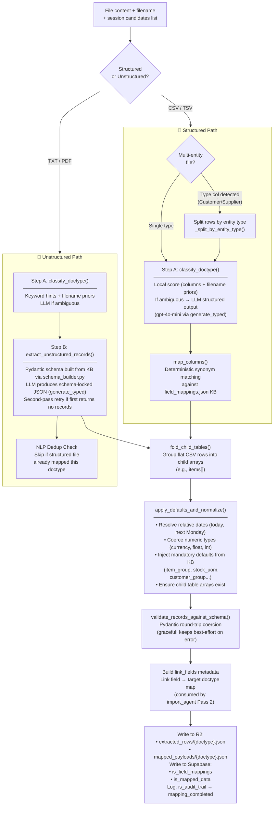
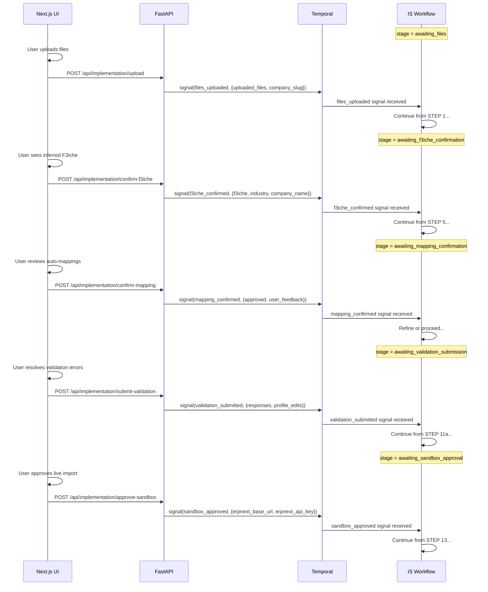
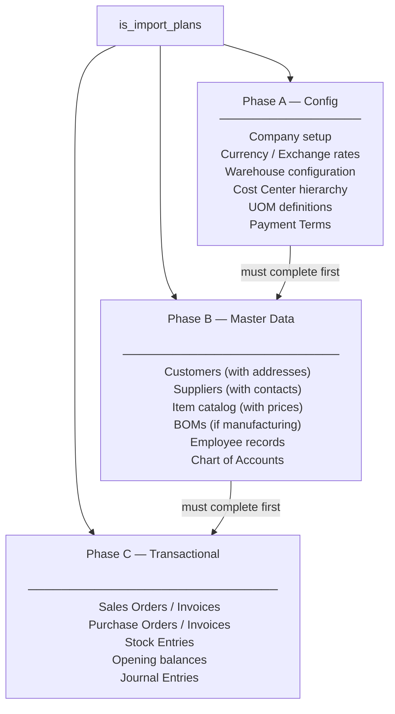

# Implementation System — Architecture & Flow

> The Implementation System (IS) is F3Next's automated ERP onboarding pipeline. It takes a company's raw data files (CSVs, XLSXs, TXTs, PDFs), intelligently maps them to ERPNext's data model via a **two-stage deterministic + LLM pipeline**, and executes a phased import. The full pipeline runs as a single 14-step Temporal workflow with 5 human-in-the-loop signal gates.

---

## 🏗️ Component Map

```
containers/implementation/
├── is_worker.py                   ← Worker entrypoint — is-queue
├── is_workflow/
│   └── workflow.py                ← ImplementationWorkflow (14 steps)
├── virus_scan_agent/
│   └── activities.py              ← virus_scan_quarantine
├── file_io/
│   ├── fetch_clean_files.py       ← Download + parse files from R2
│   ├── persist_session.py         ← Create/update is_sessions row
│   └── persist_audit.py           ← Audit trail writer (log_audit)
├── signals_agent/
│   └── activities.py              ← infer_f3iche, verify_f3iche
├── profile_agent/
│   └── activities.py              ← align_discovery_and_signals,
│                                     retrieve_industry_knowledge,
│                                     build_company_profile,
│                                     enrich_company_profile,
│                                     merge_company_profile
├── target_agent/
│   └── activities.py              ← build_target_structure
├── mapping_agent/                 ← ⭐ Upgraded modular pipeline
│   ├── activities.py              ← map_file_to_erpnext, refine_mapping_with_llm,
│   │                                 infer_doctype_from_columns
│   ├── classifier.py              ← Step A: DocType classification
│   │                                 (local scoring → LLM fallback via structured output)
│   ├── extraction.py              ← Step B: Schema-locked unstructured extraction
│   │                                 (Pydantic-constrained generate_typed)
│   ├── defaults.py                ← Deterministic normalization + defaults injection
│   │                                 (fold_child_tables, apply_defaults_and_normalize)
│   ├── schema_builder.py          ← Builds doctype-specific Pydantic schemas from KB
│   ├── kb.py                      ← KB loaders (field_mappings, baseline_defaults)
│   └── prompts.py                 ← REFINE_MAPPING_PROMPT template
├── validation_agent/
│   └── activities.py              ← validate_mapped_data
├── import_agent/
│   └── activities.py              ← build_import_plan, execute_import_phase,
│                                     get_import_plan_phases
├── utils/
│   └── llm_helper.py              ← generate_json (LLM helper for IS agents)
├── dev_fixtures/                  ← JSON fixtures for is_harness testing
└── is_harness.py                  ← Dev tool: run any step without Temporal
```

---

## 🔄 Full 14-Step Pipeline

```mermaid
flowchart TD
    START(["`**START**
    project_id + discovery_meta`"]) --> S0

    S0["**STEP 0 — Session Creation**
    persist_session
    ─────────────────────────────
    Creates is_sessions row in Supabase
    status = awaiting_files
    Returns: session_id (UUID)"]

    S0 --> SIG1{{"⏸️ SIGNAL GATE 1\nfiles_uploaded\n(user uploads CSV/XLSX/TXT/PDF files)"}}

    SIG1 --> S1

    S1["**STEP 1 — Virus Scan**
    virus_scan_quarantine
    ─────────────────────────────
    Scans all uploaded files
    Writes: is_files (virus_scan_status)
    Stores in R2: clean-data/ or quarantine/
    ⚠️ HALT on infected files"]

    S1 --> SCAN_OK{"`All files
    clean?`"}
    SCAN_OK -->|"No"| HALT(["HALT: infected_halt"])
    SCAN_OK -->|"Yes"| S2

    S2["**STEP 2 — Fetch & Parse Clean Files**
    fetch_clean_files
    ─────────────────────────────────────
    Downloads clean files from R2
    Parses: CSV, XLSX, XLS, TSV, PDF, TXT
    Builds file manifest (column names, row counts)
    Writes R2: clean-data/{slug}/{proj}/_manifest/"]

    S2 --> S3

    S3["**STEP 3 — Signals Inference (F3iche Detection)**
    infer_f3iche
    ─────────────────────────────────────
    LLM analyzes file manifest + row samples
    Detects business type signals:
    • Column names (Customer, Supplier, BOM...)
    • Data patterns (invoice numbers, SKUs...)
    Outputs: f3iche, confidence, collected_signals
    Writes: is_file_signals, is_f3iche_scores"]

    S3 --> S4

    S4["**STEP 4 — Update Session**
    persist_session: status = awaiting_f3iche_confirmation"]

    S4 --> SIG2{{"⏸️ SIGNAL GATE 2\nf3iche_confirmed\n(user confirms business type + industry)"}}

    SIG2 --> S5

    S5["**STEP 5 — Verify F3iche**
    verify_f3iche
    ─────────────────────────────────────
    Compares: user_f3iche vs inferred_f3iche
    Flags mismatches for audit trail
    (non-fatal — user's choice wins)"]

    S5 --> S6A

    S6A["**STEP 6a — Discovery-Signals Alignment**
    align_discovery_and_signals
    ─────────────────────────────────────────
    Cross-references Discovery chat intent
    vs. what the uploaded files actually show
    Produces: alignment_score, mismatches[]"]

    S6A --> S7

    S7["**STEP 7 — Build Company Profile**
    build_company_profile
    ─────────────────────────────────────
    Creates is_company_profiles v1 in Supabase
    Writes R2: _profile/company_context_v1.json
    Includes: f3iche, industry, company metadata,
    signal summary, alignment score, uploaded files"]

    S7 --> S7A

    S7A["**STEP 7a — Industry Knowledge Retrieval**
    retrieve_industry_knowledge (LLM Node 2)
    ─────────────────────────────────────────
    Queries pgvector KB for industry best practices
    Returns: industry_differentiators, best_practices"]

    S7A --> S7B

    S7B["**STEP 7b — LLM Profile Enrichment**
    enrich_company_profile (LLM Node 3)
    ──────────────────────────────────────
    LLM reads manifest + profile v1
    Generates: data_quality_score, observations,
    recommended_customizations
    Appends to company profile"]

    S7B --> S8

    S8["**STEP 8 — Build Target Structure**
    build_target_structure
    ─────────────────────────────────────
    LLM determines required ERPNext Doctypes
    and setup sequence based on f3iche + industry
    Outputs: required_doctypes[], setup_steps[]
    Writes: is_target_structures, R2: _target/"]

    S8 --> S9

    S9["**STEP 9 — Automated File Mapping**
    map_file_to_erpnext (per file, structured first)
    ──────────────────────────────────────────────────────
    Two-stage pipeline per file (see Mapping Agent below):
      Step A: classify_doctype (local scoring → LLM fallback)
      Step B: extract + fold + normalize + validate
    Writes: is_field_mappings, is_mapped_data
    Writes R2: mappings/extracted_rows/, mappings/mapped_payloads/
    Logs: is_audit_trail → mapping_completed"]

    S9 --> SIG3{{"⏸️ SIGNAL GATE 3\nmapping_confirmed\n(user reviews auto-mappings)"}}

    SIG3 -->|"approved=True, no feedback"| S11
    SIG3 -->|"user_feedback present"| S10

    S10["**STEP 10 — Conversational Mapping Refinement**
    refine_mapping_with_llm
    ──────────────────────────────────────────────────
    LLM reads user feedback
    Adjusts field mappings accordingly
    updated_mappings[] / removed_mappings[]
    Writes updated is_field_mappings + ISFieldMappingHistory
    Regenerates affected R2 mapped_payloads"]

    S10 --> SIG3

    S11["**STEP 11 — Pre-Import Validation**
    validate_mapped_data
    ─────────────────────────────────────────
    Checks mapped data vs target structure rules:
    • Required fields present?
    • Data types correct?
    • Foreign key references valid?
    Writes: is_validation_results, is_validation_errors
    Updates: is_mapped_data.validation_status
    Writes R2: _validation/report.json"]

    S11 --> SIG4{{"⏸️ SIGNAL GATE 4\nvalidation_submitted\n(user reviews validation, resolves issues)"}}

    SIG4 --> S11A

    S11A["**STEP 11a — Merge Profile Edits (conditional)**
    merge_company_profile
    ─────────────────────────────────────────────
    If user submitted profile_edits:
      Creates new is_company_profiles version
      Patches specified fields
    Writes is_audit_trail → profile_merged"]

    S11A --> S12

    S12["**STEP 12 — Build Import Plan**
    build_import_plan
    ─────────────────────────────────────
    Reads: is_target_structures + is_mapped_data
    Creates 3-phase sequential plan:
      Phase A: Config (Company, Currency, Warehouse...)
      Phase B: Master Data (Customers, Items, Suppliers...)
      Phase C: Transactional (Orders, Invoices, Stock...)
    Writes: is_import_plans, R2: _import_plan/plan.json"]

    S12 --> SIG5{{"⏸️ SIGNAL GATE 5\nsandbox_approved\n(user approves live import)"}}

    SIG5 --> S13

    S13["**STEP 13 — Execute Import Phases**
    execute_import_phase (per phase)
    ──────────────────────────────────────────────
    Reads phases dynamically from is_import_plans
    For each phase:
      POST /api/resource/{doctype} to ERPNext
      Per-record import with error handling
    Pass 2: Seeds Link field dependencies before import
    Writes: is_import_logs, is_import_plans (status)
    Writes is_audit_trail → import_executed"]

    S13 --> S135

    S135["**STEP 13.5 — CVS Bootstrap**
    ─────────────────────────────
    a) cvs_force_sync_for_project
       → Triggers CVS update workflow
       → Populates Supabase with live ERPNext data
    b) register_frappe_webhooks
       → Registers Frappe webhooks on ERPNext
       → Future data changes auto-trigger CVS updates"]

    S135 --> S14

    S14["**STEP 14 — Complete Session**
    persist_session: status = complete
    is_sessions.completed_at = now()"]

    S14 --> DONE(["`**DONE**
    {project_id, session_id, stage: complete}`"])
```



---

## 🗺️ Mapping Agent — Upgraded Two-Stage Architecture

The `mapping_agent` was fully refactored into a modular, deterministic-first pipeline. The old single-LLM approach is replaced by a **Step A → Step B** architecture.



### Key Design Decisions

| Decision | Rationale |
|----------|-----------|
| **Bounded candidate list** | `_get_candidate_doctypes()` intersects `ISTargetStructure.required_doctypes` with KB doctypes, preventing the LLM from hallucinating unknown doctypes |
| **Local scoring first** | Column/filename/keyword scoring runs deterministically; LLM is called only when top score < 4.0 or margin < 1.5 |
| **Structured output only** (`generate_typed`) | Classifier and extractor both use Pydantic-constrained structured outputs — eliminates JSON parse failures |
| **Separation of extraction vs. folding** | Unstructured extraction produces schema-shaped records; structured CSV uses synonym mapping + folding — no mixed path |
| **Defaults injection is LLM-free** | `apply_defaults_and_normalize()` never calls an LLM; all defaults come from `field_mappings.json` + `erpnext_defaults_baseline.json` |
| **NLP dedup** | Unstructured files skip doctypes already mapped by a structured file in the same session, preventing duplicate imports |
| **`link_fields` metadata** | Passed in the R2 payload so `execute_import_phase` Pass 2 knows which fields need pre-seeding |

---

## 📡 Signal Gates (Human-in-the-Loop)



---

## 🗂️ Import Phase Structure



---

## 🗄️ Database Tables Written

| Table | Step | Contents |
|-------|------|---------|
| `is_sessions` | 0, 4, 8, 14 | Session status, workflow_id, stage |
| `is_files` | 1 | File metadata, virus scan status, R2 paths |
| `is_file_signals` | 3 | Per-file signal extractions |
| `is_f3iche_scores` | 3 | F3iche confidence scores |
| `is_company_profiles` | 7, 7b, 11a | Company profile versions |
| `is_target_structures` | 8 | Required ERPNext doctypes + setup sequence |
| `is_field_mappings` | 9, 10 | Column → ERPNext field mappings |
| `is_field_mapping_history` | 10 | User correction audit log for mapping refinements |
| `is_mapped_data` | 9, 10, 11 | Extracted + mapped data rows |
| `is_validation_results` | 11 | Overall validation status |
| `is_validation_errors` | 11 | Per-field validation errors |
| `is_import_plans` | 12, 13 | Phased import plan + execution status |
| `is_import_logs` | 13 | Per-record import results |
| `is_audit_trail` | all | Full action audit log |
| `context_snapshots` (CVS) | 13.5 | Initial ERPNext data snapshot |

---

## 🔧 Dev Tool: IS Harness

The `is_harness.py` allows running any single IS step in isolation without Temporal:

```bash
# Test F3iche inference without burning LLM tokens
python -m containers.implementation.is_harness --step infer_f3iche --mock-llm

# Dry-run Phase A (no ERPNext writes)
python -m containers.implementation.is_harness --step execute_import_phase --phase phase_a_config --dry-run

# Test target structure builder against real LLM
python -m containers.implementation.is_harness --step build_target_structure

# Test file mapping with a real file manifest
python -m containers.implementation.is_harness --step map_file_to_erpnext

# Dry-run Phase D (Projects):
python -m containers.implementation.is_harness --step execute_import_phase --phase phase_d_projects --dry-run
```

**Available steps:** `virus_scan_quarantine`, `fetch_clean_files`, `infer_f3iche`, `verify_f3iche`, `align_discovery_and_signals`, `retrieve_industry_knowledge`, `build_company_profile`, `enrich_company_profile`, `merge_company_profile`, `build_target_structure`, `map_file_to_erpnext`, `refine_mapping_with_llm`, `validate_mapped_data`, `build_import_plan`, `execute_import_phase`
