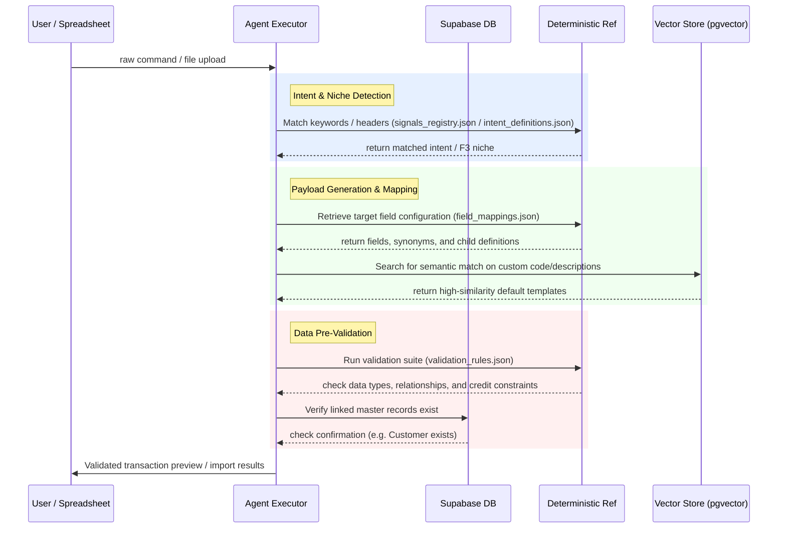

# Knowledge Base (KB) Architecture & Reference

> The Knowledge Base (KB) is F3Next's semantic and deterministic repository of domain knowledge. It bridges raw customer data, natural language commands, and ERPNext's strict schema/validation requirements. The KB provides the cognitive foundations for all agents across the implementation system (IS).

---

## 🏗️ Overview & Structure

The knowledge base is stored under `containers/knowledge_base/` and is divided into two primary paradigms:
1. **Deterministic Reference Data (JSON/Python)**: Highly structured, exact rules, schemas, dependency graphs, and taxonomies loaded into agent memories.
2. **Semantic Vector Context (pgvector/Supabase)**: Web-scraped documentation, industry standards, and niche-specific knowledge chunks vector-embedded via `gemini-embedding-001` and queried via cosine similarity.

### Directory Mapping
```
containers/knowledge_base/
├── common/
│   ├── discovery_taxonomy.py    ← Tags, vocabulary, and validations for business classification
│   ├── signals_registry.json    ← Maps uploaded file patterns to F3 niche classifications
│   ├── intent_definitions.json   ← Maps NLP prompts to ERP actions/entities (used by Clarity)
│   ├── command_patterns.json    ← Multistep transaction workflows (SO→DN→SI) (used by Command Planning)
│   └── mvp_bottleneck_map.json  ← Maps core operational challenges to setup priorities
├── erpnext/
│   ├── schema/
│   │   ├── field_mappings.json  ← Field synonym translations and constraints (used by Payload Gen)
│   │   └── validation_rules.json← Business logic validation rules, GST compliance, and integrity queries
│   ├── erpnext_doctype_graph.json← Setup layers (0-8) and dependency matrices
│   └── erpnext_deafaults_baseline.json ← Standard default lists (territories, countries, UOMs, etc.)
├── seed_kb.py                   ← Main vector seeder for industry niche chunks
├── seed_erpnext_docs.py         ← Crawls and embeds Frappe/ERPNext user manual
└── *_kb_chunks.py               ← Hardcoded semantic text chunks (Manufacturing, Trading, Projects)
```

---

## 📚 The Knowledge Stack

F3Next structures domain information into three conceptual layers:

```
┌──────────────────────────────────────────────────────────┐
│ Layer 3: Company-Specific Context (F3iche & CVS Profiles)│
├──────────────────────────────────────────────────────────┤
│ Layer 2: System-Specific Rules (ERPNext Docs, Schemas)   │
├──────────────────────────────────────────────────────────┤
│ Layer 1: Industry-Agnostic Standards (APQC PCF, Taxonomy)│
└──────────────────────────────────────────────────────────┘
```

*   **Layer 1 (Process Standards)**: APQC Process Classification Framework (PCF) data providing generic cross-industry business process structures.
*   **Layer 2 (System Knowledge)**: Standard Frappe/ERPNext capabilities, doctype dependencies, configurations, and default setups.
*   **Layer 3 (Company Context)**: Generated dynamically for each client company (stored in the database as F3iche and Configuration Version System (CVS) tables) and validated against Layer 2 rules.

---

## ⚙️ Deterministic Reference Components

### 1. Discovery Taxonomy (`common/discovery_taxonomy.py`)
Used exclusively by the **Discovery Agent ("Adi")** to analyze conversational turns, tag business properties, and build the initial company profile.
*   **Taxonomy Tags**: The allowed tag set for tagging business models along five axes:
    *   `industry`: `#Ind_Manufacturing`, `#Ind_Process`, `#Ind_Discrete`, `#Ind_Retail`, `#Ind_Service`, `#Ind_Trading`
    *   `strategy`: `#Strat_MakeToStock`, `#Strat_MakeToOrder`, `#Strat_JobWork`, `#Strat_Assembly`, `#Strat_ProjectBased`
    *   `scale`: `#Scale_Micro`, `#Scale_SMB`, `#Scale_Large`
    *   `system` (Legacy): `#Legacy_Excel`, `#Legacy_Tally`, `#Legacy_Busy`, `#Legacy_Zoho`, `#Legacy_SAP`, `#Legacy_Oracle`, `#Legacy_CustomERP`, `#Legacy_None`
    *   `pain` (Goals): `#Goal_Inventory`, `#Goal_Costing`, `#Goal_Efficiency`, `#Goal_Compliance`, `#Goal_Billing`, `#Goal_MRP`
*   **Signal Vocabulary**: Informally-worded keyword banks mapped to taxonomy tags. For example, if a user mentions *"we make bespoke cabinets"*, the signal vocabulary helps map this to `#Strat_MakeToOrder` and `#Ind_Manufacturing`.
*   **Validation Rules**: Sanity checks on the extracted parameters (e.g. flag if a company claims `>₹50Cr` revenue with only `2 employees`).
*   **Clarification Templates**: Contextual questions the agent uses to resolve vague or missing information along specific axes.

### 2. Signals Registry (`common/signals_registry.json`)
Allows the **Data Readiness Agent** and **Mapping Agent** to scan incoming customer spreadsheets and automatically detect F3 niches.
*   **Signal Types**: Scans file names, Excel sheet/tab names, column header strings, data value patterns (regexes), and structural shapes (e.g. multi-sheet workbooks).
*   **Scoring Weight**: Adds weight values (e.g. `+0.7` for "BOM" or "Recipe" suggesting manufacturing niches) or subtracts weights (e.g. `-0.5` against trading niches if a production sheet exists).
*   **Disambiguation**: If the highest score falls below the `confidence_threshold` (default `0.60`), the system triggers clarifying questions.

### 3. Intent Definitions (`common/intent_definitions.json`)
The core registry for the **Clarity Agent** to classify user natural language requests and extract named entities.
*   **Intent Taxonomy**: Categories include `create`, `read`, `update`, `delete`, `search`, `submit`, `cancel`, `report`, and `bulk`.
*   **Intent Definition Object**:
    *   `synonyms`: Array of query variations indicating the intent.
    *   `required_entities` & `optional_entities`: Array of parameters that must be extracted (e.g., `customer` and `items` for `create_sales_order`).
    *   `context_hints`: Rules and prefixes to assist the NLP extraction model.
    *   `ambiguity_resolution`: Dialog prompts to query the user if a mandatory field is missing or ambiguous.
*   **Entity Types**: Maps natural entities to ERP fields (e.g., entity `qty` maps to `Float` field `qty`, validation rules include `must_be_positive`).

### 4. Command Patterns (`common/command_patterns.json`)
The cookbook of multi-step transactional workflows. Used by the **Command Planning Agent** to expand a single user request into a dependency chain of operations.
*   **Example Patterns**:
    *   `sales_cycle_so_dn_si`: Sales Order (Draft) → Submit SO → Delivery Note from SO → Submit DN → Sales Invoice from DN → Submit SI.
    *   `manufacturing_simple`: Work Order → Submit WO → Start WO → Stock Entry (Manufacture) → Submit Stock Entry.
*   **Step Orchestration**: Declares whether steps are optional, depends-on references, custom rollback rules for draft documents, and recovery strategies for submitted transactions (which cannot be deleted and must be cancelled).

### 5. ERPNext Doctype Graph (`erpnext/erpnext_doctype_graph.json`)
Defines the installation dependency hierarchy and setup sequence of ERPNext documents.
*   **Setup Layers**: The exact order in which entities must be imported/created:
    *   *Layer 0 (System)*: `Company`, `Currency`, `UOM`, `Fiscal Year`
    *   *Layer 1 (Config)*: `Account`, `Cost Center`, `Warehouse`, `Tax Template`
    *   *Layer 2 (Masters)*: `Item Group`, `Customer Group`, `Supplier Group`, `Territory`, `Price List`
    *   *Layer 3 (Parties)*: `Item`, `Customer`, `Supplier`
    *   *Layer 4 (Pricing/BOM)*: `Item Price`, `BOM`
    *   *Layer 5 (Transactions)*: `Purchase Order`, `Sales Order`, `Stock Entry`
    *   *Layer 6 (Fulfillment)*: `Purchase Receipt`, `Delivery Note`, `Work Order`, `Job Card`
    *   *Layer 7 (Finance)*: `Purchase Invoice`, `Sales Invoice`, `Payment Entry`, `Journal Entry`
    *   *Layer 8 (Projects)*: `Project`, `Task`, `Timesheet`
*   **Doctype Constraints**: Outlines mandatory fields, setting implications, file signals, and niche relevance for each doctype.

### 6. Field Mappings (`erpnext/schema/field_mappings.json`)
The translation schema used by the **Payload Generation Agent** to map raw client spreadsheet columns to specific ERPNext doctype attributes.
*   **Doctype Specs**: Lists standard naming series, mandatory columns, and individual field schemas:
    ```json
    "customer": {
      "fieldname": "customer",
      "fieldtype": "Link",
      "options": "Customer",
      "mandatory": true,
      "user_input_synonyms": ["client", "buyer", "party"],
      "validation": "must_exist_in_customer_master"
    }
    ```
*   **Child Table Schemas**: Describes mapping tables inside parent records (e.g. `items` child array in a `Sales Order` containing `item_code`, `qty`, `rate`, and validations for each).

### 7. Validation Rules (`erpnext/schema/validation_rules.json`)
The ruleset executed by the **Validation Agent** to perform static data analysis before pushing payloads to ERPNext.
*   **Schema Validations**: Basic checks on null values, formats, data types, and min/max lengths.
*   **Referential Integrity Checks**: SQL/ORM queries validating that linked records (e.g., Customer, Warehouse, Item) pre-exist in the database.
*   **Business Rule Validations**: Doctype-specific logical checks (e.g., checking credit limits, negative stock blocks, ensuring `delivery_date >= transaction_date`).
*   **Compliance Rules**: Country-specific verification rules, currently specializing in **India GST** formats, **HSN/SAC** codes, and mandatory **e-invoicing** criteria.

---

## 🕸️ Semantic Vector Store (pgvector)

For high-dimensional semantic lookups (such as debugging error messages or mapping complex custom items), the agents run query embeddings against a Supabase table.

### Schema: `kb_embeddings`
```sql
CREATE TABLE kb_embeddings (
    id SERIAL PRIMARY KEY,
    kb_source VARCHAR(64) NOT NULL, -- 'erpnext_docs' or 'industry_kb'
    content TEXT NOT NULL,          -- The raw text chunk (prefixed with metadata)
    embedding vector(768)           -- 768-dimension vector
);
```

### Scraping & Seeding Pipelines

#### A. ERPNext Docs Scraper (`seed_erpnext_docs.py`)
*   **Source**: Crawls Frappe's official documentation sitemap.
*   **Priority Filtering**: Restricts scraping primarily to transactional modules (`selling`, `buying`, `stock`, `accounts`, `manufacturing`, `projects`, `assets`, etc.) to keep context clean.
*   **Semantic Chunking**: Split at markdown heading levels (`##`, `###`) to keep sections cohesive. Content is truncated at `1200` characters.
*   **Metadata Injection**: Prepends a rich text header containing `Module`, `Page`, and `URL` prior to embedding. This allows the model to determine the source and module context.

#### B. Industry Niche Chunks (`seed_kb.py` / `*_kb_chunks.py`)
*   **Source**: Manually curated SME business profiles and challenges.
*   **Chunk Files**:
    *   `manufacturing_kb_chunks.py`: Recipes, BOM layouts, routing examples, batch specifications.
    *   `trading_kb_chunks.py`: Warehousing strategies, high-volume retail setups, pricing schemes.
    *   `project_manufacturing_kb_chunks.py`: Custom chemistry, coating projects, and milestone planning.
*   **Embedding Generation**: Uses Google's `gemini-embedding-001` model to calculate the vectors, inserting them with a 2-second rate limit delay.

---

## 🔄 Agent-KB Interaction Flow

At runtime, the agents interact with the KB through structured pipelines:



---

## 🛠️ Maintenance & Extensions

### How to Add a New Doctype Field / Constraint
1. Open [field_mappings.json](file:///c:/dev/F3Next/containers/knowledge_base/erpnext/schema/field_mappings.json).
2. Locate the parent Doctype object under the `"doctypes"` list.
3. Add the field configuration (including `"fieldname"`, `"fieldtype"`, and `"mandatory"`). Ensure synonyms are populated under `"user_input_synonyms"`.
4. If the field requires custom logic verification, open [validation_rules.json](file:///c:/dev/F3Next/containers/knowledge_base/erpnext/schema/validation_rules.json) and append a rule block under the matching doctype category inside `"business_rule_validations"`.

### Re-running Seeding Scripts
To refresh the database embeddings during schema changes:
```powershell
# Re-seed static industry chunks:
python -m containers.knowledge_base.seed_kb

# Re-seed priority ERPNext docs in resume-mode (prevents duplicates):
python -m containers.knowledge_base.seed_erpnext_docs --priority-only --resume
```
