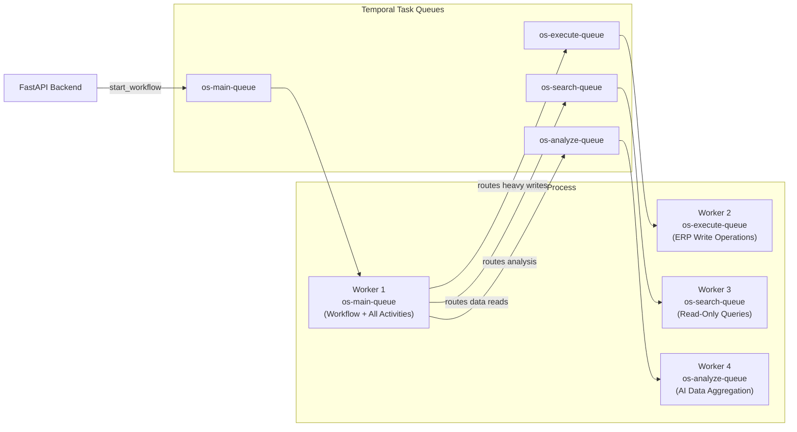
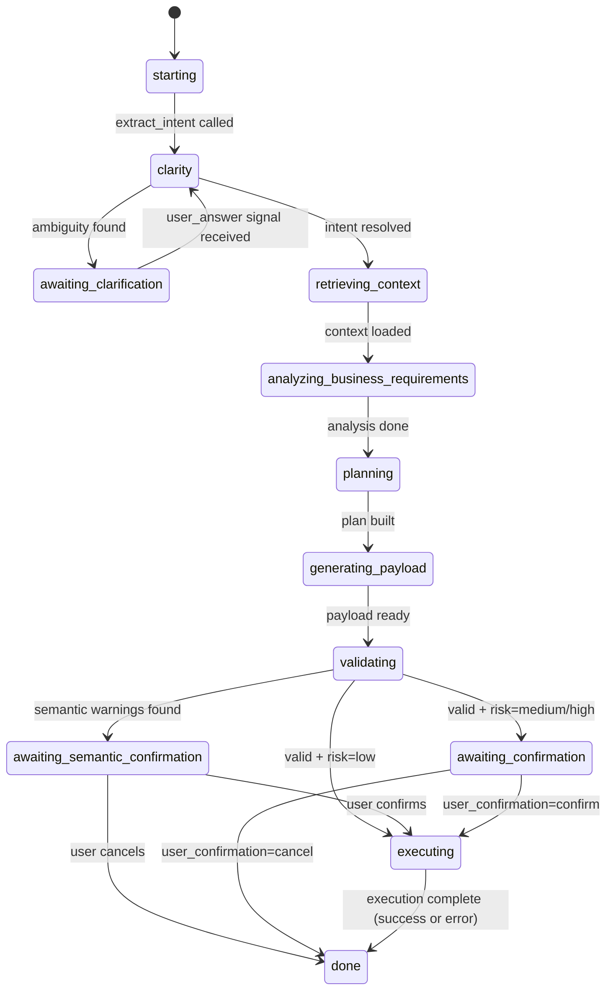
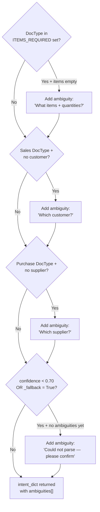

# OS Agent — Architecture & Flow

> The OS Agent is F3Next's natural language command interface to ERPNext. One user command = one Temporal workflow execution. The agent handles everything from intent parsing to ERP API execution, with human-in-the-loop checkpoints for ambiguous or high-risk operations.

---

## 🏗️ Component Map

```
containers/os/
├── os_worker.py                 ← Worker entrypoint — registers 4 task queues
├── os_workflow/
│   └── workflow.py              ← ERPOSCommandWorkflow (886 lines, full 9-step pipeline)
├── clarity_agent/
│   └── activities.py            ← extract_intent, resolve_ambiguity
├── context_retrieval/
│   └── activities.py            ← retrieve_context (calls Context Engine)
├── business_analyzer/
│   └── activities.py            ← analyze_business_requirements (RAG lookup)
├── command_planner/
│   └── activities.py            ← plan_command (builds API step plan)
├── payload_generator/
│   └── activities.py            ← generate_payload (constructs ERP API body)
├── validation_agent/
│   ├── activities.py            ← validate_payload (schema + entity checks)
│   └── semantic_validator.py    ← validate_business_logic (RAG-powered)
├── execution_agent/
│   └── activities.py            ← execute_command (calls ERPNext REST API)
├── result_formatter/
│   └── activities.py            ← format_result (LLM → human-readable response)
├── search_planner/
│   └── activities.py            ← plan_search (read-only data fetch)
├── analysis_planner/
│   └── activities.py            ← (reserved for aggregation pipeline)
└── data_analyst/
    └── activities.py            ← (reserved for AI analysis tasks)
```

---

## 🔄 Task Queue Architecture



---

## 🔁 Full 9-Step Workflow Pipeline

```mermaid
flowchart TD
    START(["`**START**
    User NL Command Received`"]) --> S1

    S1["**STEP 1 — Clarity Agent**
    extract_intent
    ─────────────────────
    LLM parses: action, target_doctype,
    entities (customer, items, qty),
    confidence score, ambiguities list"]

    S1 --> GATE1{"`confidence ≥ 0.70
    AND all required
    fields present?`"}

    GATE1 -->|"No / Fallback"| AMB["**Intent Gate**
    _gate_intent_for_minimum_requirements()
    Adds required ambiguity questions:
    • Missing items?
    • Missing customer/supplier?
    • Low confidence?"]

    AMB --> S2

    GATE1 -->|"Yes"| S2

    S2["**STEP 2 — Ambiguity Loop**
    _run_ambiguity_loop (max 3 rounds)
    ─────────────────────────────────
    For each blocking ambiguity:
    1. Set status = awaiting_clarification
    2. Frontend polls → shows question
    3. User answers via signal
    4. resolve_ambiguity (LLM re-merge)
    5. Re-apply intent gate
    Loop until no blocking ambiguities"]

    S2 --> S3

    S3["**STEP 3 — Context Retrieval**
    retrieve_context
    ─────────────────────────────────
    Calls Context Engine 3-tier load:
    • Tier 1: ERP schema + doctype graph
    • Tier 2: F3iche industry templates
    • Tier 3 (CVS): Live company data
      → known_customers, known_items,
        known_suppliers, warehouses,
        company_profile, ERP credentials"]

    S3 --> READY{"`Readiness
    blocker?`"}
    READY -->|"ERP not configured\nor CVS empty"| ERR_READY["Return error:
    'Setup not complete'"]
    READY -->|"OK"| S35

    S35["**STEP 3.5 — Business Requirements (RAG)**
    analyze_business_requirements
    ─────────────────────────────────────────
    Queries pgvector KB for APQC + ERPNext docs
    Identifies missing critical fields (Tier 1/2)
    Asks business clarification questions
    (max 2 rounds of business_clarification)"]

    S35 --> REPAIR_LOOP

    subgraph REPAIR_LOOP["Repair Loop (max 2 rounds)"]
        S4["**STEP 4 — Command Planner**
        plan_command
        ─────────────────────
        Produces: steps[], risk_level,
        requires_confirmation, pattern_id"]

        S5["**STEP 5 — Payload Generator**
        generate_payload
        ─────────────────────
        Converts plan steps → ERPNext
        API payloads (POST/PUT/GET bodies)
        Resolves item codes, customer IDs,
        warehouse names from context"]

        S6["**STEP 6 — Validation Agent**
        validate_payload
        ─────────────────────
        Schema validation rules:
        • mandatory_fields
        • unknown_customer/supplier/item
        • child_table_validation
        • unknown_warehouse
        Returns: valid, errors[], warnings[]"]

        S4 --> S5 --> S6
    end

    S6 --> VAL_OK{"`validation.valid
    == True?`"}

    VAL_OK -->|"No, fixable error"| VAL_FIX["Clarification loop
    (repair round < 2)
    Ask user for corrected values
    → re-run Steps 4-6"]
    VAL_FIX --> REPAIR_LOOP

    VAL_OK -->|"No, terminal error"| FORMAT_ERR["format_result (error)
    → Return human-readable
    validation failure"]

    VAL_OK -->|"Yes"| SEM["**Semantic Validation (RAG)**
    validate_business_logic
    ─────────────────────────────
    Checks business logic warnings:
    • Price anomalies
    • Stock constraints
    • Industry best practices"]

    SEM --> SEM_WARN{"`Semantic
    warnings?`"}

    SEM_WARN -->|"Yes"| SEM_CONFIRM["**Semantic Confirmation Gate**
    status = awaiting_semantic_confirmation
    Shows user: warnings list
    User chooses: proceed / cancel / fix"]

    SEM_CONFIRM -->|"cancel"| CANCELLED["Return: cancelled"]
    SEM_CONFIRM -->|"fix → repair round"| VAL_FIX
    SEM_CONFIRM -->|"proceed / timeout"| S7
    SEM_WARN -->|"No warnings"| S7

    S7["**STEP 7 — Confirmation Gate**
    ─────────────────────────────────
    risk_level: low → skip
    risk_level: medium/high/critical → pause
    Shows preview: action summary,
    entities, warnings, auto-corrections
    status = awaiting_confirmation
    Waits for user signal (5 min timeout)"]

    S7 --> CONFIRM{"`User
    decision`"}
    CONFIRM -->|"cancel"| CANCELLED
    CONFIRM -->|"confirm (or low-risk skip)"| S8

    S8["**STEP 8 — Execution Agent**
    execute_command
    ─────────────────────────────────
    Calls ERPNext REST API:
    POST /api/resource/{doctype}
    PUT /api/resource/{doctype}/{name}
    Handles: auth, SSL, error parsing
    Retry policy: 3 attempts, exponential backoff"]

    S8 --> EXEC_OK{"`success?`"}
    EXEC_OK -->|"No"| FORMAT_EXEC_ERR["format_result (execution error)
    → Human-readable failure message"]
    EXEC_OK -->|"Yes"| S9

    S9["**STEP 9 — Result Formatter**
    format_result
    ─────────────────────────────────
    LLM converts raw API response
    → concise, friendly user message
    e.g. '✅ Sales Order SO-00123 created
    for Acme Corp — ₹45,000 total'"]

    S9 --> DONE(["`**DONE**
    Response delivered to UI`"])

    ERR_READY --> DONE
    FORMAT_ERR --> DONE
    FORMAT_EXEC_ERR --> DONE
    CANCELLED --> DONE
```



---

## 📡 Signals & Queries



**Signals (frontend → workflow):**
| Signal | Payload | When |
|--------|---------|------|
| `user_answer` | `str` | User answers a clarification question |
| `user_confirmation` | `"confirm"` / `"cancel"` / `"fix"` | User responds to confirmation gate |

**Queries (frontend polls every 1.5s):**
| Query | Returns |
|-------|---------|
| `get_status` | `{status, confirmation_request, response}` |

---

## 🔑 Retry Policies

| Policy | Attempts | Initial Interval | Used For |
|--------|----------|-----------------|---------|
| `_RETRY_LLM` | 3 | 3s (2× backoff) | LLM activities (Clarity, Format) |
| `_RETRY_2` | 2 | 2s (2× backoff) | Context retrieval, Plan, Payload |
| `_RETRY_3` | 3 | 3s (2× backoff, no-retry on ValueError/Auth) | Execution Agent |
| `_NO_RETRY` | 1 | — | Validation, Semantic check |

---

## 📐 Intent Gate Rules

The `_gate_intent_for_minimum_requirements()` function runs **deterministically inside the workflow** (no I/O) after every `extract_intent` and `resolve_ambiguity` call:



---

## 🔧 Dev Tool: OS Action Harness
Component: [action_harness.py](file:///c:/dev/F3Next/containers/os/action_harness.py)

The `action_harness.py` allows developers to test the full OS command execution flow and natural language intents directly from the command line without launching the full Temporal workflow:

```bash
# Preview an intent and planned payload only (No writes, dry-run safety)
python -m containers.os.action_harness --intent "create sales order for Acme for 5 red chairs" --project-id b6ff0b7f-a616-4179-8f68-deda9b3578af --preview-only

# Execute an intent against the target ERPNext instance (writes live)
python -m containers.os.action_harness --intent "list open work orders" --project-id b6ff0b7f-a616-4179-8f68-deda9b3578af --confirm
```

### Shared Risk & Safety Policy Integration
Component: [action_risk.py](file:///c:/dev/F3Next/shared/erp_policies/action_risk.py)

The OS Agent shares the unified risk scoring policy engine with the Implementation System (IS).
- **Risk Classification:** When `plan_command` executes, it evaluates the planned steps against the rules in `action_risk.py` to calculate the transaction risk tier (`low`, `medium`, `high`, `critical`).
- **Confirmation Barrier:** If a command is classified as `medium` risk or higher (e.g. creating/submitting financial documents or stock transactions), the OS Agent halts, returns `awaiting_confirmation`, and renders a structured confirmation preview with warning flags (such as "Draft BOM blockers detected") and a custom alert message before permitting execution.
- **Safety Mode:** Developers and users can preview the entire API body payload and target values using `--preview-only` before committing live writes.

