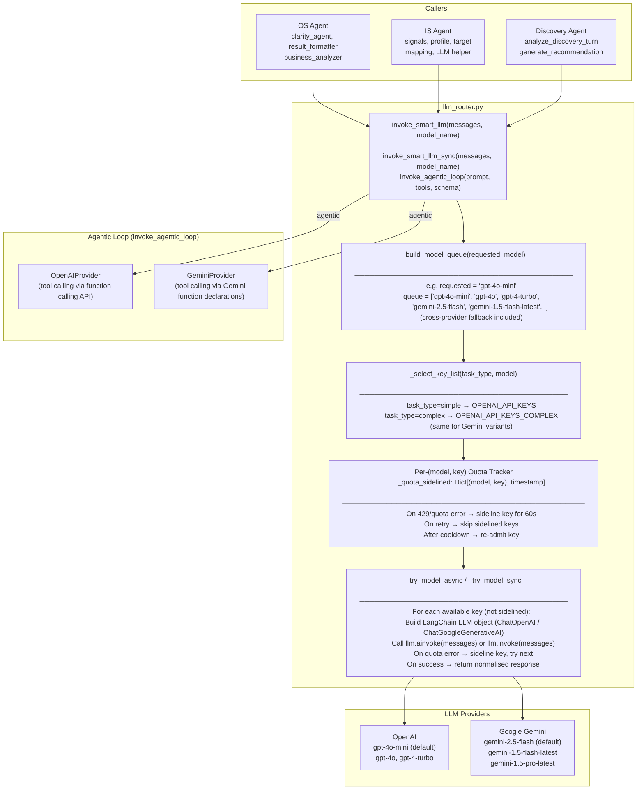
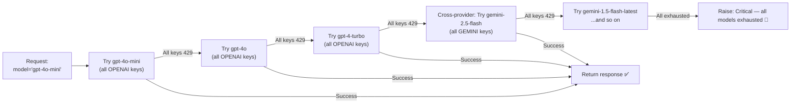
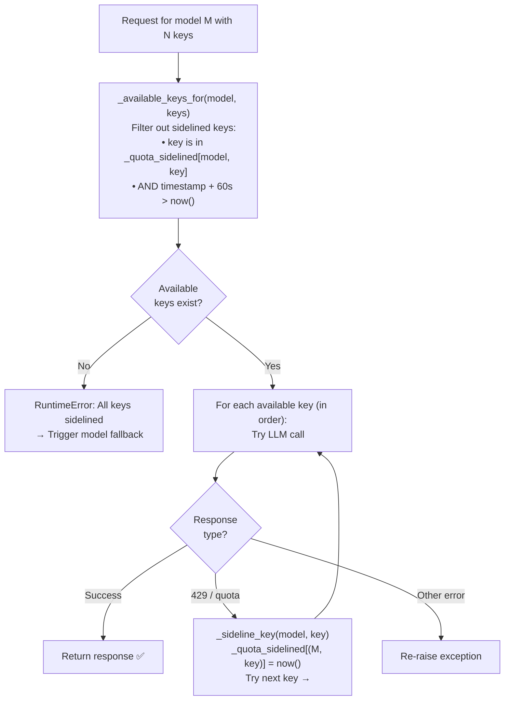
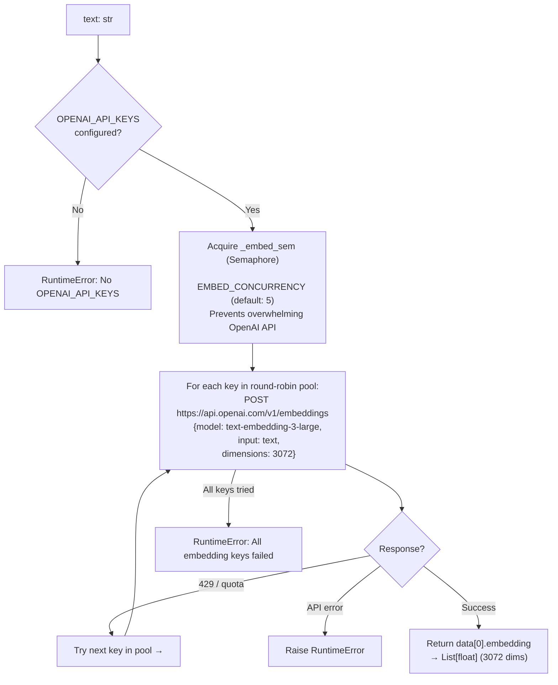
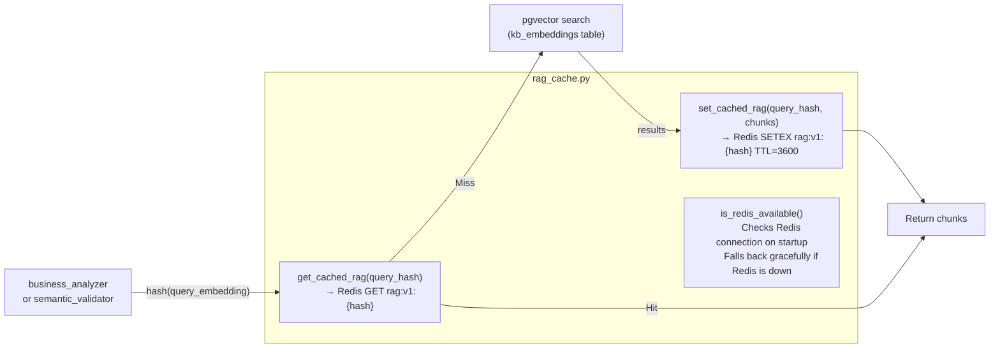
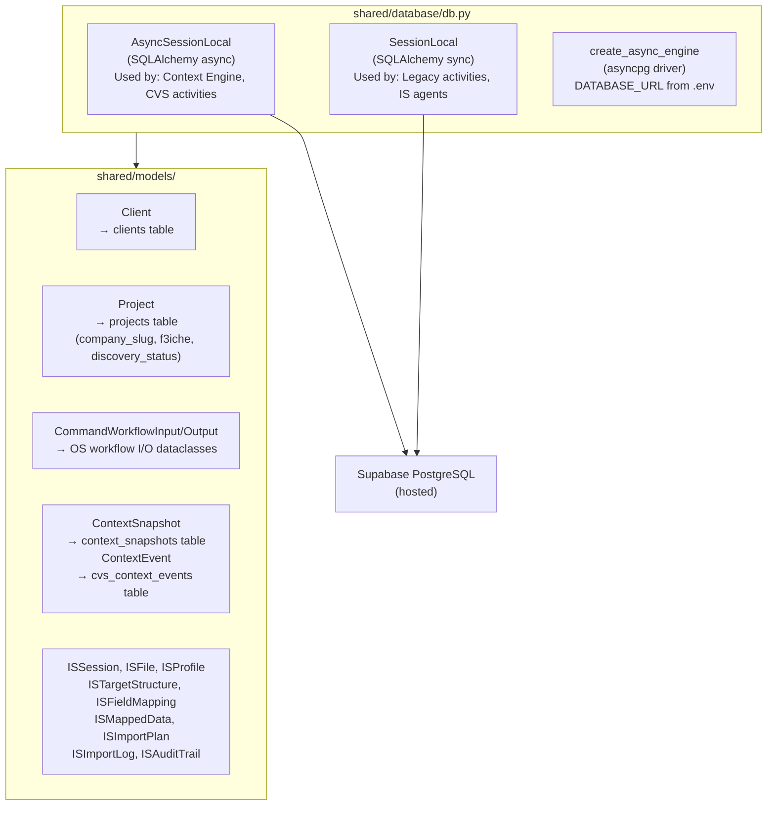
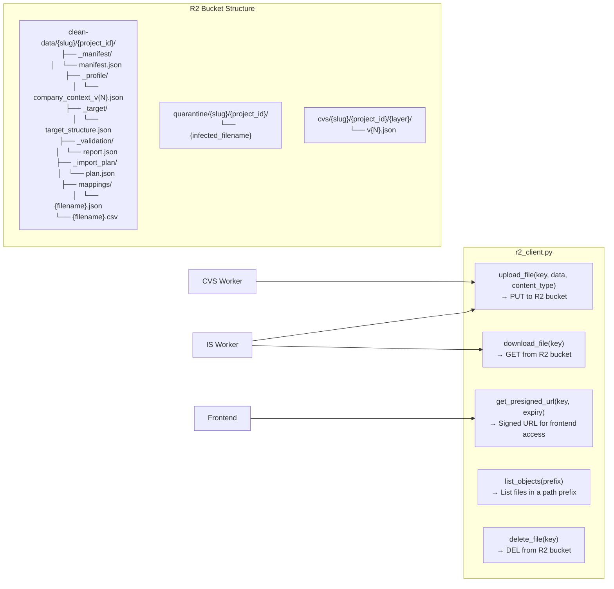
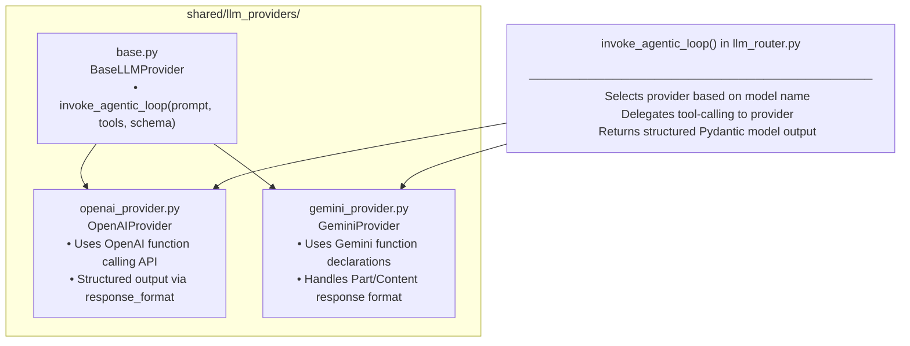
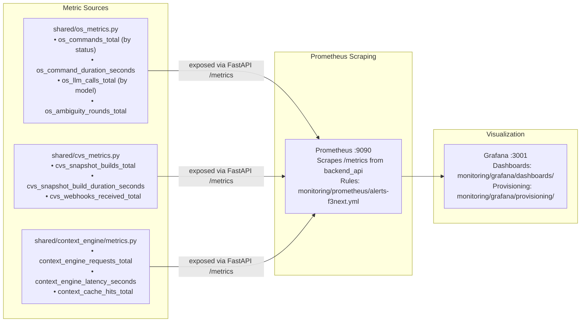

# LLM Router & Shared Infrastructure — Architecture & Flow

> This document covers the cross-cutting infrastructure shared by all F3Next services: the LLM router, embedding generator, RAG cache, R2 file client, and the shared database + model layer.

---

## 🤖 LLM Router (`llm_router.py`)

The LLM Router is a **universal, provider-agnostic AI gateway** used by all containers. It handles key rotation, quota sidetracking, model tier fallback, and cross-provider fallback transparently.

### Architecture

### Model Tier Fallback Chain

### Key Rotation & Quota State

---

## 🧬 Embedding Generator (`shared/embedding_generator.py`)

Used exclusively by the Knowledge Base seeder to vectorize documentation chunks for pgvector storage.

---

## ⚡ RAG Cache (`shared/rag_cache.py`)

Caches pgvector query results in Redis to avoid repeated expensive similarity searches for identical queries.

---

## 🗄️ Shared Database Layer (`shared/database/`)

---

## ☁️ R2 Client (`shared/r2_client.py`)

---

## 🛡️ LLM Provider Abstraction (`shared/llm_providers/`)

Used by `invoke_agentic_loop` for tool-calling workflows:

---

## 📊 Observability Stack

---

## 🔑 Environment Configuration (`.env`)

| Variable | Used By | Purpose |
|----------|---------|---------|
| `DATABASE_URL` | All workers, backend | Supabase PostgreSQL connection |
| `TEMPORAL_HOST` | All workers | Temporal server address |
| `REDIS_URL` | OS, CVS, IS, backend | Redis cache connection |
| `GEMINI_API_KEYS` | LLM router | Comma-separated Gemini API keys |
| `OPENAI_API_KEYS` | LLM router + embeddings | Comma-separated OpenAI API keys |
| `GEMINI_API_KEYS_COMPLEX` | LLM router | Premium keys for complex tasks |
| `OPENAI_EMBEDDING_MODEL` | Embedding generator | Model name (default: text-embedding-3-large) |
| `OPENAI_EMBED_DIMS` | Embedding generator | Output dimensions (default: 3072) |
| `R2_ACCOUNT_ID` | R2 client | Cloudflare R2 account |
| `R2_ACCESS_KEY_ID` | R2 client | R2 access key |
| `R2_SECRET_ACCESS_KEY` | R2 client | R2 secret |
| `R2_BUCKET_NAME` | R2 client | R2 bucket name |
| `SUPABASE_URL` | Frontend | Supabase project URL |
| `SUPABASE_ANON_KEY` | Frontend | Supabase anonymous key |
| `GEMINI_MODEL_TIERS` | LLM router | Override Gemini model fallback order |
| `OPENAI_MODEL_TIERS` | LLM router | Override OpenAI model fallback order |
