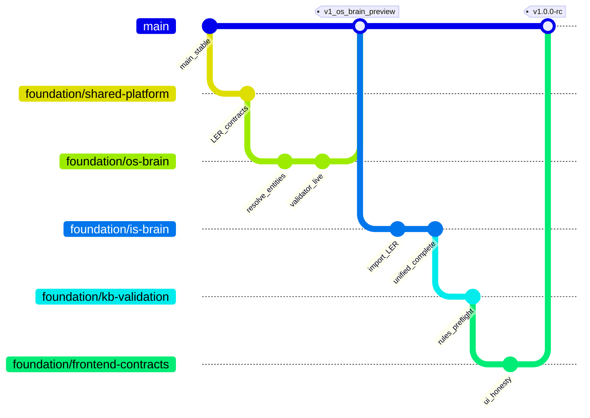

# v1.0.0 — Branch Strategy & Merge Order

> Git branching plan for the foundation program.  
> `main` remains the safety net until `v1.0.0-rc` is tagged.

---

## 1. Branch naming convention

| Git branch | Doc file | Base branch | Merges into |
|------------|----------|-------------|-------------|
| `main` | [branch-00-main-protection.md](./branch-00-main-protection.md) | — | production |
| `foundation/shared-platform` | [branch-01-foundation-shared-platform.md](./branch-01-foundation-shared-platform.md) | `main` | `foundation/os-brain` |
| `foundation/os-brain` | [branch-02-foundation-os-brain.md](./branch-02-foundation-os-brain.md) | `foundation/shared-platform` | `main` (first product proof) |
| `foundation/is-brain` | [branch-03-foundation-is-brain.md](./branch-03-foundation-is-brain.md) | `foundation/os-brain` | `main` |
| `foundation/kb-validation` | [branch-04-foundation-kb-validation.md](./branch-04-foundation-kb-validation.md) | `foundation/is-brain` | `main` |
| `foundation/frontend-contracts` | [branch-05-foundation-frontend-contracts.md](./branch-05-foundation-frontend-contracts.md) | `foundation/kb-validation` | `main` |

Optional hotfix branch (cherry-pick to `main`):

- `hotfix/os-workflow-sandbox` — P0 only from `os-brain` if production blocked before full merge.

---

## 2. Dependency graph

**Hard dependencies:**

- `os-brain` **requires** `shared-platform` (imports `shared/entity_resolution`, gate contracts).  
- `is-brain` **requires** `shared-platform`; **should follow** `os-brain` merge or rebase (LER API stable).  
- `kb-validation` can start in parallel after `shared-platform`, but merge after `is-brain` to avoid rule conflicts.  
- `frontend-contracts` last — depends on stable API shapes.  

---

## 3. Per-branch effort (rough)

| Branch | Engineering days (est.) | Risk |
|--------|-------------------------|------|
| shared-platform | 3–5 | Low — mostly new modules |
| os-brain | 5–8 | Medium — workflow + worker |
| is-brain | 8–12 | High — large surface, prune carefully |
| kb-validation | 3–5 | Medium |
| frontend-contracts | 3–5 | Low–medium |

Total calendar: ~4–6 weeks with 1–2 engineers and golden testing.

---

## 4. Rebase policy

- Rebase feature branches on parent foundation branch **daily**.  
- Before merge to `main`: linear history or squash per team convention.  
- Never force-push `main`.  

---

## 5. CI / verification per branch

| Branch | Required checks |
|--------|-----------------|
| shared-platform | `pytest shared/tests/ -q` |
| os-brain | Above + `pytest containers/os/tests/ -q` |
| is-brain | Above + `pytest containers/implementation/tests/test_ler_validate.py containers/implementation/tests/test_live_erp_readiness.py -q` |
| kb-validation | `pytest shared/tests/test_kb_policy.py -q` + `python scripts/sync_autofill_from_kb.py --check` |
| frontend-contracts | `python scripts/verify_foundation.py` |
| **rc tag** | `FOUNDATION_VERIFICATION.md` manual golden + worker rebuild |

---

## 6. Merge to `main` gates

Each branch PR must include:

1. Link to doc section in `docs/v1.0.0/branch-*.md`  
2. Triage tags (class, layer, gate)  
3. Updated row in [`RELEASE_v1_0_0.md`](./RELEASE_v1_0_0.md) checklist  
4. Worker rebuild note in PR description  
5. No new filename-only priors without KB promotion path  

---

## 7. Parallel work rules

| Can parallelize | Must serialize |
|-----------------|----------------|
| kb-validation rule authoring (against stubs) | is-brain before os LER API frozen |
| frontend mockups | os-brain merge |
| docs updates | shared-platform contract freeze |
| Golden matrix test design | — |

---

## 8. Failure recovery

If `foundation/os-brain` fails experiment:

- `main` unchanged.  
- Keep `shared-platform` for next attempt.  
- Document learnings in branch doc § Retrospective.  

If program succeeds:

- Tag `v1.0.0-rc`.  
- Archive internal “v1.5” wording in customer-facing materials → **v1.0**.  

---

*Update this file when branch names or merge order changes.*
