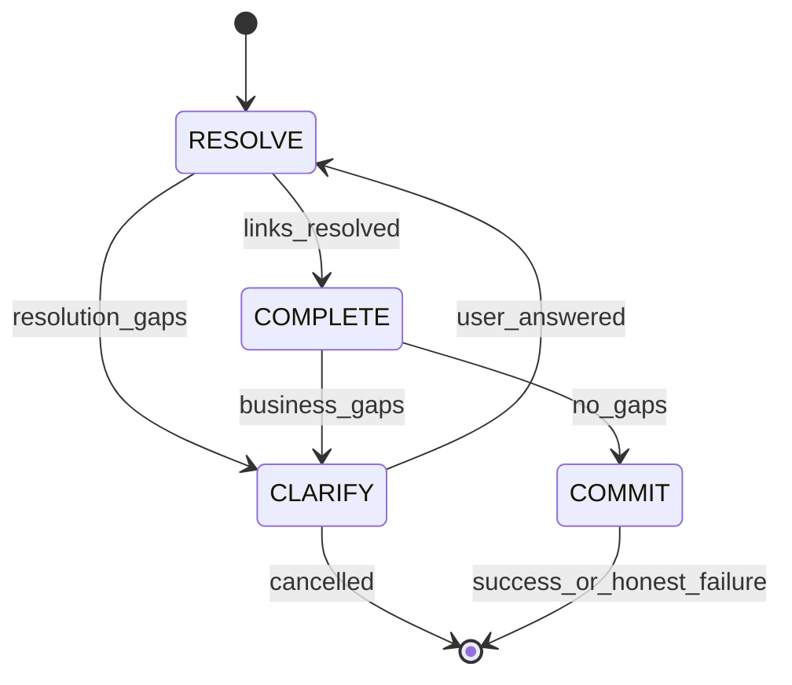

# F3.0.0 — Operating Model (Gates, Contracts, LLM, Freshness)

> Defines **how** IS and OS run under Company Brain.  
> Overview: [`PLATFORM_OVERVIEW.md`](./PLATFORM_OVERVIEW.md).

---

## 1. Universal four gates

Every user-visible operation on a `project_id` passes through up to four gates. Activities map to gates; workflows orchestrate gates.



### Gate 1 — RESOLVE

**Question:** What ERP **link values** (exact `name` fields) does this operation use?

| Input | Output |
|-------|--------|
| Raw user text / file rows / intent entities | `resolved_entities` with canonical Customer, Item, Supplier, Company, Warehouse, … |
| Live ERP via LER | `link_cache: { Doctype: [names] }` |
| Unmatched | `resolution_gaps[]` → forces CLARIFY |

**IS activities (today → target):**

- `infer_doctype_from_columns`, `map_file_to_erpnext`, `refine_mapping_with_llm`  
- **Add:** bulk LER pass on mapped rows before validate (reuse `BulkLinkResolver`)  

**OS activities:**

- `extract_intent` (LLM + optional tools)  
- **New:** `resolve_entities` after `retrieve_context`  
- Planner consumes **already resolved** entities  

**Hard rules:**

- CVS tool `search_cvs_master_data` returning **0 matches** must set `_cvs_miss` flags; must **not** alone justify `confidence=0.95` + `ambiguities=0`.  
- If live ERP list has fuzzy match → apply in RESOLVE; do not defer to validator CVS error.  

---

### Gate 2 — COMPLETE

**Question:** What **business** or **industry** requirements are still missing?

| Includes | Excludes |
|----------|----------|
| Party + line items for transactions | `naming_series`, `conversion_rate`, `title` (autofill) |
| Industry-required masters (F3iche) | Pseudo KB placeholders |
| Optional delivery / schedule (tier 2 + skip) | Company slug without live match |

**IS:** `assess_data_readiness` + industry profile → single `complete_gaps` list (supervisor consumes, does not re-scan differently).

**OS:** `analyze_business_requirements` using `business_fields_missing()` — only after RESOLVE succeeded for links.

---

### Gate 3 — CLARIFY

**Question:** What does the human need to choose or type?

| Pattern | Behavior |
|---------|----------|
| Required gap | Blocking; workflow `awaiting_clarification` |
| Optional gap | Skip phrases (`not needed`, `naah`, …) |
| Validation repair | Only **fixable** rules; autofill fields never ask user |
| Semantic confirm | **Advisory** only if COMMIT preflight passed hard rules |

**OS workflow constraint:** No imports of KB/pathlib in `workflow.py`. Clarification merge in **activities** only (`merge_clarification_into_intent`).

**IS:** Supervisor `ask_user` with severity; re-upload loop returns to RESOLVE with corpus union.

---

### Gate 4 — COMMIT

**Question:** Write to ERP with honest outcome reporting.

| Step | Honesty |
|------|---------|
| Validate mapped/payload | `valid` + `errors[]` + `warnings[]` |
| Import phases / execute | Per-step success; aggregate partial failure |
| UI | Never `complete` if `steps_failed > 0` |
| User message | `format_result` — plain language + action |

**OS additions:**

- `apply_computed_defaults_to_payload` before validate  
- Execution **preflight** (subcontract flags, etc.) before POST  
- Semantic confirm timeout policy documented (prefer explicit user confirm)  

---

## 2. GateResult contract (target shape)

Implemented in `foundation/shared-platform` as Python TypedDict or dataclass in `shared/gate_contracts.py`:

```python
# Illustrative — implement on branch-01
class GateResult(TypedDict):
    gate: Literal["resolve", "complete", "clarify", "commit"]
    status: Literal["ok", "needs_human", "blocked"]
    resolved: dict          # canonical ERP-oriented entities or row stats
    gaps: list[GapItem]     # { field, question, candidates, severity, rule_id }
    honesty: HonestySlice   # { valid, errors, warnings, corrections }
    meta: dict              # { live_fetched_at, cvs_versions, brain_version }
```

**API/UI mapping:**

| status | Frontend |
|--------|----------|
| `ok` | Proceed or show success |
| `needs_human` | Clarification / supervisor prompt |
| `blocked` | Error with remediation (IS not ready, no credentials) |

---

## 3. Live Entity Registry (LER)

### 3.1 Algorithm (existing code)

Reuse [`shared/erp_adapters/link_resolver.py`](../../shared/erp_adapters/link_resolver.py):

- `BulkLinkResolver.build_resolution_map(adapter, link_targets)`  
- `resolve_single(val, known_names)` — exact, suffix, ambiguous pick  

### 3.2 Link target discovery (KB-driven)

From target doctype KB-04:

- Party: `Customer` / `Supplier` via `os_validation.json` sales/purchase lists + field `options`  
- Line items: `item_code` in child table  
- Header links: `Company`, `Currency`, `Warehouse`, … from field_mappings Link fields  

### 3.3 Company resolution policy

[`shared/os_field_semantics.py`](../../shared/os_field_semantics.py) (evolve to `shared/erp_semantics.py`):

- `resolve_company_for_payload(preferred, context)`  
- `user_default_company_or_first_company` → first live Company when no match  
- Never send project **slug** if not a Company doc name  

### 3.4 Transaction title policy

`transaction_title_pattern`: `{party_slug}-{item_slug}` in `os_validation.json`; autofill in payload — user never asked for `title` on PO/SO.

---

## 4. CVS vs live ERP

| Concern | Owner |
|---------|--------|
| Fast prompt context | CVS `entity_registry` |
| Existence / validation authority | LER `link_cache` |
| After ERP UI edit | Webhook → CVS async + **LER on next command** |
| Readiness blocker | If adapter up: check **live** list empty, not only CVS |

### Freshness paths

1. **Per-command prefetch** (OS `resolve_entities`, IS validate/import).  
2. **Webhook** `POST /api/cvs/webhook/{company_id}` (existing).  
3. **IS step 13.5** force-sync after deploy/import.  
4. **Poller** fallback ([`ARCH_CVS.md`](../ARCH_CVS.md)).  

---

## 5. LLM intelligence tiers

| Tier | Model policy | Calls per typical OS command (target) |
|------|--------------|--------------------------------------|
| **T0** | None | LER + deterministic merge |
| **T1** | `gpt-4o-mini` (default) | extract_intent, format_result |
| **T2** | Stronger when flagged | semantic_validator, mapping refine |
| **T3** | T2 + ERP tools | Clarity tool loop; IS ambiguous file |

### Tool surface (target)

Shared ERP tools callable from Clarity / IS classifier:

| Tool | Returns |
|------|---------|
| `list_master(doctype, query?, limit?)` | Top N names from live ERP |
| `resolve_link(doctype, value)` | Canonical name or candidates |
| `get_item_flags(item_code)` | subcontract, stock, UOM |
| `get_supplier_flags(supplier)` | is_subcontractor, etc. |

Implement in `foundation/shared-platform` wrapping `ERPNextAdapter`.

### Cost philosophy

One T3 resolve at gate 1 **replaces** two repair loops (plan + payload + validate + failed execute) — net savings.

---

## 6. User experience principles

| Principle | Implementation |
|-----------|----------------|
| **Plain language** | Supervisor + format_result; no raw Frappe tracebacks |
| **Candidates not blanks** | “Which customer?” with top 5 from live ERP |
| **Honest progress** | IS validate: pass/partial/fail; OS pipeline step labels |
| **No ERP training** | Autofill internals; business questions only |
| **Yes / no / skip** | Maps to gate answers and skip phrases |
| **Same brain** | IS import success → OS sees masters immediately |

---

## 7. Internal flow (OS command — target)

```text
submit_command
  → extract_intent [T1/T3]
  → retrieve_context (profile + CVS enrich + link_cache seed)
  → resolve_entities [T0 LER]  ← NEW
  → gate: resolution_gaps? → CLARIFY
  → analyze_business_requirements
  → gate: business_gaps? → CLARIFY
  → repair loop:
      plan_command
      generate_payload (semantics autofill)
      validate_payload (LER authority + computed defaults)
      → fixable? CLARIFY : fail honest
  → semantic_validate [T2] → optional confirm
  → risk confirm if needed
  → execute_command (preflight + POST)
  → format_result [T1]
```

---

## 8. Internal flow (IS session — target)

```text
upload wave
  → parse / corpus_merge
  → RESOLVE: classify + map + LER on mapped payloads
  → COMPLETE: data_readiness unified
  → CLARIFY: supervisor + re-upload → RESOLVE
  → COMMIT: validate (honest) → import phases → import-results API
  → force-sync CVS + webhooks on ongoing ERP edits
```

---

## 9. Failure taxonomy (use on every PR)

From [`FOUNDATIONS.md`](../FOUNDATIONS.md):

| Class | v1.0.0 example |
|-------|----------------|
| **A** | Workflow pathlib import |
| **B** | Missing subcontract preflight rule |
| **C** | SchemaResolver not wired on classify |
| **D** | Worker not rebuilt after OS change |

Tag PR with: `(class, pillar, layer, gate, branch-id)`.

---

*See per-branch files for file-level edits.*
