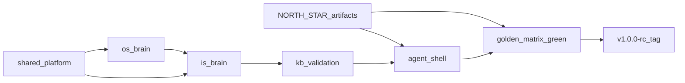

# F3Next v1.0.0 — North Star Program

> **Status:** Active — foundation branches largely in repo; **product exit** defined by north star artifacts  
> **Audience:** Engineering, product, agents  
> **Start here (product):** [**`../NORTH_STAR.md`**](../NORTH_STAR.md)  
> **Start here (brain/infra):** [**PLATFORM_OVERVIEW.md**](./PLATFORM_OVERVIEW.md)

The v1.0.0 **program** is now framed by the **Agent Shell + Golden Truth** north star. Foundation branches (shared platform, os-brain, is-brain, kb-validation, frontend-contracts) deliver plumbing; **readiness for beta** is defined by the three artifacts below.

---

## North star artifacts (canonical)

| Document | Purpose |
|----------|---------|
| [**`../NORTH_STAR.md`**](../NORTH_STAR.md) | Program index, Definition of Done, IS/OS tree |
| [**`../NORTH_STAR_AGENT_SHELL.md`**](../NORTH_STAR_AGENT_SHELL.md) | Cursor-like 3-pane UI, gate renderer, deprecations |
| [**`../GOLDEN_MATRIX_MANIFEST.md`**](../GOLDEN_MATRIX_MANIFEST.md) | Green Surface `3rd_run` — KB vs code proof matrix |
| [**`../PRESENTATION_AGENT_CONTRACT.md`**](../PRESENTATION_AGENT_CONTRACT.md) | User-facing copy layer — no debug leakage |

---

## What v1.0.0 means

| In scope | Out of scope (later) |
|----------|----------------------|
| **One agent shell** for IS (OS follows) | Full v2 single-workflow rewrite |
| **Golden matrix green** for MVP doctypes | Every ERPNext doctype |
| **Presentation agent** — clear gates only | Internal supervisor debug in chat |
| One **Company Brain** shared by IS and OS | Odoo / SAP adapters |
| Live ERP truth (LER) + four gates | Mic / daily briefing UI |
| Listed **F3iche** + chemical GS corpus | “Any industry” with zero playbook |

**North star sentence:** A company uses **one agent window** to upload messy data or run ERP commands; F3Next sets up and operates the ERP with the same brain, gates, and honesty — and **we only call it ready when the golden matrix says so**.

---

## Foundation docs (infrastructure)

| Document | Purpose |
|----------|---------|
| [**PLATFORM_OVERVIEW.md**](./PLATFORM_OVERVIEW.md) | Company Brain, surfaces, diagrams |
| [**OPERATING_MODEL.md**](./OPERATING_MODEL.md) | Gates, contracts, LLM tiers, CVS vs LER |
| [**BRANCH_STRATEGY.md**](./BRANCH_STRATEGY.md) | Branch graph, merge order |
| [**RELEASE_v1_0_0.md**](./RELEASE_v1_0_0.md) | Pre-tag checklist (OS rows + IS honesty) |
| [**FOUNDATION_VERIFICATION.md**](./FOUNDATION_VERIFICATION.md) | Manual sign-off |
| **branch-00 … branch-05** | Per-branch execution plans |

### Per-branch documents

| Branch (git name) | Doc |
|-------------------|-----|
| `main` (protection) | [branch-00-main-protection.md](./branch-00-main-protection.md) |
| `foundation/shared-platform` | [branch-01-foundation-shared-platform.md](./branch-01-foundation-shared-platform.md) |
| `foundation/os-brain` | [branch-02-foundation-os-brain.md](./branch-02-foundation-os-brain.md) |
| `foundation/is-brain` | [branch-03-foundation-is-brain.md](./branch-03-foundation-is-brain.md) |
| `foundation/kb-validation` | [branch-04-foundation-kb-validation.md](./branch-04-foundation-kb-validation.md) |
| `foundation/frontend-contracts` | [branch-05-foundation-frontend-contracts.md](./branch-05-foundation-frontend-contracts.md) |

**Note:** [branch-05](./branch-05-foundation-frontend-contracts.md) is superseded for layout by [`NORTH_STAR_AGENT_SHELL.md`](../NORTH_STAR_AGENT_SHELL.md); keep branch-05 for honesty types and API mapping until shell lands.

---

## Relationship to existing docs

| Legacy doc | v1.0.0 / north star role |
|------------|--------------------------|
| [`../FOUNDATIONS.md`](../FOUNDATIONS.md) | L0–L5 triage — still law |
| [`../PRIORITIES.md`](../PRIORITIES.md) | Sprint cap; tracks north star tracks A–E |
| [`../IS_V2_BACKLOG.md`](../IS_V2_BACKLOG.md) | Pillar status; golden rows update pillar 4/7/9 |
| [`../ARCH_IMPLEMENTATION.md`](../ARCH_IMPLEMENTATION.md) | Pipeline activities — UI migrates to shell |
| [`../ARCH_V2_VISION.md`](../ARCH_V2_VISION.md) | Post-beta live schema |

---

## Program phases

**Rule:** Do not tag `v1.0.0-rc` until [`../NORTH_STAR.md`](../NORTH_STAR.md) § Definition of Done passes (shell + golden + presentation + brain).

---

## Quick triage

1. Restate symptom in user terms.  
2. Check [`../GOLDEN_MATRIX_MANIFEST.md`](../GOLDEN_MATRIX_MANIFEST.md) row — KB or code?  
3. Check [`../NORTH_STAR_AGENT_SHELL.md`](../NORTH_STAR_AGENT_SHELL.md) — UI contract violation?  
4. Layer L0–L5 · Gate · Class A/B/C/D.  
5. Assign branch or north star track.

---

## Status (2026-06-05)

| Item | Status |
|------|--------|
| North star docs | **Published** |
| Foundation branches 01–05 code | Largely in repo |
| Golden matrix GM-FILE-04 Stock Entry | **Red** — KB synonyms |
| Agent shell | **RFC** — not implemented |
| Presentation agent | **Contract** — not implemented |
| `v1.0.0-rc` tag | Blocked on north star DoD |

---

*Last updated: 2026-06-05*
