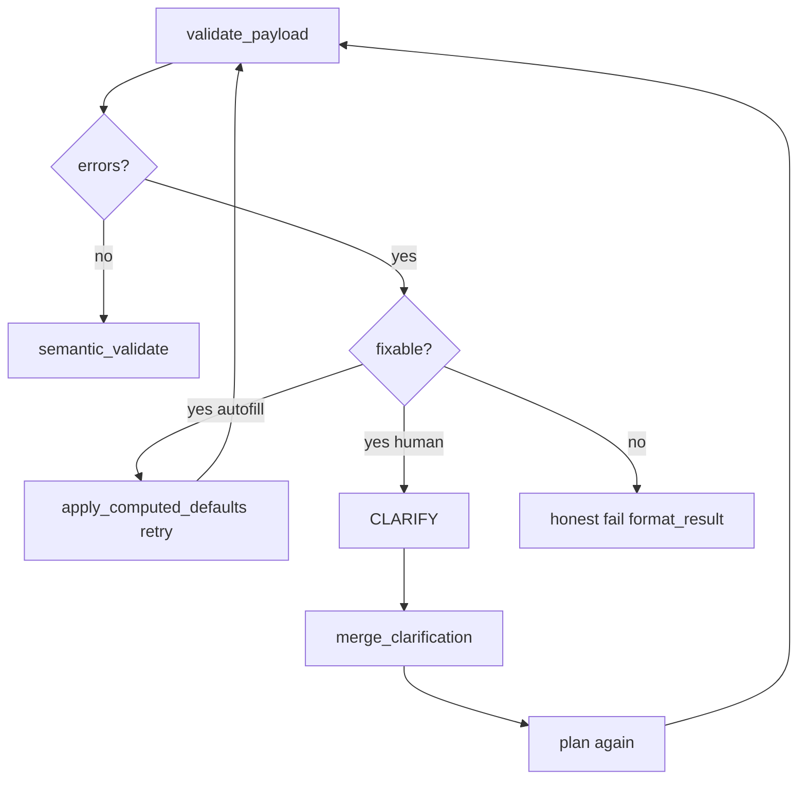

# Branch 02 — `foundation/os-brain`

> **Base:** `foundation/shared-platform`  
> **Merges into:** `main` (first product proof) then feeds `foundation/is-brain`  
> **Layer focus:** L0, L3, L4  
> **IS pillar:** N/A (OS surface)  
> **Class:** **A** (bugs), **B** (KB policy already merged), **C** (LER activity)

---

## 1. Branch thesis

Prove **Company Brain** on the **smaller blast radius** OS pipeline: one command → RESOLVE (live) → COMPLETE → CLARIFY → COMMIT with honest outcomes. After this branch, a pilot tenant can create masters in ERP UI and run SO/PO without CVS manual sync.

---

## 2. Production incidents driving this branch

| Incident | Fix location |
|----------|--------------|
| Workflow crash on validation repair | `workflow.py` sandbox — P0 |
| Strahats: 0 CVS, confidence 0.95 | `clarity_agent/activities.py` |
| Regww: company slug in payload | Already in semantics; wire LER in context + planner |
| PO title asked / merge ignored title | `merge_clarification_into_intent` — verify + clarity questions |
| CONFIRM “Failed to fetch” | API route + workflow signal (investigate) |
| Execute subcontract surprise | `execution_agent` preflight |
| Validator `unknown_*` from CVS | `validation_agent/validator.py` |

---

## 3. Workflow changes

### 3.1 Activity order (target)

File: [`containers/os/os_workflow/workflow.py`](../../containers/os/os_workflow/workflow.py)

```text
extract_intent
retrieve_context          # seeds profile, CVS, partial link_cache
resolve_entities          # NEW — LER bulk fetch
[gate] resolution_gaps → awaiting_clarification
analyze_business_requirements
[gate] business_gaps → awaiting_clarification
repair_loop:
  plan_command
  generate_payload
  validate_payload
semantic_validate (optional)
risk / semantic confirm
execute_command
format_result
```

### 3.2 New activity: `resolve_entities`

File: [`containers/os/context_retrieval/activities.py`](../../containers/os/context_retrieval/activities.py) (or new `containers/os/entity_resolution/activities.py`)

| Input | Output |
|-------|--------|
| `intent`, `doctype`, `project_id`, adapter credentials | Updates `context_snapshot`: `link_cache`, `resolved_entities`, `resolution_gaps` |

Implementation:

```python
from shared.entity_resolution.ler import build_link_cache, resolve_entities_batch
from shared.entity_resolution.targets import collect_link_targets_from_intent
```

Register in worker `activities` list and workflow.

### 3.3 P0 — Workflow sandbox purity

**Problem:** `_is_fixable_validation` imports `shared/os_field_semantics` → Temporal restricts `pathlib`.

| Step | Action |
|------|--------|
| 1 | Create `containers/os/os_workflow/workflow_gates.py` |
| 2 | Move fixable-field list: static set from KB `erp_autofill_fields` + known autofill fieldnames |
| 3 | `workflow.py` imports only `workflow_gates` (no KB, no pathlib transitive deps) |
| 4 | Keep semantic merge in **activities** (`validation_agent` or `clarity_agent`) |

Test: trigger validation error on fixable field → clarification → merge → success without workflow task failure.

---

## 4. Component-by-component changes

### 4.1 Context retrieval

**File:** `containers/os/context_retrieval/activities.py`

| Change | Detail |
|--------|--------|
| Expand `link_cache` | After `resolve_entities`, include Customer, Item, Supplier, Company, Warehouse as needed |
| `erp_resolved_company` | Set from LER not profile slug |
| Pass `resolved_entities` to downstream activities via snapshot |

**File:** `containers/os/context_retrieval/company_profile.py`

- Profile `company` slug used only as **preference** input to `resolve_company_for_payload`.

### 4.2 Clarity agent

**File:** `containers/os/clarity_agent/activities.py`

| Change | Detail |
|--------|--------|
| CVS miss flags | When `search_cvs_master_data` returns 0, set `intent._cvs_miss_customer` etc. |
| Confidence cap | If live LER also empty for party → `ambiguities` non-empty OR lower confidence below threshold |
| Tool loop (T3) | Optional: call `shared.erp_tools.list_master` when CVS+LER ambiguous |
| `resolve_ambiguity` | Never overwrite `preserve_transaction_entities` fields (delivery-only path) |

### 4.3 Command planner

**Files:**  
- `containers/os/command_planner/activities.py`  
- `containers/os/command_planner/prereq_resolver.py`

| Change | Detail |
|--------|--------|
| Consume `resolved_entities` | Planner assumes customer/item/supplier **canonical** |
| Link fields | Use `resolve_link_value_from_options` + `link_cache` |
| Prereq create | Only when LER confirms missing **and** policy allows auto-create |

### 4.4 Business analyzer

**File:** `containers/os/business_analyzer/` (activities + analyzer module)

| Change | Detail |
|--------|--------|
| Run after RESOLVE | `business_fields_missing` skips link fields already in `resolved_entities` |
| No ERP internals | `naming_series`, `conversion_rate`, `title` never in questions |

### 4.5 Payload generator

**File:** `containers/os/payload_generator/payload_builder.py`

| Change | Detail |
|--------|--------|
| `apply_computed_defaults_to_payload` | Before validate (already started — ensure uses `erp_semantics`) |
| Company field | From `link_cache` / `resolve_company_for_payload` |
| Title | `build_transaction_title` pattern from KB |

### 4.6 Validation agent

**File:** `containers/os/validation_agent/validator.py`

| Change | Detail |
|--------|--------|
| Authority | Missing Customer/Item/Supplier → error only if **not** in `link_cache` with exact name |
| Deprecate | CVS-only `unknown_customer` / `unknown_item` veto when adapter up |
| Keep | ERPNext `validate` API call for business rules |
| Defaults | `apply_computed_defaults_to_payload` at start of validate activity |

### 4.7 Execution agent

**File:** `containers/os/execution_agent/activities.py`

| Change | Detail |
|--------|--------|
| Preflight | Before POST: `get_item_flags`, supplier subcontract flags |
| Error message | Map ERP message to plain language via `format_result` patterns |
| Company | Final guard: reject if `company` not in live Company list |

### 4.8 API — confirm path

**Files:** `containers/os/api/` (or gateway routing to Temporal)

| Investigation | Fix |
|---------------|-----|
| `POST /api/os/confirm/{workflow_id}` | Ensure routes to correct worker queue |
| CORS / auth | Frontend `Failed to fetch` root cause |
| Timeout UX | Document 5-min auto-proceed; prefer explicit user confirm in frontend branch |

### 4.9 Worker registration

**File:** `containers/os/worker.py` (or equivalent)

- Register `resolve_entities` activity.  
- Rebuild image: `docker compose build os_worker && docker compose up -d os_worker`.

---

## 5. Clarification & merge behavior

**File:** `shared/erp_semantics.py` — `merge_clarification_into_intent`

| Field | Must merge on round 2 |
|-------|----------------------|
| `title` | Yes (user may type; still autofill preferred) |
| `delivery_date` | Yes |
| `supplier`, `customer` | Preserve unless user explicitly changes |
| Party on PO | `preserve_transaction_entities` after partial LLM repair |

**File:** `containers/os/clarity_agent/` — question generation

- Do not ask for fields in `erp_autofill_fields` KB list.  
- Ask with **candidates** from `link_cache` when `severity=choice`.

---

## 6. Ideation: repair loop semantics



**Fixable** = in `workflow_gates.FIXABLE_VALIDATION_CODES` and not autofill field.

---

## 7. Tests & verification

| Test | Path |
|------|------|
| Business semantics | `containers/os/tests/test_business_fields.py` — extend LER cases |
| Entity resolution integration | `containers/os/tests/test_resolve_entities_activity.py` (new) |
| Workflow gates | `containers/os/tests/test_workflow_gates.py` (new) |
| Golden | `RELEASE_v1_0_0.md` G-OS-SO-01..04, G-OS-CO-01, G-OS-PO-* |

```bash
pytest containers/os/tests/ -q
python -m shared.smoke_llm
```

Manual: Strahats SO after UI customer; Regww PO with subcontract item.

---

## 8. PR breakdown (suggested order)

1. P0 `workflow_gates.py` + sandbox fix  
2. `resolve_entities` activity + snapshot fields  
3. Clarity CVS-miss / confidence gating  
4. Validator `link_cache` authority  
5. Planner + business analyzer consumption  
6. Execution preflight  
7. Confirm API fix (if separate, can hotfix `main`)  
8. `ARCH_OS.md` — 4-phase diagram update  

---

## 9. Non-goals

- IS import changes.  
- Full Clarity T3 tool UI.  
- Replacing Temporal with single agent.

---

## 10. Success criteria

- [x] Automated regression: `python scripts/verify_foundation.py`  
- [ ] G-OS-SO-01, G-OS-CO-01, G-OS-VAL-01 pass on pilot tenants (manual — [`FOUNDATION_VERIFICATION.md`](./FOUNDATION_VERIFICATION.md))  
- [x] No `pathlib` / KB import in `workflow.py` for fixable validation  
- [x] `resolve_entities` activity + `link_cache` on context after step 3.25  
- [ ] Worker deployed to staging with rebuild note in PR  
- [x] [`PRIORITIES.md`](../PRIORITIES.md) foundation closure updated  

---

*Next: [`branch-03-foundation-is-brain.md`](./branch-03-foundation-is-brain.md)*
