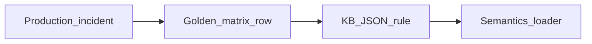

# Branch 04 — `foundation/kb-validation`

> **Base:** `foundation/is-brain` (recommended) or parallel after `shared-platform` with rebase  
> **Layer focus:** L3  
> **IS pillar:** 3 (KB), 7 (validation)  
> **Class:** **B** (KB gap) + policy spine

---

## 1. Branch thesis

Move **business truth** from scattered code branches into **KB JSON policy** so both IS and OS read one source: what to autofill, what to ask, what to preflight, how to title transactions, how to resolve company links.

Code on `os-brain` / `is-brain` **reads** policy; this branch **authors** and **aligns** the KB.

---

## 2. Canonical policy files

| File | Role |
|------|------|
| [`containers/knowledge_base/erpnext/schema/shared/os_validation.json`](../../containers/knowledge_base/erpnext/schema/shared/os_validation.json) | OS: autofill lists, transaction patterns, doctype business field sets |
| [`containers/knowledge_base/erpnext/schema/shared/validation_rules.json`](../../containers/knowledge_base/erpnext/schema/shared/validation_rules.json) | IS: row rules, severity, remediation text |
| **New:** `execution_preflight_rules.json` | OS COMMIT: subcontract, item-supplier, stock flags |
| **New:** `link_resolution_policy.json` | Company fallback, ambiguous pick policy, alias tables |
| F3iche overlays | Per-industry required masters under `f3iche/` |

---

## 3. Policy content (ideation)

### 3.1 `os_validation.json` (extend)

| Key | Purpose | Example value |
|-----|---------|---------------|
| `erp_autofill_fields` | Never ask user | `title`, `naming_series`, `conversion_rate` |
| `transaction_title_pattern` | Autofill title | `{party_slug}-{item_slug}` |
| `company_resolution_policy` | LER preference order | `user_default_company_or_first_company` |
| `sales_order.business_fields` | COMPLETE gate | `customer`, `items` |
| `purchase_order.business_fields` | COMPLETE gate | `supplier`, `items` |
| `master_create_doctypes` | Skip master flow for SO/PO | explicit list |

**Align with:** `shared/erp_semantics.is_master_create_doctype`, `business_fields_missing`.

### 3.2 `validation_rules.json` (IS)

| Addition | Detail |
|----------|--------|
| Link rules | Reference doctype from mapping; severity `error` if LER miss post-rewrite |
| Industry packs | F3iche ID tags on rule groups |
| Honest messages | `user_message` plain language; `rule_id` for analytics |

### 3.3 `execution_preflight_rules.json` (new)

```json
{
  "rules": [
    {
      "id": "po_subcontract_item",
      "doctype": "Purchase Order",
      "when": {"supplier.is_subcontractor": true},
      "check": {"item.is_sub_contracted_item": true},
      "severity": "blocking",
      "message": "Item {item_code} must be flagged as sub-contracted in Item master for this supplier."
    }
  ]
}
```

**Consumer:** `containers/os/execution_agent/activities.py` loads rules + `shared.erp_tools.get_item_flags`.

### 3.4 `link_resolution_policy.json` (new)

| Policy | Code hook |
|--------|-----------|
| Company: prefer user default → first live | `resolve_company_for_payload` |
| Suffix wildcard allowlist | `BulkLinkResolver` config |
| Block sending `project.slug` as Company | validator final guard |

### 3.5 KB-04 field mappings audit

Under `containers/knowledge_base/erpnext/mappings/`:

- Remove pseudo placeholders `{supplier_name}` that never resolve  
- Ensure Link `options` match LER doctype keys  
- Promote golden matrix failures into mapping modules (class B)

---

## 4. Code changes (minimal on this branch)

This branch is **primarily data**; small code only to **load** new JSON:

| File | Change |
|------|--------|
| `shared/kb/loaders.py` or equivalent | Load `execution_preflight_rules.json` |
| `containers/os/execution_agent/activities.py` | Evaluate preflight rules |
| `containers/os/validation_agent/validator.py` | Read `link_resolution_policy` if not hardcoded |
| `workflow_gates.py` | Generate `FIXABLE_FIELDS` from `erp_autofill_fields` KB (optional codegen script) |

**Codegen script (optional):** `scripts/sync_autofill_from_kb.py` → writes static list for Temporal sandbox.

---

## 5. Promotion workflow (no filename priors)



Every new rule needs:

1. `rule_id`  
2. Golden or unit test reference  
3. Entry in [`RELEASE_v1_0_0.md`](./RELEASE_v1_0_0.md) § Known failures or matrix  

---

## 6. Industry / F3iche alignment

| Industry pack | Validates |
|---------------|-----------|
| Green Surface | Warehouse aliases, BOM paths |
| Strahats / food | Item, Customer, SO patterns |
| Regww | Company list, PO supplier |

Tier 2 F3iche in Context Engine must reference same rule IDs as JSON `f3iche_tag` filters.

---

## 7. Verification

| Check | Method |
|-------|--------|
| JSON schema valid | `pytest containers/knowledge_base/tests/` if present |
| OS PO title | `test_business_fields` |
| Subcontract preflight | New test with mocked ERP flags |
| IS rule severity | Harness validate step |

---

## 8. PR breakdown

1. `os_validation.json` + semantics alignment PR  
2. `execution_preflight_rules.json` + execution agent  
3. `link_resolution_policy.json` + company guard  
4. `validation_rules.json` IS link + messages  
5. Mapping module fixes from golden failures  
6. Doc: KB promotion section in [`FOUNDATIONS.md`](../FOUNDATIONS.md)  

---

## 9. Non-goals

- New doctype coverage without golden proof  
- Odoo/SAP rules  
- Rewriting all KB-04 modules in one PR

---

## 10. Success criteria

- [x] G-OS-PO-02 (subcontract) passes or honest preflight message  
- [x] No OS question for fields in `erp_autofill_fields`  
- [x] IS validate messages human-readable for top 10 rule IDs  
- [x] `workflow_gates` autofill list matches KB  

---

*Next: [`branch-05-foundation-frontend-contracts.md`](./branch-05-foundation-frontend-contracts.md)*
