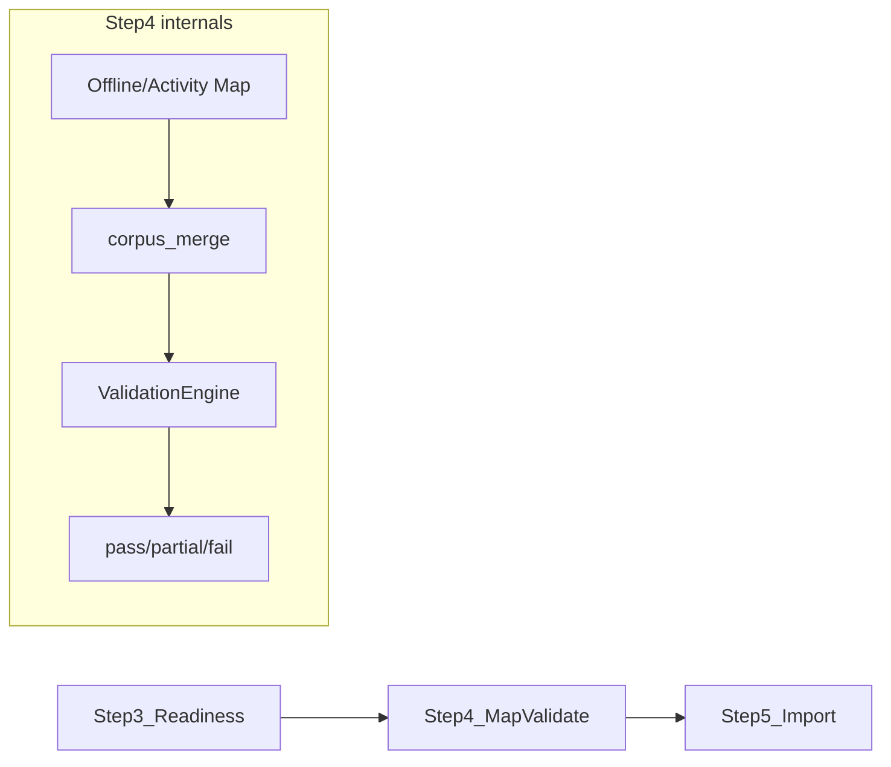

# Implementation Step 4 — Map & Validate

Formal plan for productizing the Validate-phase pipeline (IS pillars 7 + 9).

## Architecture triage

| Field | Value |
|-------|--------|
| **Layer** | L2 Corpus spine → L3 ERP knowledge → L1 honesty |
| **IS pillars** | **7** Mapping & merge · **9** Validation & trust gate |
| **Classification** | **C** — pillar extension (consolidate + productize) |
| **Product UI** | **Validate** (`StepRail.tsx` → `ValidateView.tsx`) |
| **Hard boundary** | Step 4 = "Are mappings & types correct?" — not coverage (Step 3) or import (Step 5) |

## Position in pipeline



## Input contracts

**From Step 1:** `seed_doctypes`, `import_phases`, `validation_rules`, `required_doctypes`

**From Step 2:** manifest v2, corpus understanding, file→doctype assignments

**From Step 3:** `readiness_level` gate — RED blocks mapping start in product (workflow may proceed with supervisor ack)

## Output contract: `MapValidateReport`

Package: [`containers/implementation/map_validate/`](../../containers/implementation/map_validate/)

| Artifact | Purpose |
|----------|---------|
| `map_results[]` | Per (file, doctype) dry-run / map outcome |
| `validation_report` | `_ValidationEngine.validate()` shape |
| `validation_level` | `pass` / `partial` / `fail` |
| `import_ready` | Honest gate for confirm button |
| `executive_summary` | UI banner (no internal codes) |

## Phased rollout

| Phase | Goal | Status |
|-------|------|--------|
| **A** | Package + models + inputs + plan doc | ✅ Done |
| **B** | `assess_map_validate_offline()` + gate | ✅ Done |
| **C** | `validate_ui.py` humanized payload | ✅ Done |
| **D** | API `GET /map-validate/{id}` + launcher hook | ✅ Done |
| **E** | `ValidateSummaryBanner` on ValidateView | ✅ Done |
| **F** | Harness + 3rd_run golden tests | ✅ Done |

## What Step 4 owns vs not

| Concern | Owner |
|---------|--------|
| Column → field mapping (KB/LLM tiers) | `mapping_agent` — orchestrated by Step 4 |
| Multi-file merge / dedupe | `corpus_merge.py` |
| Type/enum/required checks on mapped payloads | `validation_agent._ValidationEngine` |
| LER link resolution warnings | validation + `ler_greenfield` |
| Import execution | Step 5 — `import_agent` |
| File coverage matrix | Step 3 — `readiness` |

## Verification

```bash
pytest containers/implementation/map_validate/test/ -q
python -m containers.implementation.map_validate.test.harness_map_validate --matrix
python -m containers.implementation.map_validate.test.harness_map_validate --fixture green_surface_3rd_run
```

## v1-worthy definition

1. Every mapped seed doctype appears in Validate preview with honest pass/partial/fail.
2. Mapping methods visible per doctype (KB / fuzzy / LLM).
3. Critical validation errors block `import_ready`; warnings → partial + ack.
4. Gap upload re-runs map+validate without Discovery restart.
5. Golden `3rd_run` offline harness: map pass for party/SO/PO + validate partial or pass with 0 blocking errors.

See also: [`map_validate/README.md`](../../containers/implementation/map_validate/README.md)
