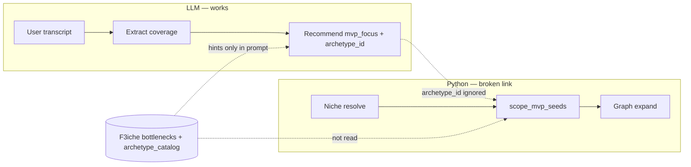

# MVP Boundary Generation — V1 Plan

> **Created**: 2026-07-06  
> **Status**: Active — **gate before Discovery step is v1-worthy**  
> **Audience**: Engineering (coding agents, tech team)  
> **Read when**: Before any change to `mvp_scoping.py`, `build_target.py`, discovery finalize, or archetype KB consumption  
> **Companion**: `[09_CORE_KB_AND_STEPWISE_MIGRATION.md](./09_CORE_KB_AND_STEPWISE_MIGRATION.md)`

---

## 1. Symptom (user terms)

After discovery chat, the client expects **Day-1 ERP modules** that match **what they actually said hurts** — not a fixed chemical-manufacturing checklist.

Harness tests (5 July 2026) showed:


| User story                                                            | Expected Day-1 emphasis                           | Actual outcome                                             |
| --------------------------------------------------------------------- | ------------------------------------------------- | ---------------------------------------------------------- |
| Custom epoxy / Instagram quotes / “don’t care about machine overhead” | Quotation, Sales Order, order tracking            | Work Order, Job Card; **Quotation & Sales Order deferred** |
| ISO audit / quality gates on raw materials                            | Quality Inspection, Batch, incoming stock control | WIP template; **Quality Inspection deferred**              |
| Green Surface WIP + Tally (control)                                   | BOM, Work Order, Stock Entry                      | **Passed** (regex + transcript aligned)                    |


**Rating today:** LLM recommend step ≈ 7/10; MVP boundary scoping ≈ 3/10 for arbitrary input.

---

## 2. Architecture triage


| Field              | Value                                                                                                   |
| ------------------ | ------------------------------------------------------------------------------------------------------- |
| **Layer**          | L2 Discovery → L3 Target structure (`scope_mvp_seeds` + `build_discovery_target`)                       |
| **IS pillar**      | Pillar 2 — Project target / MVP boundary                                                                |
| **Classification** | **A** code bug (scoping ignores LLM + KB) + **C** pillar partially built (archetype contract not wired) |
| **Not**            | B KB gap for chemical F3iche (Research filled `bottlenecks[]`) · D ops/env                              |


**Cross-cutting:** Shared LLM (extract/recommend), discovery finalize order, IS worker reads `mvp_boundary.json` from R2.

---

## 3. Root cause — brain vs body




### Confirmed bugs

1. `archetype_id` **not consumed** — `scope_mvp_seeds` uses 3 hardcoded regex rules; `mvp_focus.archetype_id` is decorative.
2. **Regex false positives** — e.g. “formulations” triggers `factory_wip_bridge` while user intent is ISO/quality (`scrap_wastage` or a QC archetype).
3. **Fallback = wrong default** — `template_minus_defer` loads full F3iche list, then **caps at 8** in template order → manufacturing modules win, sales/QC lose.
4. **Recommend blind to F3iche** — `generate_erp_recommendation` passes `f3iche_id=None` → Research `bottlenecks[]` not in recommend prompt.
5. **Niche resolver brittleness** — keyword “epoxy” → `manufacturing_project_chemical` for unrelated businesses (custom countertop CRM).
6. **Catalog path wrong** — `bottleneck_context.py` loads `knowledge_base/.../_templates/archetype_catalog.json`; canonical file is `containers/discovery/kb/archetype_catalog.json`.
7. **Extract schema noise** — LLM returns `null` for unused coverage dimensions → Pydantic warnings (non-fatal but brittle).
8. **No exclusion signals** — “don’t care about machine overhead” does not defer WO/Job Card.

### What we will **not** do (anti-patch)


| Forbidden                                      | Why                                             |
| ---------------------------------------------- | ----------------------------------------------- |
| New JSON per customer or per test failure      | Repeats 150-file patch spiral                   |
| More `_SCOPING_RULES` regex rows per archetype | Duplicates Research `signals[]`; unmaintainable |
| Filename / synonym priors for bottlenecks      | Violates core KB doctrine                       |
| `mvp_bottleneck_map_v2.json`                   | Extend existing contract instead                |


---

## 4. Target architecture (v1-worthy)

**Single contract:** Research maintains archetypes in KB; Python **reads the same shape** for both LLM hints and scoping.

```
archetype_id + day1_seed_hints + defer_typically + signals
  ↑ F3iche bottlenecks[] (niche-specific overrides)
  ↑ containers/discovery/kb/archetype_catalog.json (global)
  ↓
containers/discovery/archetype_registry.py  ← NEW (code, not JSON patch)
  ↓
scope_mvp_seeds()  — primary: archetype_id lookup
                   — secondary: signal score on transcript
                   — tertiary: minimal safe default
                   — last resort: deprecated regex (flag off by default)
  ↓
build_discovery_target() — graph expand (unchanged, deterministic)
```

**Priority order for scoping (hard rule):**

1. `user_confirmed_override` (UI module confirmation)
2. `mvp_focus.archetype_id` → registry lookup
3. **Signal match** on transcript against merged archetypes (score, not first-regex-wins)
4. **Minimal default** — small operational core, not “first 8 of chemical template”
5. Legacy regex — behind `DISCOVERY_USE_LEGACY_REGEX_SCOPING=false` default after parity tests

**North star alignment:** Any company, any bottleneck — **new behavior = new archetype row in KB** (Research) + generic registry lookup (Engineering). No new Python branch per pain.

---

## 5. Archetype registry (engineering contract)

### 5.1 Module: `containers/discovery/archetype_registry.py`

Responsibilities:


| Function                                        | Behavior                                                                              |
| ----------------------------------------------- | ------------------------------------------------------------------------------------- |
| `load_catalog()`                                | Read `containers/discovery/kb/archetype_catalog.json`                                 |
| `load_f3iche_archetypes(f3iche_id)`             | Read `bottlenecks[]` from F3iche JSON                                                 |
| `merged_archetypes(f3iche_id)`                  | F3iche entries **override** catalog entries with same `archetype_id`; union otherwise |
| `get_by_id(archetype_id, f3iche_id)`            | Return one archetype dict or `None`                                                   |
| `match_by_signals(text, f3iche_id, *, top_k=1)` | Score `signals[]` against transcript; return best id if score ≥ threshold             |
| `canonicalize_seed(name)`                       | Reuse `canonicalize_template_doctype` from `f3iche_seeds`                             |


Archetype shape (already in KB):

```json
{
  "archetype_id": "string",
  "primary_bottleneck": "string",
  "signals": ["..."],
  "functional_requirements": ["..."],
  "day1_seed_hints": ["Item", "BOM", ...],
  "defer_typically": ["..."],
  "notes": "string"
}
```

### 5.2 Seed universe rule

Day-1 seeds = `day1_seed_hints` **∩ template_seeds** plus optional **graph-valid doctypes** not on template when archetype is global (e.g. `Warranty Claim` on trading F3iche):

- If hint ∉ `mandatory_doctypes`, include only if doctype exists in `erpnext_doctype_graph.json` and log `scoping_mode: archetype_graph_extension`.
- Prevents silent drop of catalog seeds on wrong F3iche while allowing cross-niche archetypes.

### 5.3 Defer rule

- Apply archetype `defer_typically` to **template seeds** (doctype names).
- `import_field_policy.defer_until_post_mvp` applies to **import fields only** — never confuse with doctype defer (fix comments in F3iche if needed).
- When archetype scoping active: **archetype defer wins** over template-order cap.

### 5.4 Cap rule (replace broken fallback)

- Remove “first N of mandatory_doctypes” behavior.
- Cap applies to **archetype-selected** seeds only; priority: hints order, then optional graph deps.
- `_MAX_DAY1_SEEDS` remains (8) but trims **lowest-priority optional** seeds, never core hints.

---

## 6. Pipeline reorder (discovery finalize)

**Current:** extract → recommend (no F3iche hints) → niche resolve → scope  

**Target:**

```
messages
  → extract_from_transcript
  → resolve_discovery_f3iche_niche (broad f3iche + industry + transcript)
  → generate_erp_recommendation(coverage, f3iche_id=niche_id)  ← hints from F3iche bottlenecks[]
  → build_discovery_target(f3iche=niche_id, mvp_focus, coverage, transcript)
```

Files:

- `containers/discovery/chat_service.py` — add optional `f3iche_id` to `generate_erp_recommendation` / `complete_discovery`
- `backend/app/services/discovery_chat.py` — reorder finalize to resolve niche before recommend
- `containers/discovery/test/harness_mvp_boundary.py` — mirror production order

---

## 7. Implementation phases (engineering tasks)

### Phase 0 — Registry + path fix (foundation)

**Goal:** One loader; catalog file actually read.


| Task | Detail                                                                                      |
| ---- | ------------------------------------------------------------------------------------------- |
| E0.1 | Create `archetype_registry.py` with merge + lookup + signal match                           |
| E0.2 | Fix `bottleneck_context.py` catalog path → `containers/discovery/kb/archetype_catalog.json` |
| E0.3 | Unit tests: merge override, get_by_id, signal match on known phrases                        |
| E0.4 | Register all IDs currently in chemical F3iche + catalog (no regex duplication)              |


**Verify:** `python -c "from containers.discovery.archetype_registry import get_by_id; ..."` resolves all 8+ chemical + 9 global IDs.

---

### Phase 1 — Archetype-driven scoping (core fix)

**Goal:** `archetype_id` from LLM drives Day-1 seeds.


| Task | Detail                                                                                          |
| ---- | ----------------------------------------------------------------------------------------------- |
| E1.1 | Refactor `scope_mvp_seeds` to call `get_by_id(mvp_focus.archetype_id, f3iche_id)` first         |
| E1.2 | Build `mvp` from `day1_seed_hints`; apply `defer_typically`; set `scoping_mode: archetype_{id}` |
| E1.3 | If `archetype_id` missing/unknown → `match_by_signals(context, f3iche_id)`                      |
| E1.4 | Replace fallback: **minimal default** `{Item}` + signal-matched hints, not full template slice  |
| E1.5 | Fix cap logic — never drop primary hints for template list order                                |
| E1.6 | Dual-system (Tally) note: defer finance masters only when archetype doesn’t require them        |
| E1.7 | Deprecate `_SCOPING_RULES` behind env flag; default off after Phase 5                           |


**Verify:** Harness Test 1 → Quotation/Sales Order in seeds; Test 2 → Quality Inspection in seeds (may need new global archetype — see §9).

---

### Phase 2 — Finalize order + recommend hints


| Task | Detail                                                                                    |
| ---- | ----------------------------------------------------------------------------------------- |
| E2.1 | `complete_discovery(messages, f3iche_id=None)` — resolve niche when None using transcript |
| E2.2 | Pass `f3iche_id` into `build_bottleneck_hint_context` during recommend                    |
| E2.3 | Update `finalize_discovery` to niche-before-recommend                                     |
| E2.4 | Update harness to match                                                                   |


**Verify:** Recommend prompt includes `F3ICHE BOTTLENECKS (manufacturing_project_chemical)` block; `archetype_id` accuracy improves on harness cases.

---

### Phase 3 — Niche resolution v1

**Goal:** Reduce wrong-template assignment without new patch files.


| Task | Detail                                                                                                                   |
| ---- | ------------------------------------------------------------------------------------------------------------------------ |
| E3.1 | Add `resolve_discovery_f3iche_niche_with_llm` optional path: transcript + list of F3iche ids → pick id (structured JSON) |
| E3.2 | Keep keyword resolver as fallback                                                                                        |
| E3.3 | Feature flag `DISCOVERY_LLM_NICHE_RESOLVE` default off until golden pass                                                 |
| E3.4 | Log `niche_resolution_source: keyword                                                                                    |


**Verify:** Custom countertop story does not force chemical template when LLM niche enabled (may map to trading/ETO F3iche when exists).

---

### Phase 4 — Extract schema hardening


| Task | Detail                                                                                                                   |
| ---- | ------------------------------------------------------------------------------------------------------------------------ |
| E4.1 | Coerce `coverage.*: null` → empty `CoverageDimension` before Pydantic validate                                           |
| E4.2 | Optional: add `defer_modules_mentioned: list[str]` to `MvpFocus` for “don’t care about X” (LLM output, scoping consumes) |


**Verify:** Harness runs without extract validation warnings.

---

### Phase 5 — Golden harness (10/10 gate)

**Goal:** Core-only path proven before deprecating legacy map.


| Task | Detail                                                                                                            |
| ---- | ----------------------------------------------------------------------------------------------------------------- |
| E5.1 | Add `containers/discovery/test/fixtures/` transcripts (user text only)                                            |
| E5.2 | Add `containers/discovery/test/test_mvp_boundary_golden.py` with expected seeds per fixture                       |
| E5.3 | Fixtures minimum: Green Surface WIP, custom order/CRM, ISO quality, Part A/B inventory                            |
| E5.4 | CI job: `pytest containers/discovery/test/test_mvp_boundary_golden.py` (mock LLM optional row + live row nightly) |
| E5.5 | Document rows in `docs/GOLDEN_MATRIX_MANIFEST.md` discovery section                                               |


**Gate:** All golden rows pass with `DISCOVERY_USE_MVP_MAP_FALLBACK=false` and `DISCOVERY_USE_LEGACY_REGEX_SCOPING=false`.

---

### Phase 6 — Deprecation (after gate)


| Task | Detail                                                              |
| ---- | ------------------------------------------------------------------- |
| E6.1 | Mark `mvp_bottleneck_map.json` deprecated in `_meta` comment        |
| E6.2 | Remove `_SCOPING_RULES` or keep flag-only for emergency rollback    |
| E6.3 | Update `09_CORE_KB_AND_STEPWISE_MIGRATION.md` discovery row to Done |
| E6.4 | Backlog line in `IS_V2_BACKLOG.md`                                  |


---

## 8. `mvp_boundary` artifact (output contract)

Ensure persisted JSON includes traceability for debugging:

```json
{
  "mode": "archetype_inventory_visibility",
  "f3iche": "manufacturing_project_chemical",
  "archetype_id": "inventory_visibility",
  "archetype_source": "mvp_focus",
  "seed_doctypes": ["..."],
  "deferred_doctypes": ["..."],
  "scoping_reasoning": "...",
  "niche_resolution_source": "keyword",
  "signal_match_score": null,
  "dual_system_note": "..."
}
```

---

## 9. Input needed from Research (not engineering tasks)

Engineering **blocks** on content, not on Research doing engineering work. Please confirm or supply:


| Question                                                                                                                                      | Why                                                                                                                |
| --------------------------------------------------------------------------------------------------------------------------------------------- | ------------------------------------------------------------------------------------------------------------------ |
| **ISO / incoming QC archetype** — Is there a global `archetype_id` for strict quality gates (not `scrap_wastage`)? Test 2 mapped to wrong id. | LLM + scoping need correct hints: `Quality Inspection`, `Quality Inspection Template`, `Batch`, `Purchase Receipt` |
| **ETO / custom order archetype** — CRM-style “quotes + build status” for make-to-order without factory WIP?                                   | Test 1 needs `Quotation`, `Sales Order`, possibly `Project` — not `factory_wip_bridge`                             |
| `day1_seed_hints` **⊆ ERPNext doctypes** — Review new catalog entries (`Subcontracting Order`, `Warranty Claim`, etc.) against graph          | Seeds outside graph break expansion                                                                                |
| **F3iche vs global split** — Which archetypes stay in chemical F3iche vs catalog only?                                                        | Merge override rules                                                                                               |
| **Negative defer phrases** — Any standard `defer_typically` for “machine overhead / WO not needed”?                                           | Optional until `defer_modules_mentioned` in schema                                                                 |


Research continues filling archetypes; engineering does **not** wait for all F3iches — registry works per id as rows appear.

---

## 10. Future gaps (watch list)


| Gap                                        | Mitigation                                                         |
| ------------------------------------------ | ------------------------------------------------------------------ |
| Multi-bottleneck chats                     | Phase 2+ schema: `secondary_archetype_ids[]`; union hints with cap |
| LLM picks invalid `archetype_id`           | Validate against merged registry; fall back to signal match        |
| Archetype seeds not on F3iche template     | Graph extension rule (§5.2)                                        |
| Wrong niche + right archetype              | Phase 3 LLM niche; separate F3iche for ETO vs chemical             |
| User module confirmation overrides LLM     | Already supported — ensure UI path tested in E5                    |
| `enhance_with_llm` in build_target stub    | Do not rely on until implemented; scoping must be sufficient alone |
| New Research ids without `day1_seed_hints` | Registry validation warning at load time                           |


---

## 11. Verification checklist (v1 worthy)

- [ ] Harness Test 1 (custom orders): `Quotation` + `Sales Order` in Day-1 seeds; no spurious `Job Card` unless mentioned
- [ ] Harness Test 2 (ISO quality): `Quality Inspection` (+ template if needed) in Day-1 seeds; not WIP-only mode
- [ ] Green Surface WIP: parity with current good outcome
- [ ] Part A/B chemical: `inventory_visibility` seeds include Batch/Warehouse/Stock Entry
- [ ] `archetype_id` in output matches scoping mode prefix
- [ ] No Pydantic extract warnings on sparse transcripts
- [ ] Golden pytest green with legacy fallbacks disabled
- [ ] `python -m containers.discovery.test.harness_mvp_boundary` documents production-order pipeline

---

## 12. Suggested sprint order

1. **Phase 0 + Phase 1** — unblocks 80% of harness failures (same sprint)
2. **Phase 2** — improves LLM archetype pick quality
3. **Phase 5** — lock gate before further discovery UI work
4. **Phase 3 + 4** — parallel once Phase 1 merged
5. **Phase 6** — only after 10/10 golden

**Max 5 active items** per `[PRIORITIES.md](../PRIORITIES.md)`: treat Phase 0–1 as **P0 Discovery MVP boundary**.

---

## 13. Related files


| File                                                | Role                                   |
| --------------------------------------------------- | -------------------------------------- |
| `containers/discovery/mvp_scoping.py`               | Scoping logic — primary change surface |
| `containers/discovery/archetype_registry.py`        | **New** — KB → code bridge             |
| `containers/discovery/bottleneck_context.py`        | LLM hint formatting                    |
| `containers/discovery/chat_service.py`              | Extract + recommend                    |
| `containers/discovery/kb/archetype_catalog.json`    | Global archetypes                      |
| `containers/knowledge_base/common/f3iches/*.json`   | Per-niche `bottlenecks[]`              |
| `containers/discovery/target/build_target.py`       | Graph expand (post-scoping)            |
| `containers/discovery/test/harness_mvp_boundary.py` | Manual + golden driver                 |
| `backend/app/services/discovery_chat.py`            | Finalize orchestration                 |


---

*This step does not ship until golden harness passes with archetype-driven scoping and legacy regex/map disabled.*