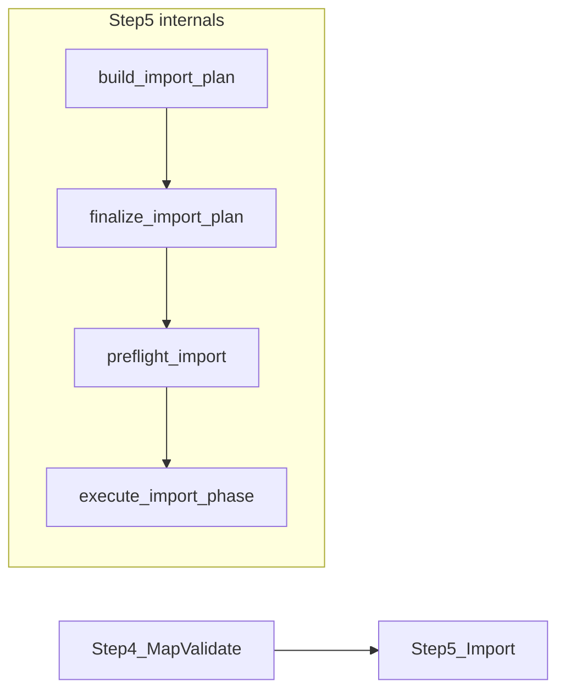

# Implementation Step 5 — Phased Import

Formal plan for productizing the Import-phase pipeline (IS pillar 10).

## Architecture triage

| Field | Value |
|-------|--------|
| **Layer** | L4 Import execution → L1 honesty → L5 observability |
| **IS pillar** | **10** — Phased import & verify |
| **Classification** | **C** — pillar extension (consolidate + productize) |
| **Product UI** | **Import** (`StepRail.tsx` → `ImportView.tsx`) |
| **Hard boundary** | Step 5 = "Did mapped data land safely in live ERP?" — not mapping (Step 4) or coverage (Step 3) |

## Position in pipeline



## Input contracts

**From Step 1:** `seed_doctypes`, `setup_steps`, `import_phases`, `deferred_doctypes`

**From Step 4:** `import_ready=true`, validation level pass/partial with 0 blocking errors

**From workflow:** mapped R2 payloads, validation results, optional bootstrap summary

## Output contract: `ImportExecutionReport`

Package: [`containers/implementation/import_exec/`](../../containers/implementation/import_exec/)

| Artifact | Purpose |
|----------|---------|
| `plan_status` | `ready` / `ready_with_gaps` / `blocked` |
| `phases[]` | Ordered phases with step actions |
| `create_step_count` | Steps with `action=create` and mapped paths |
| `data_gap_count` | Critical unmapped steps |
| `import_level` | `success` / `partial` / `failed` / `blocked` |
| `import_ready` | Honest gate for live import approval |
| `executive_summary` | UI banner (no internal codes) |

## Phased rollout

| Phase | Goal | Status |
|-------|------|--------|
| **A** | Package + models + inputs + plan doc | ✅ Done |
| **B** | `assess_import_offline()` + gate | ✅ Done |
| **C** | `import_ui.py` humanized payload | ✅ Done |
| **D** | API `GET /import-execution/{id}` + launcher hook | ✅ Done |
| **E** | `ImportSummaryBanner` on ImportView | ✅ Done |
| **F** | Harness + 3rd_run golden tests | ✅ Done |

## What Step 5 owns vs not

| Concern | Owner |
|---------|--------|
| Import plan build from graph setup_steps | `import_agent.build_import_plan` — orchestrated by Step 5 |
| Finalize mapped paths + MVP scope blocking | `finalize_import_plan` + `mvp_import_scope.py` |
| LER bulk pre-resolution before POST | `execute_import_phase` Pass 2.5 |
| Submit policy (BOM before WO) | `submit_gate` Pass 2.6 |
| Mapping / validation | Step 4 — `map_validate` |
| File coverage matrix | Step 3 — `readiness` |

## Verification

```bash
pytest containers/implementation/import_exec/test/ -q
python -m containers.implementation.import_exec.test.harness_import --matrix
python -m containers.implementation.import_exec.test.harness_import --fixture green_surface_3rd_run
```

## v1-worthy definition

1. Import plan includes all mapped MVP seeds with `action=create` and record counts.
2. Deferred / optional doctypes → `ready_with_gaps`, not false `blocked`.
3. Step 4 `import_ready=false` or validation fail → plan `blocked`; live import refused.
4. Phase order: site config → masters → projects → transactional (`phase_order.py`).
5. Offline golden `3rd_run`: plan not blocked; Customer/Supplier/SO/PO have create steps.
6. UI banner + import-results API agree on partial vs success (`complete_with_errors`).
7. Workflow logs **Step 5 / 5** for finalize + execute import phases.

See also: [`import_exec/README.md`](../../containers/implementation/import_exec/README.md)
