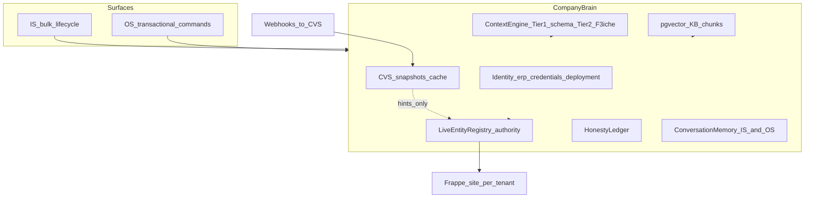
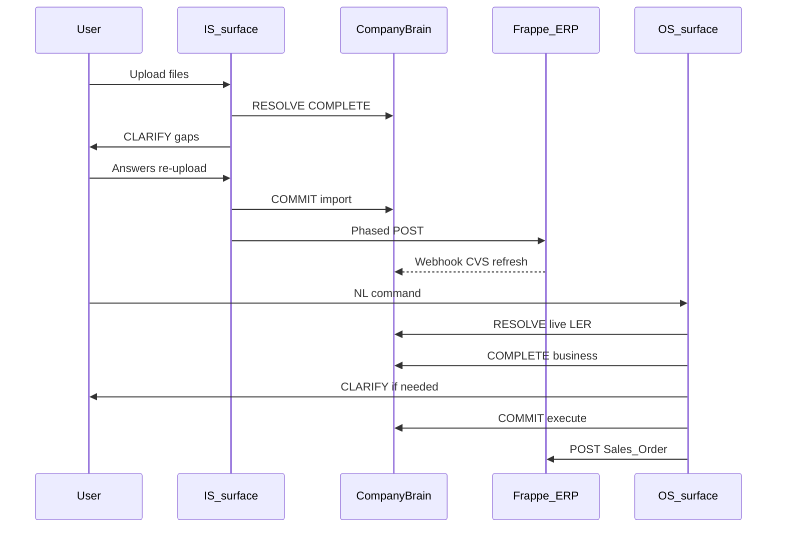

# F3Next v1.0.0 — Platform Overview (Everything Together)

> Master architecture narrative for the v1.0.0 foundation program.  
> Per-branch execution detail lives in `branch-*.md`; operations in [`OPERATING_MODEL.md`](./OPERATING_MODEL.md).

---

## 1. The problem we are solving

F3Next accumulated **correct puzzle pieces** without a **single spine**:

| Piece | Introduced for | Symptom when disconnected |
|-------|----------------|---------------------------|
| IS pipeline | Bulk upload → import | Works for corpus; doesn’t feed OS truth |
| OS pipeline | NL commands | Validates against stale CVS |
| CVS | Fast company snapshot | UI-created ERP masters invisible until sync |
| Context Engine | Tiered schema + F3iche | OS/IS read different slices |
| Webhooks | Freshness | OS still vetoed on old snapshot |
| KB-04 field mappings | Deterministic map | OS asked users for ERP internals |
| `BulkLinkResolver` | IS import links | Never used in OS Clarity/validate |
| Shared LLM | Cheap intelligence | Used unevenly; repair loops cost more than one good tool call |

**User-visible failures (2026-05 production learnings):**

- Sales order on Strahats: customer/item added in ERPNext UI → OS still errors (CVS stale).  
- Purchase order: confirm works → ERP rejects subcontract item (no live preflight).  
- Sales order: validation repair loop crashes workflow (`pathlib` in Temporal sandbox).  
- Regww: `company` slug sent to ERP instead of live Company name.  

v1.0.0 does **not** throw away Temporal, activities, or KB. It installs **Company Brain** and **four gates** that IS and OS both obey.

---

## 2. North star

```text
Any company in our industry catalog can:
  1. Onboard messy files → honest validate → live import (IS)
  2. Operate ERP via natural language commands (OS)
  3. See yes/no/skip and plain language — never a lying green UI
  4. Trust that “exists in ERP” means live Frappe, not yesterday’s snapshot
```

**Long horizon (same brain, more surfaces):** mic, daily briefing, proactive alerts — not a different architecture.

---

## 3. Company Brain (one brain, two surfaces)

**Company Brain** is the shared runtime context for `project_id`. It is not necessarily a new microservice on day one; it is a **contract + shared modules + DB rows** every worker uses.



### 3.1 Module responsibilities

| Module | Authority | Consumers |
|--------|-----------|-----------|
| **Live Entity Registry (LER)** | “Does this link value exist on site?” | OS resolve, IS import/validate, planner, validator, execution preflight |
| **CVS** | Cached master_data + transaction_intel versions | Clarity hints, RAG, fast prompts — **not veto** |
| **Context Engine** | Schema + F3iche industry overlay | `retrieve_context`, mapping schemas |
| **KB / semantics** | Field meanings, autofill, title patterns | Payload, business analyzer, mapping defaults |
| **Honesty ledger** | pass / partial / fail; per-phase import errors | Validate UI, OS terminal, APIs |
| **Memory** | Session turns, upload notes, supervisor Q&A | Clarity, supervisor, future mic |

### 3.2 Golden rule

```text
CVS may suggest. LER decides.
```

UI-created Customer in ERPNext → visible on next OS command via **live prefetch**, without manual “force-sync CVS.”

---

## 4. Two surfaces, same gates

| Gate | Purpose | IS manifestation | OS manifestation |
|------|---------|------------------|------------------|
| **1 RESOLVE** | Map reality → canonical ERP link values | Classify files; map columns; resolve row links | Parse intent; resolve customer/item/company |
| **2 COMPLETE** | Business + industry completeness | Data readiness; required masters | Optional delivery; party+lines; not ERP internals |
| **3 CLARIFY** | Human fills gaps | Supervisor; re-upload; chat bar | Clarification; fixable validation (not autofill fields) |
| **4 COMMIT** | Honest write | Validate → import phases → results API | Validate → confirm → execute → format |

Every gate returns a **`GateResult`**-shaped contract (see [`OPERATING_MODEL.md`](./OPERATING_MODEL.md)).

---

## 5. End-to-end company lifecycle



**Sync points:**

1. Same `projects.id` → `deployment_details` → ERP URL/credentials.  
2. IS import completion → CVS update (+ webhook on ongoing ERP edits).  
3. OS always prefetches live links for command (LER), merges with CVS hints.  
4. Same `f3iche_id` / industry tags for Tier2 rules on both surfaces.  

---

## 6. Intelligence strategy (LLM as moat)

F3Next’s cost advantage (~₹1/IS run on mini) enables **more** tool-augmented LLM at gates — not less.

| Tier | When | Examples |
|------|------|----------|
| **T0** | Exact truth | LER, idempotency, honesty enums, date parse |
| **T1** | Fast structured | classify, extract, format_result |
| **T2** | Reasoning | supervisor copy, mapping refine, semantic warnings |
| **T3** | Tool loops | Clarity with `list_customers` / `list_items`; IS file understanding |

**Principle:** Never ask LLM “does customer exist?” when LER can answer in one API call.

Detail: [`OPERATING_MODEL.md`](./OPERATING_MODEL.md) § LLM tiers.

---

## 7. What changes vs what stays

### Stays

- Temporal workflows (`ImplementationWorkflow`, `ERPOSCommandWorkflow`).  
- Activity boundaries (clarity, context, plan, payload, validate, execute, import phases).  
- Supabase session tables (`is_sessions`, `os_sessions`, `context_snapshots`).  
- KB-04 modular mappings under `containers/knowledge_base/erpnext/`.  
- R2 file storage, virus scan, phased import.  
- [`FOUNDATIONS.md`](../FOUNDATIONS.md) L0–L5 honesty rules.  

### Changes (foundation program)

| Area | Change |
|------|--------|
| **shared/** | `entity_resolution` package wrapping `BulkLinkResolver`; gate result types |
| **OS** | `resolve_entities` activity; workflow sandbox fix; validator uses `link_cache` |
| **IS** | Unified COMPLETE gate; import/validate use LER; prune duplicate gap paths |
| **KB** | `os_validation.json` + `validation_rules.json` as policy spine |
| **Readiness** | “Live ERP empty” not “CVS empty” when adapter available |
| **Docs** | `ARCH_PLATFORM` narrative; OS 4-phase; IS gate diagram |

### Explicitly deferred

- Replacing pipeline with one V2 mega-agent.  
- Non-ERPNext adapters as v1.0 requirement.  
- Universal doctype coverage without KB promotion path.  

---

## 8. Branch program map

See [`BRANCH_STRATEGY.md`](./BRANCH_STRATEGY.md). Summary:

1. **`foundation/shared-platform`** — LER, contracts, semantics package.  
2. **`foundation/os-brain`** — Prove brain on commands (smaller blast radius).  
3. **`foundation/is-brain`** — Align import/validate/readiness to LER.  
4. **`foundation/kb-validation`** — Rules, preflight, industry policies.  
5. **`foundation/frontend-contracts`** — UI honesty aligned to gate results.  
6. **Tag `v1.0.0-rc`** — Golden matrix per industry.  

`main` stays deployable; cherry-pick P0 OS sandbox fix if production blocked.

---

## 9. Success metrics (v1.0.0)

| Metric | Target |
|--------|--------|
| UI-created master → OS command without manual CVS sync | 100% on golden tenants |
| Clarity `ambiguities=0` with 0 CVS + 0 live match | 0% (must block or ask) |
| Validation repair workflow crash | 0 |
| Import UI `complete` with `steps_failed > 0` | 0 |
| PO/SO execute surprise after semantic confirm | rare; preflight catches subcontract class |
| Listed industry golden matrix | pass or classified failure doc |

Full checklist: [`RELEASE_v1_0_0.md`](./RELEASE_v1_0_0.md).

---

## 10. Architecture layers (mapping to FOUNDATIONS)

| Layer | v1.0.0 deliverable |
|-------|-------------------|
| **L0** | Workflow purity; worker deploy; shared LLM smoke |
| **L1** | GateResult honesty; import-results; OS terminal truth |
| **L2** | corpus_merge unchanged; IS RESOLVE uses LER |
| **L3** | KB + live schema; `erp_semantics`; F3iche Tier2 |
| **L4** | Import preflight + idempotency + company resolution |
| **L5** | Validate UI + OS terminal + supervisor messages |

---

## 11. Document index

- Gates & contracts: [`OPERATING_MODEL.md`](./OPERATING_MODEL.md)  
- Branches: [`BRANCH_STRATEGY.md`](./BRANCH_STRATEGY.md) + `branch-*.md`  
- Release: [`RELEASE_v1_0_0.md`](./RELEASE_v1_0_0.md)  
- Index: [`README.md`](./README.md)  

---

*This overview is the narrative anchor for all v1.0.0 foundation work. Update when branches merge.*
