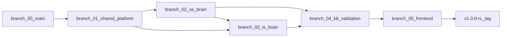

# F3Next v1.0.0 — Foundation Architecture Program

> **Status:** Planning / execution on foundation branches  
> **Audience:** Engineering, product, agents implementing the program  
> **Preserved baseline:** `main` (and current production deploys) until merge gates pass  

This directory is the **single program guide** for product **v1.0.0** — our first broadly usable release for companies in F3Next’s **listed industries**, not internal labels like “v1.5” or “v2 agent.”

---

## What v1.0.0 means

| In scope | Out of scope (later) |
|----------|----------------------|
| One **Company Brain** shared by IS and OS | Full single-agent rewrite ([`ARCH_V2_VISION.md`](../ARCH_V2_VISION.md)) |
| Live ERP truth for master links (LER) | Every ERPNext doctype on day one |
| Honest validate / import / command outcomes | Odoo / SAP adapters |
| Listed **F3iche** industries + KB coverage | “Any industry” with zero playbook |
| ERPNext tenant per `project_id` | Mic / all-day operator surface (same brain, new UI later) |

**North star:** A company uploads messy data or speaks in natural language; F3Next **sets up** the ERP (IS) and **runs** it day-to-day (OS) with the same intelligence, gates, and honesty.

---

## How to read this folder

| Document | Purpose |
|----------|---------|
| [**PLATFORM_OVERVIEW.md**](./PLATFORM_OVERVIEW.md) | **Start here** — whole system, brain, surfaces, diagrams, principles |
| [**OPERATING_MODEL.md**](./OPERATING_MODEL.md) | Universal gates, contracts, LLM tiers, CVS vs live ERP |
| [**BRANCH_STRATEGY.md**](./BRANCH_STRATEGY.md) | Branch graph, merge order, dependencies, risk |
| [**RELEASE_v1_0_0.md**](./RELEASE_v1_0_0.md) | Exit criteria, golden matrix, deploy checklist |
| [**FOUNDATION_VERIFICATION.md**](./FOUNDATION_VERIFICATION.md) | Automated + manual sign-off before `v1.0.0-rc` |
| **Per-branch plans** | Detailed ideation and file-level change lists |

### Per-branch documents

| Branch (git name) | Doc |
|-------------------|-----|
| `main` (protection) | [branch-00-main-protection.md](./branch-00-main-protection.md) |
| `foundation/shared-platform` | [branch-01-foundation-shared-platform.md](./branch-01-foundation-shared-platform.md) |
| `foundation/os-brain` | [branch-02-foundation-os-brain.md](./branch-02-foundation-os-brain.md) |
| `foundation/is-brain` | [branch-03-foundation-is-brain.md](./branch-03-foundation-is-brain.md) |
| `foundation/kb-validation` | [branch-04-foundation-kb-validation.md](./branch-04-foundation-kb-validation.md) |
| `foundation/frontend-contracts` | [branch-05-foundation-frontend-contracts.md](./branch-05-foundation-frontend-contracts.md) |

---

## Relationship to existing docs

| Legacy doc | v1.0.0 role |
|------------|-------------|
| [`FOUNDATIONS.md`](../FOUNDATIONS.md) | L0–L5 layers and triage — **still law** |
| [`PRIORITIES.md`](../PRIORITIES.md) | Sprint cap (≤5 items); add v1.0 rows from this program |
| [`ARCH_OS.md`](../ARCH_OS.md) | Updated after `os-brain` merge to 4-phase diagram |
| [`ARCH_IMPLEMENTATION.md`](../ARCH_IMPLEMENTATION.md) | Updated after `is-brain` merge to gate model |
| [`ARCH_CONTEXT_ENGINE.md`](../ARCH_CONTEXT_ENGINE.md) | Brain Tier 1–3; LER documented as live overlay |
| [`ARCH_CVS.md`](../ARCH_CVS.md) | Cache layer; webhooks + post-import sync |

---

## Program phases (summary)

**Rule:** Do not merge `is-brain` before `shared-platform` + `os-brain` prove the LER contract.

---

## Quick triage for any v1.0 work item

1. Restate symptom in user terms.  
2. Layer L0–L5 ([`FOUNDATIONS.md`](../FOUNDATIONS.md)).  
3. Surface: IS ingest | IS commit | OS command | platform.  
4. Gate: RESOLVE | COMPLETE | CLARIFY | COMMIT.  
5. Class A/B/C/D.  
6. Assign branch from table above.  

---

## Document status

| File | Status |
|------|--------|
| `PLATFORM_OVERVIEW.md` | Complete |
| `OPERATING_MODEL.md` | Complete |
| `BRANCH_STRATEGY.md` | Complete |
| `RELEASE_v1_0_0.md` | Complete |
| `FOUNDATION_VERIFICATION.md` | Complete — manual golden checklist |
| `branch-00` … `branch-05` | Code complete; manual golden pending |
| **Automated verify** | `python scripts/verify_foundation.py` (65+ unit tests) |

---

## Foundation program status (2026-05-30)

| Phase | Status |
|-------|--------|
| Branches 01–05 code | **Complete in repo** |
| Automated regression | **Pass** — `verify_foundation.py` |
| Worker deploy (P6) | **Manual** — `docker compose build …` |
| Golden matrix E2E | **Manual** — `FOUNDATION_VERIFICATION.md` |
| `v1.0.0-rc` tag | **Blocked on** manual golden + merge to `main` |

---

*Last updated: 2026-05-30*
