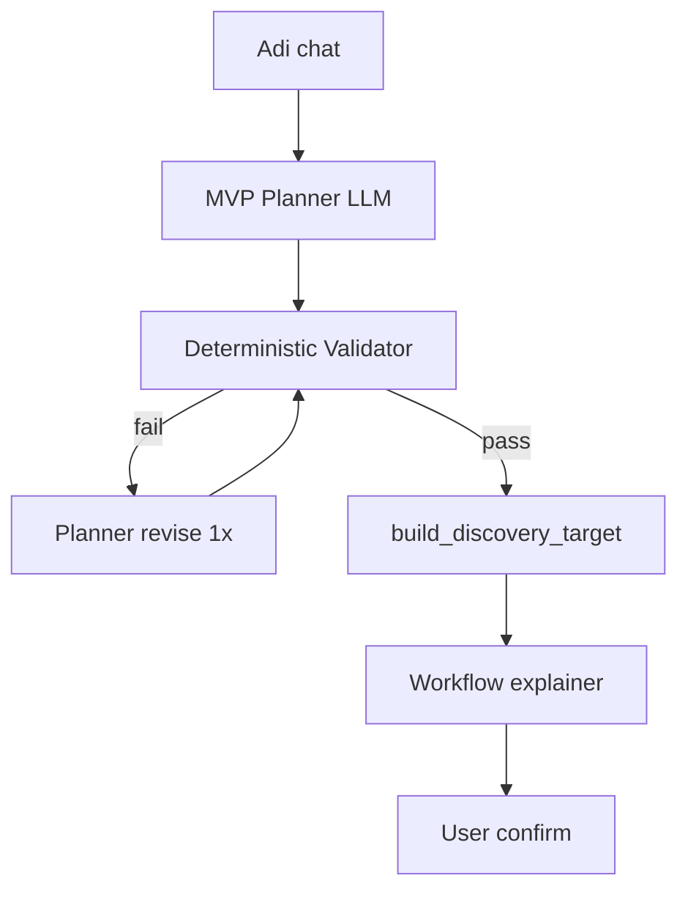

# Discovery Step 1 — V1-Worthy Plan (Planner + Validator)

> **Created**: 2026-07-21  
> **Status**: Active — engineering in progress  
> **Parent**: [`10_MVP_BOUNDARY_V1_PLAN.md`](./10_MVP_BOUNDARY_V1_PLAN.md) · [`12_DISCOVERY_ROUTING_ENGINEERING_PLAN.md`](./12_DISCOVERY_ROUTING_ENGINEERING_PLAN.md)  
> **Gate**: Step 1 v1-worthy when GM-DISC-01..05 green + live matrix ≥80%

---

## 1. Symptom (user terms)

After discovery chat, the user expects a **Day-1 implementation plan that solves what they actually said** — correct industry template, complete traceability path, honest upload list — not “closest archetype id → read JSON hints.”

Live failure (Apex Resins): chemical adhesives + batch recall routed to `manufacturing_fabrication_jobshop`, too-narrow seeds, `Customer` hidden while `Delivery Note` seeded.

---

## 2. Architecture triage

| Field | Value |
|-------|-------|
| **Layer** | L2 Discovery → L3 Target structure |
| **IS pillar** | Pillar 2 — Project target / MVP boundary |
| **Classification** | **A** code bug (classifier pipeline replaces reasoning) + **B** KB used as rails not reference |
| **Cross-cutting** | Shared LLM, `build_target` graph, import honesty contracts |

---

## 3. Root cause

Current Step 1 finalize:

```
transcript → extract → niche_resolver → recommend (pick archetype_id)
         → scope_mvp_seeds (lookup day1_seed_hints) → build_target (graph expand)
```

The LLM **stops thinking** after `archetype_id`. Python owns scope from KB hints. KB becomes a vending machine, not a reference library.

**Fix:** Replace “classify → lookup” with **plan → validate → explain**.

---

## 4. Target architecture



### Roles

| Component | Role |
|-----------|------|
| **MVP Planner** | Reads transcript + retrieved KB snippets; outputs niche, workflows, day1/deferred doctypes **with reasoning** |
| **MVP Validator** | Python + `erpnext_doctype_graph.json`: dependencies, problem coverage, dual-system overrides, template allowlist |
| **build_target** | Graph expand + persist; **does not** invent scope |
| **Workflow explainer** | Human copy from **validated** plan only |

### KB role shift

| Before | After |
|--------|-------|
| `day1_seed_hints` = answer | Pattern library for planner retrieval |
| `archetype_id` = primary key | Retrieval hint + telemetry |
| Graph expand silent | Promoted masters visible in upload contract |

---

## 5. Engineering phases

### Phase 0 — Plan + contracts ✅ (this doc)

- Pydantic `MVPPlanResult` schema
- Feature flag `DISCOVERY_USE_MVP_PLANNER` (default `false` until matrix green)

### Phase 1 — Validator (deterministic) ✅

**File:** `containers/discovery/mvp_validator.py`

Rules:

1. **Dependency promotion** — transactional seeds pull required masters into Day-1 (`Delivery Note` → `Customer`; `Batch` + raw trace → `Supplier`)
2. **Problem coverage** — transcript signals → required doctypes:
   - raw material batch / upstream trace → `Purchase Receipt` and/or `Supplier`
   - customer recall / who received batch → `Customer` + `Delivery Note`
   - expiry / shelf life → `Batch`
3. **Template allowlist** — seeds ⊆ template ∪ graph extension allowlist
4. **Dual-system override** — Tally/Busy defers invoicing but **not** operational masters needed for trace
5. **Niche sanity** — batch + expiry on `manufacturing_fabrication_jobshop` → validation warning + suggest chemical/food niche

**Tests:** `test_mvp_validator.py` including Apex Resins fixture.

### Phase 2 — Planner (LLM) ✅

**Files:**

- `containers/discovery/mvp_planner.py`
- `containers/discovery/prompts/planner.py`

Planner output (JSON):

```json
{
  "niche_id": "manufacturing_project_chemical",
  "niche_reasoning": "...",
  "primary_bottleneck": "...",
  "workflows_required": ["raw_material_batch_receipt", "customer_dispatch_trace"],
  "day1_doctypes": [{"doctype": "Batch", "why": "..."}],
  "deferred_doctypes": [{"doctype": "Sales Invoice", "why": "Tally handles accounting"}],
  "dual_system_note": "...",
  "reference_archetype_ids": ["batch_expiration_obsolescence"],
  "plan_reasoning": "..."
}
```

Flow: plan → validate → optional one revision with validation errors → persist `mvp_plan` in `discovery_metadata`.

### Phase 3 — Wire finalize path ✅

**Files:** `chat_service.py`, `target/build_target.py`

- When `DISCOVERY_USE_MVP_PLANNER=true`: `complete_discovery` calls planner; legacy recommend becomes fallback
- `build_discovery_target` accepts `mvp_plan`; uses validated seeds with `mode: planner_validated`
- Store `plan_reasoning`, `validation_notes` in `mvp_boundary.json`

### Phase 4 — Niche + copy fixes

- Niche hints: adhesives, sealants, resins, chemical drums, shelf life → `manufacturing_project_chemical` or `manufacturing_food_batch`
- `workflow_explanation.py`: add `Warehouse`, `Delivery Note`, `Purchase Receipt` labels (no “layout plan”)
- Default `DISCOVERY_LLM_NICHE_RESOLVE=true` when planner enabled

### Phase 5 — Golden gate

| Row | Scenario | Expected |
|-----|----------|----------|
| **GM-DISC-05** | Apex Resins recall + Tally | niche `manufacturing_project_chemical`; seeds include Batch, Customer, Delivery Note, Purchase Receipt or Supplier |
| Matrix | ≥80% on `live_routing_matrix.json` | |

**Harness:**

```powershell
python -m containers.discovery.test.harness_mvp_boundary --transcript-file containers/discovery/test/fixtures/apex_resins_recall.txt --report
pytest containers/discovery/test/test_mvp_validator.py -q
pytest containers/discovery/test/ -q
```

### Phase 6 — Default-on + deprecate classifier scope

- Flip `DISCOVERY_USE_MVP_PLANNER=true` by default
- `scope_mvp_seeds` remains fallback + user override path only
- Update `10_MVP_BOUNDARY_V1_PLAN.md` checklist

---

## 6. What we will NOT do

| Forbidden | Why |
|-----------|-----|
| 100 new archetype rows per recall variant | Compositional pains need planner, not ids |
| Planner without validator | Hallucinated doctypes / import gaps |
| Validator without planner | Current classifier problem persists |
| Remove graph expansion | Still hard law for import order |

---

## 7. Verification checklist (Step 1 v1-worthy)

- [ ] GM-DISC-01..04 still green (regression)
- [ ] GM-DISC-05 Apex Resins green
- [ ] Live matrix ≥80%
- [ ] `mvp_plan.plan_reasoning` persisted for debug
- [ ] UI upload list includes promoted masters (Customer when Delivery Note seeded)
- [ ] Wrong niche (jobshop + batch expiry) caught by validator
- [ ] Legacy path works when `DISCOVERY_USE_MVP_PLANNER=false`

---

## 8. Files touched

| File | Change |
|------|--------|
| `containers/discovery/schemas.py` | `MVPPlanResult`, `DoctypePlanEntry` |
| `containers/discovery/mvp_validator.py` | **New** |
| `containers/discovery/mvp_planner.py` | **New** |
| `containers/discovery/prompts/planner.py` | **New** |
| `containers/discovery/chat_service.py` | Planner integration |
| `containers/discovery/target/build_target.py` | `mvp_plan` param |
| `containers/discovery/niche_resolver.py` | Chemical/adhesive hints |
| `containers/discovery/workflow_explanation.py` | Warehouse / PR labels |
| `containers/discovery/test/fixtures/apex_resins_recall.txt` | **New** |
| `docs/GOLDEN_MATRIX_MANIFEST.md` | GM-DISC-05 row |

---

## 9. Sprint order (max 5 active)

1. Phase 0 + 1 — validator + tests (**P0**)
2. Phase 2 + 3 — planner + wire (**P0**)
3. Phase 4 — niche + copy (**P1**)
4. Phase 5 — golden gate (**P0 gate**)
5. Phase 6 — default-on (**after gate**)

---

*Step 1 ships when planner+validator passes golden matrix — not when another archetype row is added.*
