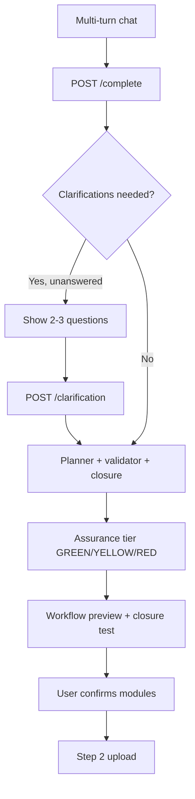

# Discovery Step 1 — Consultative Loop Plan

> **Created**: 2026-07-21  
> **Status**: Active — engineering in progress  
> **Parent**: [`13_DISCOVERY_STEP1_V1_PLAN.md`](./13_DISCOVERY_STEP1_V1_PLAN.md)  
> **Branch**: `feature/discovery-step1-consultative`

---

## 1. Symptom (user terms)

Step 1 feels like a **one-shot vending machine**: extract 5 tags → plan → confirm. Users cannot see reasoning, answer clarifying questions, or refine scope before the Day-1 contract locks. Distrust comes from silent promotions, missing closure verification, and no mid-flight correction.

---

## 2. Architecture triage

| Field | Value |
|-------|-------|
| **Layer** | L2 Discovery → L3 Target structure |
| **IS pillar** | Pillar 2 — Project target / MVP boundary |
| **Classification** | **C** pillar extension (consultative UX + assurance gates) |
| **Cross-cutting** | Frontend workflow preview, hooks.discovery_metadata |

---

## 3. Target flow

### Assurance tiers (not LLM confidence)

| Tier | Meaning | UX |
|------|---------|-----|
| **GREEN** | Closure pass, strong signal match, ≤2 promotions | Show plan, confirm |
| **YELLOW** | Weak signals, many promotions, warnings | Show plan + highlight assumptions |
| **RED** | Validator errors after revision | Block confirm; show issues (future: deep loop) |

---

## 4. Engineering phases

### Phase A — Clarifying loop ✅ (this branch)

**Files:** `discovery_clarify.py`, `phases.py`, `discovery_chat.py`, `discovery.py` API, `DiscoveryClient.tsx`

- Detect ambiguities from transcript (MTS/MTO, trace direction, routing, QC)
- Return 2–3 structured questions before planning when YELLOW triggers
- Append answers to transcript context for planner

### Phase B — Transparent reasoning + assurance ✅

**Files:** `discovery_assurance.py`, `promotion_reasons.py`, `WorkflowPreviewDisplay.tsx`

- Compute assurance tier from validation + signal margin + promotion count
- Surface `closure_test`, `plan_reasoning`, per-doctype promotion reasons in UI
- Badge promoted modules with validator reason (not generic "traceability")

### Phase C — Validator warning conversation ✅

- Surface validator warnings in preview before confirm
- Block confirm on RED assurance; notes field for scope revision requests

### Phase D — Upload schema preview ✅

**Files:** `upload_schema_preview.py`, `WorkflowPreviewDisplay.tsx`

- Required/optional columns per doctype from `field_mappings.json` KB before upload step

### Phase E — RED path deep loop (future)

- Multi-step consultant agent when structural assurance fails
- Frappe meta when site exists; web last resort

---

## 5. Clarification question families

| ID | Trigger | Question purpose |
|----|---------|------------------|
| `manufacturing_strategy` | manufacture keywords, no MTS/MTO | Stock vs order-driven production |
| `trace_direction` | batch/trace/recall keywords | Upstream raw vs downstream customer |
| `routing_depth` | yield/routing/WIP, no explicit ops | Per-step machine time needed? |
| `quality_gates` | chemical + no QC/ISO signals | Incoming/stage QC vs costing only |

---

## 6. Verification

- Unit: `test_discovery_clarify.py`, `test_discovery_assurance.py`
- Golden: Apex + yield fixtures pass with clarification answers appended
- Manual: complete → questions → answer → preview shows assurance + closure

---

## 7. Sprint order

1. Phase A + B ✅
2. QI promotion guard (quality_gates clarification) ✅
3. Phase C warnings in UI ✅
4. Phase D upload schema ✅
5. Phase E deep loop (future)
